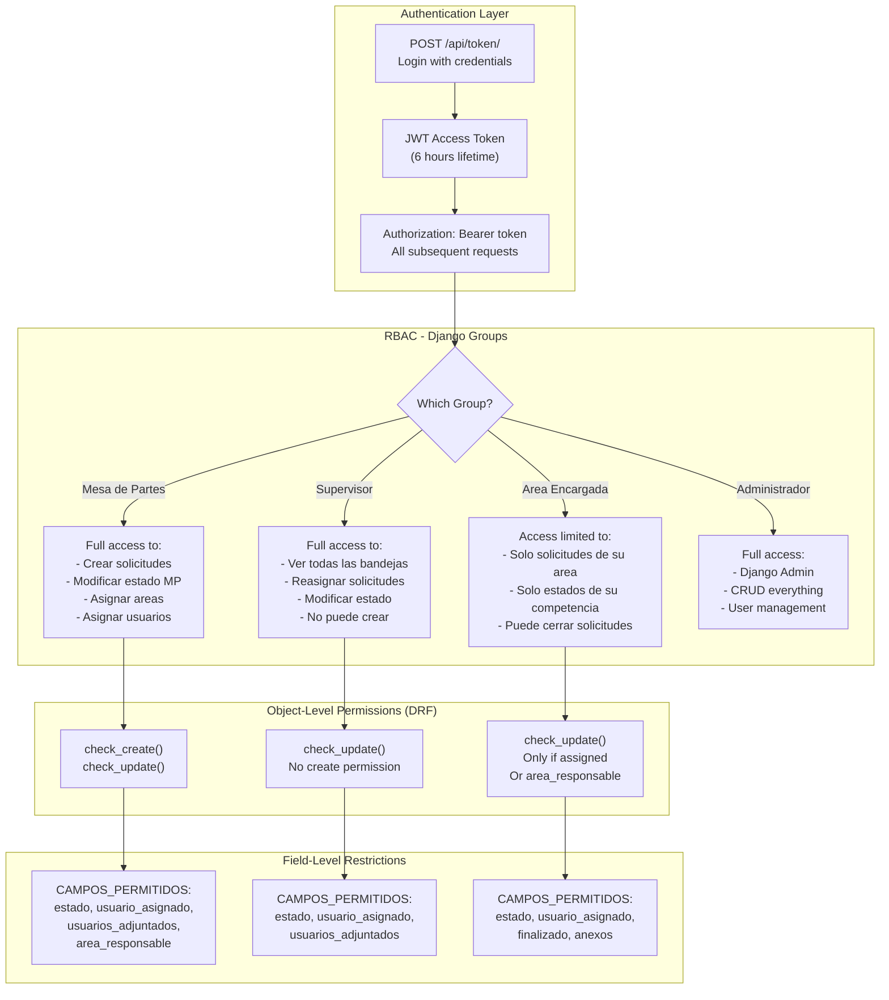
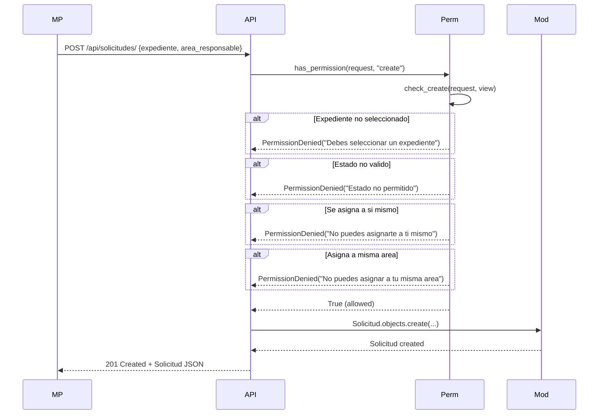
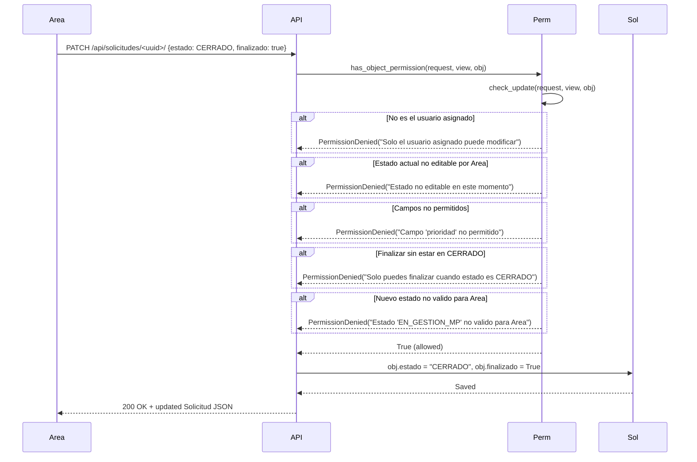

# Visión Global del Backend — Matriz de Roles y Permisos

> **Aplicación**: Mesa de Partes CIP
> **Versión del documento**: 1.0
> **Última actualización**: Agosto 2026

---

## 1. Modelo RBAC Global

El sistema implementa **Role-Based Access Control (RBAC)** a nivel de sistema usando **Django Groups** natively.

### 1.1 Los 4 Grupos Globales

| Grupo | Rol Funcional | Nivel Jerárquico | Descripción |
|-------|---------------|------------------|-------------|
| `Mesa de Partes` | Recepción | Operativo (nivel 1) | Recibe trámites, crea solicitudes, asigna áreas |
| `Supervisor` | Supervisión | Supervisor (nivel 2) | Supervisa toda la bandeja, reassigna, redirige |
| `Area Encargada` | Gestión de Área | Operativo (nivel 1) | Procesa solicitudes de su área específica |
| `Administrador` | Administración | Gerencia (nivel 3) | Superusuario — acceso total al sistema |

**Asignación de usuarios a grupos:**

```
User → PerfilUsuario → Cargo → nivel
                          ↓
                    Grupo Django (asignación manual o por señal)
```

### 1.2 Diagrama de Permisos a Nivel Sistema



---

## 2. Matriz de Capacidades por Grupo

### 2.1 CRUD sobre Expedientes

| Acción | Mesa de Partes | Supervisor | Area Encargada | Administrador |
|--------|:--------------:|:---------:|:--------------:|:-------------:|
| **Listar** | ✅ Propios | ✅ Todos | ✅ Área solo | ✅ Todos |
| **Crear** | ✅ | ❌ | ❌ | ✅ |
| **Ver detalle** | ✅ Propios | ✅ Todos | ✅ Área solo | ✅ Todos |
| **Modificar** | ❌ | ❌ | ❌ | ✅ |
| **Eliminar** | ❌ | ❌ | ❌ | ✅ |

### 2.2 CRUD sobre Solicitudes

| Acción | Mesa de Partes | Supervisor | Area Encargada | Administrador |
|--------|:--------------:|:---------:|:--------------:|:-------------:|
| **Listar** | ✅ Creados por MP | ✅ Todos | ✅ Su área | ✅ Todos |
| **Crear** | ✅ | ❌ | ❌ | ✅ |
| **Ver detalle** | ✅ Propios | ✅ Todos | ✅ Su área | ✅ Todos |
| **Modificar** | ✅ Campos MP | ✅ Campos Supervisor | ✅ Campos Área | ✅ Todos |
| **Eliminar** | ❌ | ❌ | ❌ | ✅ |

### 2.3 Transiciones de Estado

| Estado actual | Mesa de Partes puede → | Supervisor puede → | Area Encargada puede → |
|--------------|:----------------------:|:------------------:|:----------------------:|
| `EN_GESTION_MP` | → `ENVIADO_A_AREA` | → `ENVIADO_A_AREA` | ❌ No editable |
| `REENVIO_MP` | → `EN_GESTION_MP`, `ENVIADO_A_AREA` | ❌ No editable | ❌ No editable |
| `ENVIADO_A_AREA` | → `EN_GESTION_MP`, `ENVIADO_A_AREA` | → `ENVIADO_A_AREA` | → `EN_TRAMITE_AREA` |
| `EN_TRAMITE_AREA` | ❌ No editable | ❌ No editable | → `CERRADO` |
| `CERRADO` | ❌ No editable | ❌ No editable | Solo `finalizado=True` |

### 2.4 Campos Editables por Grupo

| Campo | Mesa de Partes | Supervisor | Area Encargada |
|-------|:--------------:|:----------:|:--------------:|
| `estado` | ✅ | ✅ | ✅ |
| `usuario_asignado` | ✅ | ✅ | ✅ |
| `usuarios_adjuntados` | ✅ | ✅ | ✅ |
| `area_responsable` | ✅ | ❌ | ❌ |
| `finalizado` | ❌ | ❌ | ✅ (solo `True`, solo si estado=`CERRADO`) |
| `prioridad` | ❌ | ❌ | ❌ |
| `expediente` | ❌ (creación) | ❌ | ❌ |
| `id_publico` | ❌ | ❌ | ❌ |

---

## 3. Implementación de Permisos

### 3.1 Arquitectura de Permisos

```
DRF Permission System
├── BasePermission (abstract)
│   ├── has_permission(request, view) →bool  (a nivel de vista)
│   └── has_object_permission(request, view, obj) →bool  (a nivel de objeto)
│
└── SafeFieldCheckMixin (custom mixin)
    └── validate_allowed_fields(request, allowed_set)
        └── Lanza PermissionDenied si el request intenta modificar campos no permitidos
```

### 3.2 Clases de Permiso por Rol

#### Mesa de Partes (Recepción)

```python
class RecepcionMesaDePartesSolicitudPermission(SafeFieldCheckMixin, BasePermission):

    CAMPOS_PERMITIDOS = {"estado", "usuario_asignado", "usuarios_adjuntados", "area_responsable"}

    def has_permission(self, request, view):
        if view.action == "create":
            return self.check_create(request, view)
        if view.action == "destroy":
            return False
        return True

    def check_create(self, request, view):
        # 1. Debe seleccionar expediente
        # 2. No puede marcar finalizado
        # 3. Estado debe ser permitido
        # 4. No asignarse a sí mismo
        # 5. No asignar a misma área

    def check_update(self, request, view, obj):
        # 1. Solo puede modificar lo que él creó (obj.expediente.creado_por == user)
        # 2. Estado actual debe permitir edición
        # 3. Solo campos en CAMPOS_PERMITIDOS
        # 4. No puede finalizar
        # 5. Nuevo estado debe ser válido para MP
```

#### Supervisor

```python
class SupervisorMesaDePartesSolicitudPermission(SafeFieldCheckMixin, BasePermission):

    CAMPOS_PERMITIDOS = {"estado", "usuario_asignado", "usuarios_adjuntados"}

    def has_permission(self, request, view):
        # NO puede crear solicitudes
        if view.action == "create":
            return False
        if view.action == "destroy":
            return False
        return True

    def check_update(self, request, view, obj):
        # 1. Estado debe estar en SUPERVISOR_EDITABLES
        # 2. Solo campos permitidos
        # 3. Nuevo estado debe ser válido para Supervisor
```

#### Área Encargada

```python
class EncargadoAreaSolicitudPermission(SafeFieldCheckMixin, BasePermission):

    CAMPOS_PERMITIDOS = {"estado", "usuario_asignado", "finalizado", "usuarios_adjuntados", "anexos"}

    def has_permission(self, request, view):
        # NO puede crear solicitudes
        if view.action == "create":
            return False
        if view.action == "destroy":
            return False
        return True

    def check_update(self, request, view, obj):
        # 1. Debe ser el usuario asignado (obj.usuario_asignado == user)
        # 2. Estado actual debe permitir edición
        # 3. Solo campos permitidos
        # 4. Solo puede finalizar cuando estado == CERRADO
```

### 3.3 Estados Válidos por Rol

Los estados se definen centralmente en `common/utils/constants/solicitudes/estados.py`:

```python
class EstadosSolicitud:

    # Estados donde cada rol puede editar
    MESA_DE_PARTES_EDITABLES = [
        "EN_GESTION_MP",
        "REENVIO_MP",
        "ENVIADO_A_AREA",
    ]

    SUPERVISOR_EDITABLES = [
        "EN_GESTION_MP",
        "ENVIADO_A_AREA",
    ]

    AREA_ENCARGADA_EDITABLES = [
        "ENVIADO_A_AREA",
        "EN_TRAMITE_AREA",
        "CERRADO",
    ]

    # Estados donde cada rol tiene visibilidad
    MESA_DE_PARTES = [
        "EN_GESTION_MP",
        "REENVIO_MP",
        "ENVIADO_A_AREA",
    ]

    SUPERVISOR = [
        "EN_GESTION_MP",
        "REENVIO_MP",
        "ENVIADO_A_AREA",
    ]

    AREA_ENCARGADA = [
        "REENVIO_MP",
        "ENVIADO_A_AREA",
        "EN_TRAMITE_AREA",
        "CERRADO",
    ]
```

---

## 4. Flujo de Permisos en una Solicitud

### 4.1 Creación de Solicitud (Mesa de Partes)



### 4.2 Modificación por Área Encargada



---

## 5. Restricciones a Nivel de Campo (Field-Level)

### 5.1 SafeFieldCheckMixin

Esta clase mixin valida que el request NO incluya campos no autorizados:

```python
class SafeFieldCheckMixin:
    CAMPOS_PERMITIDOS = set()  # Override en cada subclase

    def validate_allowed_fields(self, request, allowed_set):
        """
        Lanza PermissionDenied si request.data contiene campos
        que NO están en allowed_set.
        """
        forbidden = set(request.data.keys()) - allowed_set
        if forbidden:
            raise PermissionDenied(
                f"Campos no permitidos: {forbidden}"
            )
```

### 5.2 Validación en cascada

```
Request llega con data = {estado, usuario_asignado, prioridad}

PerfilUsuario: RecepcionMesaDePartes
CAMPOS_PERMITIDOS = {"estado", "usuario_asignado", "usuarios_adjuntados", "area_responsable"}

validate_allowed_fields(request, CAMPOS_PERMITIDOS)

  data.keys() = {estado, usuario_asignado, prioridad}
  allowed_set  = {estado, usuario_asignado, usuarios_adjuntados, area_responsable}

  forbidden = {prioridad} - {estado, usuario_asignado, usuarios_adjuntados, area_responsable}

  → PermissionDenied("Campos no permitidos: {'prioridad'}")
```

---

## 6. Bandejas y Visibilidad

### 6.1 Bandeja de Mesa de Partes

```python
# Ver solo solicitudes en estados de MP
solicitudes.filter(
    estado__in=EstadosSolicitud.MESA_DE_PARTES
)
```

### 6.2 Bandeja de Supervisor

```python
# Ve todas las solicitudes en estados de Supervisor
solicitudes.filter(
    estado__in=EstadosSolicitud.SUPERVISOR
)
```

### 6.3 Bandeja de Área Encargada

```python
# Ve solicitudes donde:
# 1. area_responsable == área del usuario (si tiene perfil)
# 2. estado en estados de Área Encargada
# 3. O es el usuario_asignado

perfil = request.user.perfilusuario
solicitudes.filter(
    area_responsable=perfil.area,
    estado__in=EstadosSolicitud.AREA_ENCARGADA
)
```

### 6.4 Bandeja de Mis Pendientes

```python
# /api/pendientes/
# Solicitudes donde el usuario está involucrado de cualquier forma

Q(usuario_asignado=user) | Q(creado_por=user) | Q(usuarios_adjuntos=user)
```

---

## 7. Casos Especiales de Permisos

### 7.1 Solicitud Sin Asignar (V2)

En V2, `usuario_asignado` puede ser `NULL`. La solicitud va a la "bandeja de área":

```
Solicitud (usuario_asignado=NULL, area_responsable=Logística)

→ Aparece en la bandeja de Área Encargada
→ Cualquier usuario con rol Area Encargada + área=Logística puede tomarla
```

### 7.2 Reenvío a Mesa de Partes

```
Solicitud fue enviada a Área Equivocada
    ↓
Área Encargada detecta error
    ↓
Cambia estado a REENVIO_MP
    ↓
Solicitud vuelve a bandeja de Mesa de Partes
    ↓
Mesa de Partes reasigna área correcta
```

### 7.3 Antecedentes (Expedientes relacionados)

```
Expediente A es antecedente de Expediente B
    ↓
Al crear Solicitud para B, se pueden vincular antecedentes
    ↓
El área chargée de B puede ver A como referencia
    ↓
Usuarios_adjuntos permite compartir contexto entre áreas
```

---

## 8. Resumen de Permisos por Endpoint

| Endpoint | Método | Mesa de Partes | Supervisor | Área Enc. | Admin |
|----------|--------|:--------------:|:---------:|:---------:|:-----:|
| `/api/expedientes/` | GET | ✅ Propios | ✅ Todos | ✅ Área | ✅ |
| `/api/expedientes/` | POST | ✅ | ❌ | ❌ | ✅ |
| `/api/expedientes/<id>/` | GET | ✅ Propio | ✅ | ✅ | ✅ |
| `/api/expedientes/<id>/` | PATCH | ❌ | ❌ | ❌ | ✅ |
| `/api/expedientes/<id>/` | DELETE | ❌ | ❌ | ❌ | ✅ |
| `/api/solicitudes/` | GET | ✅ Crea MP | ✅ Todos | ✅ Área | ✅ |
| `/api/solicitudes/` | POST | ✅ | ❌ | ❌ | ✅ |
| `/api/solicitudes/<id>/` | PATCH | ✅ Solo campos MP | ✅ Solo campos Sup. | ✅ Solo campos Área | ✅ |
| `/api/solicitudes/<id>/` | DELETE | ❌ | ❌ | ❌ | ✅ |
| `/api/comentarios-solicitud/` | GET | ✅ Propias | ✅ Todas | ✅ Área | ✅ |
| `/api/comentarios-solicitud/` | POST | ✅ | ✅ | ✅ | ✅ |
| `/api/pendientes/` | GET | ✅ Sus solicitudes | ✅ Todas | ✅ Área | ✅ |
| `/api/me/` | GET | ✅ | ✅ | ✅ | ✅ |
| `/api/perfil-usuario/` | GET/PATCH | ✅ Propio | ✅ | ✅ | ✅ |
| `/api/areas/` | GET | ✅ | ✅ | ✅ | ✅ |
| `/api/areas/` | POST | ❌ | ❌ | ❌ | ✅ |
