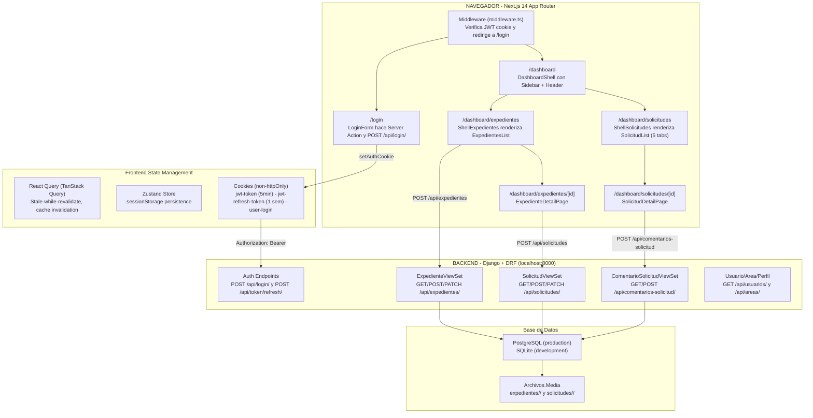
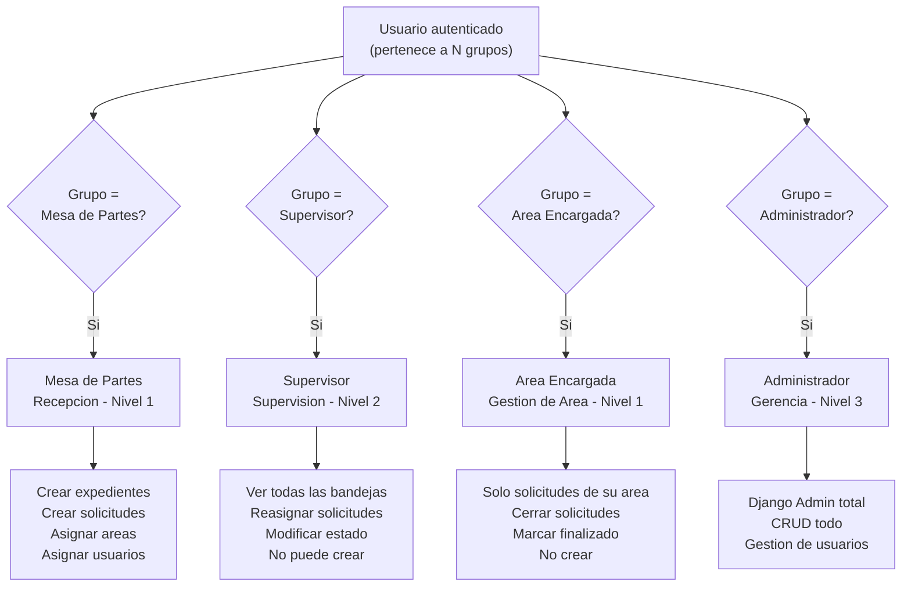
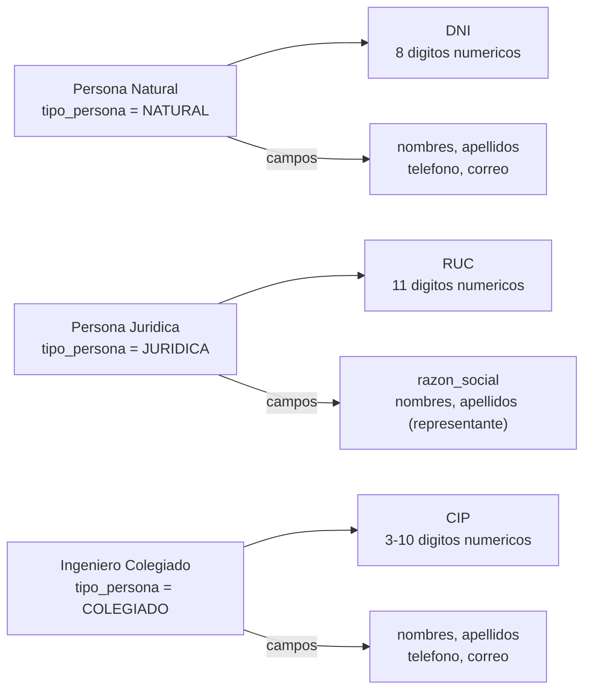
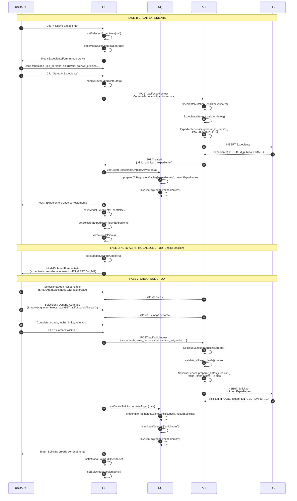
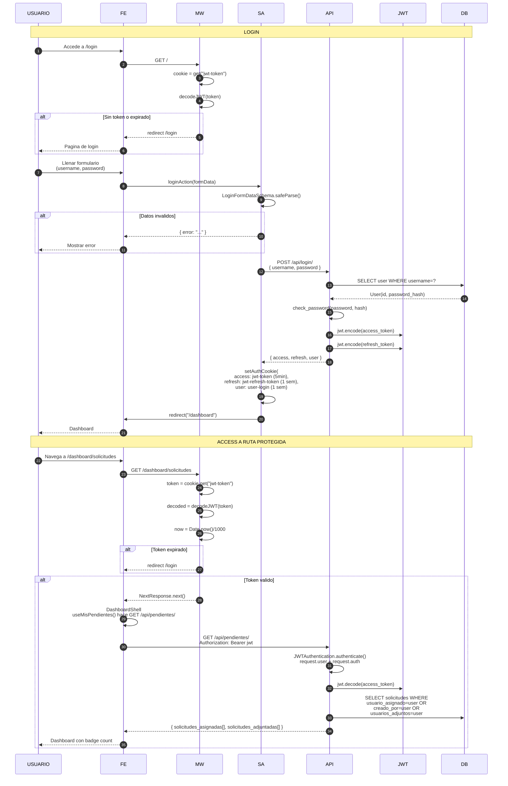
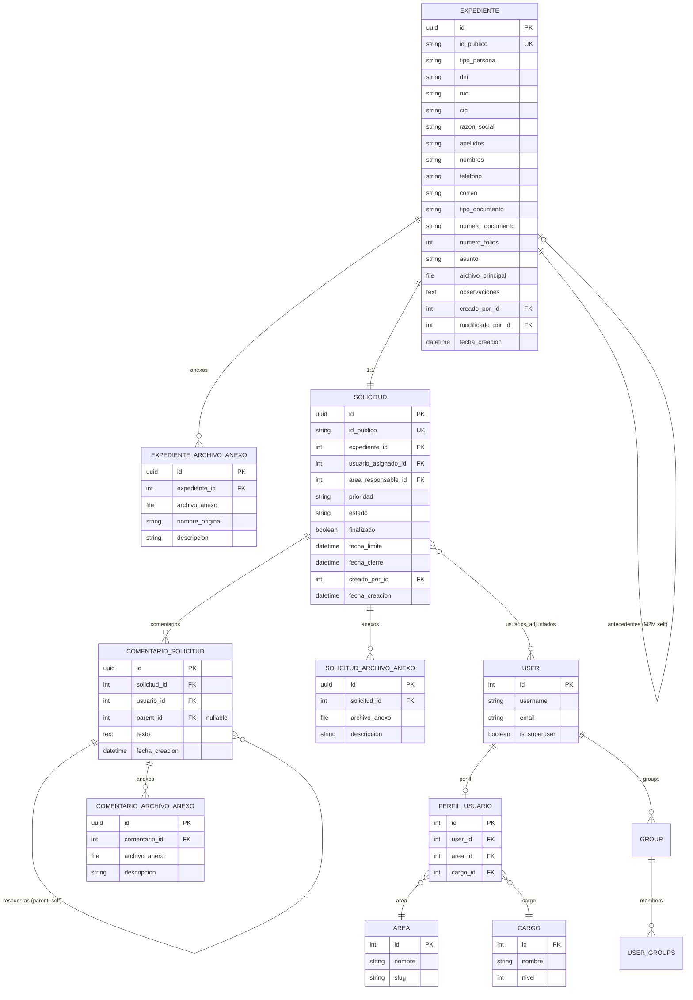
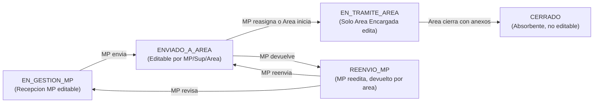
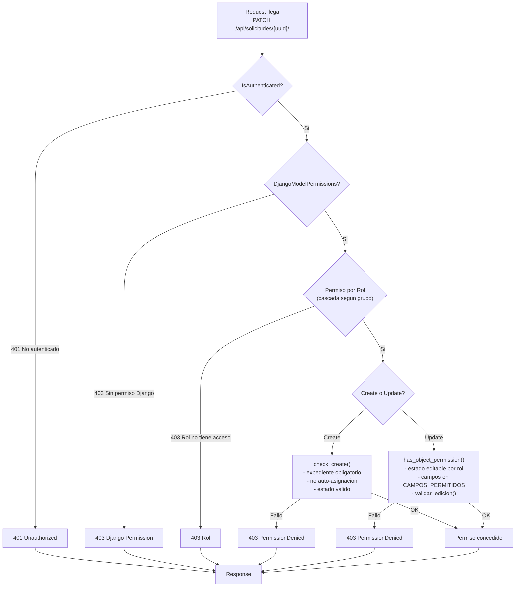

# Flujo Maestro del Sistema — Mesa de Partes CIP

> **Documento Maestro de Arquitectura** para presentación a Gerencia y Arquitectos.
> Fusiona la experiencia de usuario (Frontend React/Next.js) con la seguridad y persistencia (Backend Django/DRF).
> **Versión**: 1.0 | **Última actualización**: Agosto 2026

---

## Índice

1. [Visión Global del Sistema](#1-visión-global-del-sistema)
2. [Tipos de Usuario y Permisos](#2-tipos-de-usuario-y-permisos)
3. [Tipos de Persona y Documento](#3-tipos-de-persona-y-documento)
4. [Ciclo de Vida Completo (User Journey)](#4-ciclo-de-vida-completo-user-journey)
5. [Diagrama de Secuencia End-to-End](#5-diagrama-de-secuencia-end-to-end)
6. [Diagrama de Flujo de Actores (Flowchart)](#6-diagrama-de-flujo-de-actores-flowchart)
7. [Arquitectura de Datos](#7-arquitectura-de-datos)
8. [Máquina de Estados de Solicitud](#8-máquina-de-estados-de-solicitud)
9. [Sistema de Permisos RBAC](#9-sistema-de-permisos-rbac)
10. [Seguridad y Auditoría](#10-seguridad-y-auditoría)

---

## 1. Visión Global del Sistema



### Stack Tecnológico

| Capa | Tecnología | Rol |
|------|-----------|-----|
| **Frontend** | Next.js 14 (App Router) | UI/UX, React Query, Zustand |
| **Backend** | Django 4.x + DRF | API REST, autenticación, lógica de negocio |
| **Base de Datos** | PostgreSQL / SQLite | Persistencia relacional |
| **Autenticación** | SimpleJWT (JWTs) | Tokens stateless, 6h acceso / 1 día refresh |
| **Auditoría** | django-simple-history | Tablas shadow para cada cambio |
| **Almacenamiento** | Sistema de archivos local | UUID-renamed files, path isolation |

---

## 2. Tipos de Usuario y Permisos

### 2.1 Los 4 Grupos Globales (Django Groups)



### 2.2 Matriz de Capacidades

| Acción | Mesa de Partes | Supervisor | Área Encargada | Administrador |
|--------|:--------------:|:----------:|:--------------:|:-------------:|
| **Crear Expediente** | ✅ | ❌ | ❌ | ✅ |
| **Ver Expedientes propios** | ✅ | ✅ (todos) | ✅ (área) | ✅ |
| **Crear Solicitud** | ✅ | ❌ | ❌ | ✅ |
| **Modificar estado** | ✅ (campos MP) | ✅ (campos Sup.) | ✅ (campos Área) | ✅ |
| **Cerrar Solicitud** | ❌ | ❌ | ✅ | ✅ |
| **Eliminar** | ❌ | ❌ | ❌ | ✅ |
| **Comentar** | ✅ | ✅ | ✅ | ✅ |

### 2.3 Campos Editables por Rol

| Campo | Mesa de Partes | Supervisor | Área Encargada |
|-------|:--------------:|:----------:|:--------------:|
| `estado` | ✅ | ✅ | ✅ |
| `usuario_asignado` | ✅ | ✅ | ✅ |
| `usuarios_adjuntados` | ✅ | ✅ | ✅ |
| `area_responsable` | ✅ | ❌ | ❌ |
| `finalizado` | ❌ | ❌ | ✅ (solo `True` en `CERRADO`) |
| `prioridad` | ❌ | ❌ | ❌ |

---

## 3. Tipos de Persona y Documento

### 3.1 Tipos de Persona (Expediente)



| `tipo_persona` | Identificador | Validación | Campos requeridos |
|---------------|---------------|-----------|-------------------|
| `NATURAL` | DNI | 8 dígitos | nombres, apellidos, teléfono, correo |
| `JURIDICA` | RUC | 11 dígitos | razon_social, nombres, apellidos (representante), teléfono, correo |
| `COLEGIADO` | CIP | 3-10 dígitos | nombres, apellidos, teléfono, correo |

### 3.2 Tipos de Documento (Expediente)

| Valor DB | Display | Uso |
|----------|---------|-----|
| `INVITACION` | Invitación | — |
| `ACTA_SESION_ORDINARIA` | Acta de Sesión Ordinaria | — |
| `CARTA` | Carta | Comunicación formal |
| `CARTA_MULTIPLE` | Carta Múltiple | — |
| `CARTA_NOTARIAL` | Carta Notarial | — |
| `CEDULA_NOTIFICACION` | Cédula de Notificación | — |
| `DISPOSICION_FISCAL` | Disposición Fiscal | — |
| `FACTURA` | Factura | — |
| `INFORME_VALORACION` | Informe de Valoración | — |
| `INFORME_PERICIAL_PARTE` | Informe Pericial de Parte | — |
| `OFICIO` | Oficio | Comunicación oficial |
| `OFICIO_CIRCULAR` | Oficio Circular | — |
| `OFICIO_MULTIPLE` | Oficio Múltiple | — |
| `OPINION` | Opinión | — |
| `SOLICITUD` | Solicitud | Trámite estándar |

---

## 4. Ciclo de Vida Completo (User Journey)

### 4.1 User Journey — Flujo de Trámite End-to-End

```mermaid
flowchart TD
    START(["Usuario accede al sistema"]) --> AUTH_CHECK{"Autenticado?<br/>(jwt-token valido)"}

    AUTH_CHECK -->|No| REDIRECT_LOGIN["redirect /login"]
    AUTH_CHECK -->|Si| DASHBOARD["Dashboard<br/>DashboardShell + Sidebar"]

    REDIRECT_LOGIN --> LOGIN["/login<br/>LoginForm hace Server Action"]
    LOGIN -->|POST /api/login/| AUTH["Backend valida credenciales<br/>JWT access + refresh"]
    AUTH -->|setAuthCookie| DASHBOARD

    DASHBOARD --> CHOICE{"Que desea hacer?"}

    CHOICE -->|"Crear Expediente<br/>(Nuevo tramite)"| NEW_EXP["+ Nuevo Expediente"]
    NEW_EXP --> EXP_FORM["ExpedienteForm<br/>tipo_persona, dni/ruc/cip,<br/>nombres, asunto, archivo_principal..."]
    EXP_FORM --> VALIDATE{"Datos validos?<br/>(Zod en frontend)"}
    VALIDATE -->|No| FIX_EXP["Corrige errores"]
    FIX_EXP --> EXP_FORM
    VALIDATE -->|Si| SAVE_EXP["POST /api/expedientes/<br/>(Multipart payload)"]

    SAVE_EXP --> DB_EXP["Expediente creado<br/>id_publico = LIMA-YYYYMMDD-HEX4<br/>UUID generado"]

    DB_EXP --> AUTO_SOL["CHAIN FLOW<br/>Auto-abre Modal Solicitud<br/>(150ms timeout)"]

    AUTO_SOL --> SOL_FORM["ModalSolicitudForm<br/>(expediente pre-rellenado)"]
    SOL_FORM --> SOL_FIELDS["Seleccionar:<br/>- Area Responsable<br/>- Usuario Asignado<br/>- Usuarios Adjuntos<br/>- Estado (EN_GESTION_MP)<br/>- Fecha limite"]
    SOL_FIELDS --> SAVE_SOL["POST /api/solicitudes/<br/>(SolicitudCreateFormData)"]

    SAVE_SOL --> DB_SOL["Solicitud creada<br/>vinculada 1:1 al Expediente<br/>Estado: EN_GESTION_MP"]

    DB_SOL --> CHOICE_AREA{"Asignar a Area<br/>Responsable?"}
    CHOICE_AREA -->|"Si"| ASSIGN_AREA["Cambia estado a ENVIADO_A_AREA"]
    ASSIGN_AREA --> AREA_NOTIFY["Notificacion al Area<br/>(visible en bandeja)"]

    CHOICE_AREA -->|"No"| STAY_MP["Permanecer en<br/>EN_GESTION_MP"]

    AREA_NOTIFY --> AREA_WORK["Area Encargada recibe<br/>en su bandeja"]
    STAY_MP --> AREA_WORK

    AREA_WORK --> AREA_ACTION{"Acciones del<br/>Area Encargada"}

    AREA_ACTION -->|"Corregir/Mover"| REENVIO["REENVIO_MP<br/>(Devuelve a Mesa de Partes)"]
    AREA_ACTION -->|"Iniciar gestion"| TRAMITE["EN_TRAMITE_AREA<br/>(Area procesando)"]
    AREA_ACTION -->|"Finalizar"| CLOSE["CERRADO<br/>(finalizado=True,<br/>fecha_cierre=now)"]

    REENVIO --> MP_REVIEW["Mesa de Partes<br/>revisara y reasignara"]
    TRAMITE -->|"Completo?"| CLOSE
    CLOSE --> ARCHIVE["Expediente archivado<br/>Tramite completado"]

    CHOICE -->|"Comentar en<br/>Solicitud existente"| GO_SOL["Ir a Solicitud<br/>/dashboard/solicitudes/[id]"]
    GO_SOL --> VIEW_SOL["SolicitudDetailPage<br/>Exp. Vinculado + Comentarios"]
    VIEW_SOL --> ADD_COMMENT["Escribir comentario"]
    ADD_COMMENT -->|"Con archivos"| ATTACH["Anexar archivos<br/>(FormData multipart)"]
    ATTACH --> POST_COM["POST /api/comentarios-solicitud/<br/>(texto + anexos)"]
    POST_COM --> DB_COM["Comentario guardado<br/>en arbol (parent/child)"]
    DB_COM --> VIEW_COM["Thread actualizado<br/>auto-scroll al nuevo"]

    POST_COM -.->|"Responder?"| REPLY["Responder a comentario<br/>(parent_id en payload)"]
    REPLY --> POST_COM
```



### 4.2 Chain Flow: Crear Expediente → Auto-Abrir Solicitud



---

## 5. Diagrama de Secuencia End-to-End

### 5.1 Request Completa: Multipart + JSON → API → DB

```mermaid
sequenceDiagram
    autonumber
    participant USUARIO
    participant FE
    participant RQ
    participant API
    participant SER
    participant SVC
    participant DB
    participant FS

    Note over USUARIO,DB: TRAMITE COMPLETO: CREAR EXPEDIENTE + SOLICITUD + COMENTARIO

    USUARIO->>FE: Llena ExpedienteForm<br/>(archivo_principal + datos)
    FE->>FE: buildFormData() {<br/>archivo_principal: File,<br/>tipo_persona: "NATURAL",<br/>dni: "12345678",<br/>...}

    FE->>RQ: useCreateExpediente.mutateAsync(formData)
    RQ->>FE: mutation start

    FE->>API: POST /api/expedientes/<br/>Content-Type: multipart/form-data<br/>------boundary----<br/>Content-Disposition: form-data; name="archivo_principal"; filename="doc.pdf"<br/>Content-Type: application/pdf<br/>&lt;&lt;binary content&gt;&gt;<br/>------boundary----<br/>Content-Disposition: form-data; name="tipo_persona"<br/>&lt;&lt;JSON data&gt;&gt;<br/>------boundary----<br/>Content-Disposition: form-data; name="anexos"<br/>[{"descripcion": "factura"}]<br/>------boundary------

    API->>SER: ExpedienteMutationSerializer(data=request.data, files=request.FILES)
    SER->>SER: is_valid(raise_exception=True)
    SER->>SVC: ExpedienteService.validar_datos(data)

    alt DNI Validation
        SVC->>SVC: assert len(dni) == 8 and dni.isdigit()
    end

    SER->>SVC: id_publico = generar_id_publico()<br/>LIMA-20260822-A1B2C3D4

    API->>DB: BEGIN TRANSACTION
    API->>DB: INSERT INTO expedientes_expediente (<br/>id, id_publico, tipo_persona, dni,<br/>creado_por_id, archivo_principal,<br/>fecha_creacion...<br/>) VALUES (<br/>UUID(), "LIMA-...", "NATURAL",<br/>"12345678", user_id, "expedientes/LIMA-.../principal/uuid.pdf", now()<br/>)

    DB-->>API: Expediente(id: UUID)

    SER->>SER: procesar_anexos(expediente, anexos)
    SER->>DB: INSERT INTO expedientes_expedientearchivoanexo<br/>(id, expediente_id, archivo_anexo, descripcion)
    DB-->>SER: Anexos creados

    API->>DB: COMMIT

    SER-->>API: Expediente (completo con relaciones)
    API-->>FE: 201 Created<br/>{ id, id_publico, archivo_principal, anexos[], ... }

    RQ->>RQ: prependToPaginatedCache(['expedientes'], data)
    RQ->>RQ: invalidateQueries(['expedientes'])
    FE-->>USUARIO: Toast "Expediente creado"<br/>Modalthen SolicitudForm

    Note over USUARIO,DB: CHAIN: SOLICITUD AUTO-CREADA
    USUARIO->>FE: Completar ModalSolicitudForm<br/>(area, usuario_asignado)
    FE->>API: POST /api/solicitudes/<br/>Content-Type: application/json<br/>{<br/>expediente: "UUID",<br/>area_responsable: 3,<br/>usuario_asignado: 5,<br/>estado: "EN_GESTION_MP",<br/>fecha_limite: "2026-08-24T..."<br/>}

    API->>SER: SolicitudMutationSerializer.create()
    SER->>SER: validate_allowed_fields(request, CAMPOS_PERMITIDOS_MP)
    SER->>API: permiso.check_create(request, view)

    alt Check: No auto-asignacion
        SER->>SER: assert usuario_asignado != request.user
    end

    API->>DB: BEGIN TRANSACTION
    API->>DB: INSERT INTO solicitudes_solicitud (<br/>id, expediente_id, area_responsable_id,<br/>usuario_asignado_id, estado, prioridad,<br/>creado_por_id, fecha_limite...<br/>) VALUES (<br/>UUID(), exp.UUID, 3, 5,<br/>"EN_GESTION_MP", "NORMAL", user_id, now()+2d<br/>)
    DB-->>API: Solicitud(id: UUID, estado: EN_GESTION_MP)

    API->>DB: INSERT INTO solicitudes_usuariosolicitudadjuntado<br/>(usuarios_adjuntos en M2M)
    API->>DB: COMMIT

    API-->>FE: 201 Created<br/>{ id, expediente, estado, area_responsable, ... }
    FE-->>USUARIO: Toast "Solicitud creada"

    Note over USUARIO,DB: COMENTARIO CON ANEXOS
    USUARIO->>FE: Clic "Escribir comentario"<br/>(desde ExpedienteDetailPage)
    FE->>FE: CommentDialog + AnexosManager
    USUARIO->>FE: Escribe texto + adjunta archivos
    FE->>FE: buildApiPayload() forma FormData

    FE->>API: POST /api/comentarios-solicitud/<br/>Content-Type: multipart/form-data<br/>------boundary----<br/>Content-Disposition: form-data; name="texto"<br/>"Observacion sobre el tramite..."<br/>------boundary----<br/>Content-Disposition: form-data; name="solicitud"<br/>"UUID"<br/>------boundary----<br/>Content-Disposition: form-data; name="anexos[0]"; filename="evidencia.pdf"<br/>Content-Type: application/pdf<br/>&lt;&lt;binary&gt;&gt;<br/>------boundary------

    API->>SER: ComentarioSolicitudMutationSerializer
    SER->>SER: validate_create()
    SER->>API: permiso.check_create()

    alt Check: No comentar en solicitud finalizada
        SER->>SER: assert not solicitud.finalizado
    end

    API->>DB: BEGIN TRANSACTION
    API->>DB: INSERT INTO solicitudes_comentariosolicitud (<br/>id, solicitud_id, usuario_id, texto, parent_id<br/>) VALUES (UUID(), sol.UUID, user_id, "Observacion...", null)
    DB-->>API: Comentario(id: UUID)

    SER->>DB: INSERT INTO solicitudes_comentariosolicitudarchivoanexo<br/>(comentario_id, archivo_anexo, descripcion)
    API->>DB: COMMIT

    API-->>FE: 201 Created<br/>{ id, texto, usuario, fecha_creacion, anexos[], respuestas[] }
    FE-->>USUARIO: Comentario visible en thread<br/>auto-scroll
```

### 5.2 Flujo de Autenticación Completo



---

## 6. Diagrama de Flujo de Actores (Flowchart)

```mermaid
flowchart TD
    START(["Inicio"]) --> AUTH{"Tiene sesion<br/>jwt-token valida?"}

    AUTH -->|No| LOGIN_PAGE["/login<br/>LoginPage + LoginForm"]
    LOGIN_PAGE --> LOGIN_FORM["LoginForm<br/>(username, password)"]
    LOGIN_FORM --> SERVER_ACTION["loginAction (Server Action)<br/>Zod validation hace POST /api/login/"]
    SERVER_ACTION --> SET_COOKIES["setAuthCookie()<br/>jwt-token (5min)<br/>jwt-refresh-token<br/>user-login"]
    SET_COOKIES --> DASHBOARD_REDIR["redirect('/dashboard')"]
    AUTH -->|Si| DASHBOARD

    DASHBOARD_REDIR --> DASHBOARD
    DASHBOARD["/dashboard<br/>DashboardShell<br/>(useMisPendientes hace badge)"] --> SHELL["Shell Layout<br/>Sidebar + Header"]
    SHELL --> SIDEBAR["Sidebar<br/>- Expedientes<br/>- Solicitudes<br/>- Badge counts"]
    SHELL --> HEADER["Header<br/>Greeting + Notificaciones<br/>User Menu (logout)"]

    SIDEBAR --> MAIN_CHOICE{"Accion del usuario?"}

    EXP_BRANCH["MODULO EXPEDIENTES"]

    MAIN_CHOICE -->|"Expedientes"| EXP_LIST_PAGE["/dashboard/expedientes<br/>ShellExpedientes"]
    EXP_LIST_PAGE --> EXP_TABS["3 Tabs:<br/>Todos - Mis Expedientes - Sin Solicitud"]
    EXP_LIST_PAGE --> EXP_SEARCH["SearchInput<br/>(busqueda por DNI/RUC/CIP)"]
    EXP_LIST_PAGE --> EXP_CREATE_BTN["+ Nuevo Expediente"]

    EXP_CREATE_BTN --> EXP_MODAL["ModalExpedienteForm<br/>(modo crear)"]
    EXP_MODAL --> EXP_FORM["ExpedienteForm<br/>- tipo_persona selector<br/>- Campos condicionales (DNI/RUC/CIP)<br/>- archivo_principal (PDF)<br/>- anexos opcionales"]
    EXP_FORM --> EXP_SUBMIT["Clic Guardar"]
    EXP_SUBMIT --> FE_EXP_REQ["FE: POST /api/expedientes/<br/>Multipart FormData"]

    FE_EXP_REQ --> API_EXP_CREATE["API: ExpedienteMutationSerializer.create()<br/>- validar_datos()<br/>- generar_id_publico()<br/>- INSERT Expediente<br/>- procesar_anexos()"]
    API_EXP_CREATE --> DB_EXP["DB: Expediente creado<br/>id_publico: LIMA-YYYYMMDD-XXXX<br/>vinculado a creado_por"]

    DB_EXP --> EXP_CHAIN["CHAIN FLOW<br/>autoModalSolicitudOpen = true"]
    EXP_CHAIN --> SOL_MODAL["ModalSolicitudForm<br/>(pre-rellenado con expediente)"]
    SOL_MODAL --> SOL_FORM["SolicitudForm<br/>- SmartAreaSelect<br/>- SmartAssignmentSelect<br/>- SmartCollaboratorsSelect<br/>- SmartEstadoSelect"]
    SOL_FORM --> SOL_SUBMIT["Clic Guardar Solicitud"]
    SOL_SUBMIT --> FE_SOL_REQ["FE: POST /api/solicitudes/"]
    FE_SOL_REQ --> API_SOL_CREATE["API: SolicitudMutationSerializer<br/>- validate_allowed_fields()<br/>- INSERT Solicitud<br/>- 1:1 con Expediente"]
    API_SOL_CREATE --> DB_SOL["DB: Solicitud creada<br/>Estado: EN_GESTION_MP"]

    EXP_LIST_PAGE --> EXP_DETAIL["/dashboard/expedientes/[id]<br/>ExpedienteDetailPage"]
    EXP_DETAIL --> EXP_GRID["Grid 4+8 columnas"]
    EXP_GRID --> EXP_LEFT["Col 4:<br/>- DatosSolicitanteSection<br/>- DetalleDocumento<br/>- Anexos"]
    EXP_GRID --> EXP_RIGHT["Col 8:<br/>- Con Solicitud hace Ficha + Evidencias<br/>- Sin Solicitud hace CTA vacio"]
    EXP_RIGHT --> HAS_SOL{"Tiene<br/>solicitud?"}
    HAS_SOL -->|Si| SOL_CONTENT["Ficha Solicitud<br/>+ Evidencias<br/>+ Historial"]
    HAS_SOL -->|No| NO_SOL["Card vacio<br/>'Iniciar flujo' abre ModalSolicitudForm"]

    SOL_BRANCH["MODULO SOLICITUDES"]

    MAIN_CHOICE -->|"Solicitudes"| SOL_LIST_PAGE["/dashboard/solicitudes<br/>ShellSolicitudes"]
    SOL_LIST_PAGE --> SOL_TABS["5 Tabs:<br/>Todas - Asignadas - Creadas - Mi Area - Adjuntadas"]
    SOL_TABS --> SOL_ENDPOINT["ENDPOINT_MAP[tab]<br/>hace /api/solicitudes/{tab}/?view=card"]
    SOL_ENDPOINT --> SOL_FETCH["useFetchSolicitudesDinamicas()"]
    SOL_FETCH --> SOL_CARDS["SolicitudList<br/>SolicitudCard x N"]
    SOL_CARDS --> SOL_PAGINATION["Paginacion<br/>offset x limit"]
    SOL_LIST_PAGE --> SOL_SEARCH["SearchInput"]
    SOL_LIST_PAGE --> SOL_FILTERS["Filtros: estado, finalizado"]

    SOL_LIST_PAGE --> SOL_DETAIL["/dashboard/solicitudes/[id]<br/>SolicitudDetailPage"]
    SOL_DETAIL --> SOL_DETAIL_GRID["Grid 2/3 + 1/3"]
    SOL_DETAIL_GRID --> SD_EXP["Expediente Vinculado<br/>(card + link)"]
    SOL_DETAIL_GRID --> SD_ANEXOS["Evidencia Anexada"]
    SOL_DETAIL_GRID --> SD_HISTORIAL["Historial Comentarios<br/>CommentSection"]
    SOL_DETAIL_GRID --> SD_PLAZOS["Plazos y Fechas"]
    SOL_DETAIL_GRID --> SD_ASIGNADOS["Personal Asignado"]

    COM_BRANCH["FLUJO DE COMENTARIOS"]

    SD_HISTORIAL --> COM_SECTION["CommentSection<br/>(buildCommentTree hace CommentNode[])"]
    COM_SECTION --> COM_FOOTER["Footer<br/>'Escribir comentario'"]
    COM_FOOTER --> COM_DIALOG["CommentDialog<br/>GenericForm + AnexosManager"]
    COM_DIALOG --> COM_SUBMIT["usePostComentario.mutateAsync()<br/>POST /api/comentarios-solicitud/"]
    COM_SUBMIT --> COM_API["API: Crear comentario + anexos"]
    COM_API --> COM_CACHE["appendNestedItemInCache()<br/>invalidateQueries"]
    COM_CACHE --> COM_TREE["CommentItem (recursive)<br/>depth 0-3, maxDepth=3"]
    COM_TREE --> COM_COLLAPSE{"depth >= maxDepth?"}
    COM_COLLAPSE -->|Si| COM_COLLAPSED["Collapsible<br/>'Ver N respuestas'"]
    COM_COLLAPSE -->|No| COM_SHOW["Render directo<br/>con linea de hilo"]
    COM_TREE --> COM_REPLY["Reply button<br/>parentComment.id en payload"]

    STATE_BRANCH["MAQUINA DE ESTADOS"]
    DB_SOL --> STATE_START["Estado inicial:<br/>EN_GESTION_MP"]
    STATE_START --> STATE_CHOICE{"Transicion<br/>de estado?"}
    STATE_CHOICE -->|"Mesa de Partes"| STATE_MP["EN_GESTION_MP / REENVIO_MP"]
    STATE_CHOICE -->|"Enviar a Area"| STATE_SEND["ENVIADO_A_AREA"]
    STATE_CHOICE -->|"Area inicia"| STATE_AREA["EN_TRAMITE_AREA"]
    STATE_CHOICE -->|"Area cierra"| STATE_CLOSE["CERRADO<br/>(finalizado=True)"]

    STATE_MP -->|"a ENVIADO_A_AREA"| STATE_SEND
    STATE_SEND -->|"Area inicia gestion"| STATE_AREA
    STATE_AREA -->|"Con anexos OK"| STATE_CLOSE

    MAIN_CHOICE -->|"Logout"| LOGOUT["logoutAction()<br/>deleteAllAuthCookies()<br/>redirect('/login')"]

    classDef auth fill:#ffcccc,stroke:#cc0000,stroke-width:2px
    classDef dashboard fill:#fff3cd,stroke:#f0a500,stroke-width:2px
    classDef expedientes fill:#cce5ff,stroke:#0066cc,stroke-width:2px
    classDef solicitudes fill:#d4edda,stroke:#28a745,stroke-width:2px
    classDef comments fill:#e2d9f3,stroke:#6f42c1,stroke-width:2px
    classDef chain fill:#ffd700,stroke:#ff8c00,stroke-width:3px,stroke-dasharray:5,5
    classDef state fill:#ffe4b5,stroke:#8b4513,stroke-width:2px

    class START,AUTH,LOGIN_PAGE,LOGIN_FORM,SERVER_ACTION,SET_COOKIES,DASHBOARD_REDIR auth
    class DASHBOARD,SHELL,SIDEBAR,HEADER,MAIN_CHOICE,LOGOUT dashboard
    class EXP_BRANCH,EXP_LIST_PAGE,EXP_TABS,EXP_SEARCH,EXP_CREATE_BTN,EXP_MODAL,EXP_FORM,EXP_CHAIN,EXP_DETAIL,EXP_GRID,EXP_LEFT,EXP_RIGHT,HAS_SOL,NO_SOL expedientes
    class SOL_BRANCH,SOL_LIST_PAGE,SOL_TABS,SOL_ENDPOINT,SOL_FETCH,SOL_CARDS,SOL_PAGINATION,SOL_SEARCH,SOL_FILTERS,SOL_DETAIL,SOL_DETAIL_GRID,SD_EXP,SD_ANEXOS,SD_HISTORIAL,SD_PLAZOS,SD_ASIGNADOS solicitudes
    class COM_BRANCH,COM_SECTION,COM_FOOTER,COM_DIALOG,COM_SUBMIT,COM_API,COM_CACHE,COM_TREE,COM_COLLAPSE,COM_COLLAPSED,COM_SHOW,COM_REPLY comments
    class STATE_BRANCH,STATE_START,STATE_CHOICE,STATE_MP,STATE_SEND,STATE_AREA,STATE_CLOSE state
    class FE_EXP_REQ,FE_SOL_REQ chain
    class DB_EXP,DB_SOL chain
```



---

## 7. Arquitectura de Datos

### 7.1 Diagrama ER Simplificado



### 7.2 Modelo de Archivos

```
media/
├── expedientes/
│   └── LIMA-20260822-A1B2C3D4/
│       ├── principal/
│       │   └── a0eebc99-9c0b-4ef8-bb6d-6bb9bd380a11.pdf
│       └── anexos/
│           └── b1eebc99-9c0b-4ef8-bb6d-6bb9bd380a12.pdf
└── solicitudes/
    └── LIMA-20260822-A1B2C3D4/
        ├── anexos/
        │   └── c2eebc99-9c0b-4ef8-bb6d-6bb9bd380a13.pdf
        └── comentarios/
            └── d3eebc99-9c0b-4ef8-bb6d-6bb9bd380a14.pdf
```

### 7.3 ID Público — Formato

```
LIMA-YYYYMMDD-HEX4
     │    │      │
     │    │      └── 4 bytes hex mayusculas (ej: A1B2C3D4)
     │    └── Fecha de creacion
     └── Literal fijo (sede)
```

---

## 8. Máquina de Estados de Solicitud

### 8.1 Los 5 Estados



### 8.2 Matriz de Transiciones

| Estado Actual | → EN_GESTION_MP | → REENVIO_MP | → ENVIADO_A_AREA | → EN_TRAMITE_AREA | → CERRADO |
|---|---|---|---|---|---|
| `EN_GESTION_MP` | — | ✅ | ✅ | ❌ | ❌ |
| `REENVIO_MP` | ✅ | — | ✅ | ❌ | ❌ |
| `ENVIADO_A_AREA` | ✅ | ✅ | — | ✅ | ❌ |
| `EN_TRAMITE_AREA` | ❌ | ❌ | ❌ | — | ✅ |
| `CERRADO` | ❌ | ❌ | ❌ | ❌ | — (absorbente) |

### 8.3 Quién Puede Hacer Qué

| Transición | Rol | Validaciones |
|---|---|---|
| → EN_GESTION_MP | Mesa de Partes, Supervisor | No finalizada |
| → REENVIO_MP | Mesa de Partes | Estado actual editable por MP |
| → ENVIADO_A_AREA | Mesa de Partes, Supervisor, Área Encargada | area_responsable configurado |
| → EN_TRAMITE_AREA | Área Encargada | Usuario es el `usuario_asignado` |
| → CERRADO | Área Encargada | Estado actual = EN_TRAMITE_AREA + solicitud tiene anexos |

---

## 9. Sistema de Permisos RBAC

### 9.1 Cadena de Verificación de Permisos



### 9.2 Campos Permitidos por Rol

```mermaid
flowchart LR
    CAMPO["Campo"] -->|estado| MP -->|"Si"| SUP -->|"Si"| AREA -->|"Si"
    CAMPO -->|usuario_asignado| MP2 -->|"Si"| SUP2 -->|"Si"| AREA2 -->|"Si"
    CAMPO -->|usuarios_adjuntados| MP3 -->|"Si"| SUP3 -->|"Si"| AREA3 -->|"Si"
    CAMPO -->|area_responsable| MP4 -->|"Si"| SUP4 -->|"No"| AREA4 -->|"No"
    CAMPO -->|finalizado| MP5 -->|"No"| SUP5 -->|"No"| AREA5 -->|"Si (solo en CERRADO)"
    CAMPO -->|prioridad| MP6 -->|"No"| SUP6 -->|"No"| AREA6 -->|"No"
```

---

## 10. Seguridad y Auditoría

### 10.1 Blindaje en 3 Capas

```
CAPA 1: PERMISOS (DRF)
SafeFieldCheckMixin.validate_allowed_fields()
Rechaza campos fuera de CAMPOS_PERMITIDOS del rol
403 PermissionDenied antes de llegar al serializer

CAPA 2: SERIALIZER (validate())
SolicitudService.validar_edicion()
Rechaza si solicitud.finalizado == True
Rechaza transiciones de estado invalidas

CAPA 3: SERVICE (logica de negocio)
ExpedienteService.validar_datos()
SolicitudService.validar_finalizacion()
Valida DNI/RUC/CIP, fechas, anexos requeridos
```

### 10.2 Auditoría con Simple History

| Modelo | Tabla History | Rastreado |
|--------|--------------|-----------|
| `Expediente` | `historical_expediente` | ✅ Create, Update, Delete |
| `Solicitud` | `historical_solicitud` | ✅ Create, Update, Delete |
| `ComentarioSolicitud` | `historical_comentariosolicitud` | ✅ Create, Update, Delete |
| `ExpedienteArchivoAnexo` | — | ❌ No rastreado |
| `SolicitudArchivoAnexo` | — | ❌ No rastreado |
| `ComentarioArchivoAnexo` | — | ❌ No rastreado |

### 10.3 Seguridad en Archivos

| Medida | Implementación |
|--------|---------------|
| **Renombrado UUID** | `uuid.uuid4().hex + ext` — sin nombres originales |
| **Aislamiento por expediente** | `expedientes/<id_publico>/` — carpeta propia |
| **Sin path traversal** | `filename.split('.')[-1]` — solo extensión |
| **FK PROTECT** | No elimina usuario con expedientes activos |
| **CASCADE** | Eliminación de anexos al eliminar expediente |

---

## Anexo: Endpoints Principales

| Método | Endpoint | Descripción |
|--------|----------|-------------|
| POST | `/api/login/` | Login → JWT access + refresh |
| POST | `/api/token/refresh/` | Refresh access token |
| GET | `/api/pendientes/` | Bandeja "Mis Pendientes" |
| GET | `/api/expedientes/` | Lista global expedientes |
| POST | `/api/expedientes/` | Crear expediente (multipart) |
| GET | `/api/expedientes/{uuid}/` | Detalle expediente |
| PATCH | `/api/expedientes/{uuid}/` | Actualizar expediente |
| GET | `/api/expedientes/creadas/` | Expedientes del usuario |
| GET | `/api/expedientes/creadas-sin-solicitud/` | Sin flujo asignado |
| GET | `/api/solicitudes/?view=card` | Todas (card view) |
| GET | `/api/solicitudes/asignadas/?view=card` | Asignadas al usuario |
| GET | `/api/solicitudes/mi-area/?view=card` | Del área del usuario |
| POST | `/api/solicitudes/` | Crear solicitud |
| PATCH | `/api/solicitudes/{uuid}/` | Actualizar solicitud |
| POST | `/api/comentarios-solicitud/` | Crear comentario (multipart) |
| GET | `/api/areas/` | Lista de áreas |
| GET | `/api/usuarios/` | Lista de usuarios |

---

*Documento generado automaticamente por fusion de la documentacion Frontend (Next.js/React Query) y Backend (Django/DRF).*
*Representa el estado actual del sistema Mesa de Partes CIP — Agosto 2026.*
