# Flujo Maestro — Frontend CIP (Mesa de Partes Virtual)

## Índice

1. [Arquitectura General del Frontend](#1-arquitectura-general-del-frontend)
2. [Diagrama de Flujo de Navegación UX](#2-diagrama-de-flujo-de-navegación-ux)
3. [Diagrama de Secuencia: Crear Expediente → Auto-Abrir Solicitud → Asignar → Comentar](#3-diagrama-de-secuencia-crear-expediente--auto-abrir-solicitud--asignar--comentar)
4. [Mapa de Estado: Hooks de React Query y Stores de Zustand](#4-mapa-de-estado-hooks-de-react-query-y-stores-de-zustand)
5. [Endpoints Consumidos por Módulo](#5-endpoints-consumidos-por-módulo)
6. [Claves de Caché de React Query](#6-claves-de-caché-de-react-query)

---

## 1. Arquitectura General del Frontend

```
NAVEGADOR (Next.js 14 App Router)

RUTAS PUBLICAS:
  /login  --> LoginPage --> LoginForm --> loginAction (Server Action)
  /       --> LandingPage (publica)

MIDDLEWARE (middleware.ts):
  - Verifica cookie "jwt-token" en cada request
  - Decodifica JWT valida expiracion (exp)
  - Sin token valido + ruta protegida --> redirect /login
  - Token valido + /login --> redirect /dashboard
  - Rutas excluidas: /api/*, /_next/static, /_next/image, /favicon.ico

RUTAS PROTEGIDAS (/dashboard/*):
  /dashboard --> DashboardLayout (Server)
      |--> getUserCookie() --> server-side auth
      v
  DashboardShell (Client)
      |-- Sidebar (user, badge solicitudesCount)
      |-- Header (greeting, notifications, user menu)
      +-- children
          |-- /dashboard/solicitudes --> ShellSolicitudes
          |-- /dashboard/solicitudes/[id] --> SolicitudDetailPage
          |-- /dashboard/expedientes --> ShellExpedientes
          |-- /dashboard/expedientes/[id] --> ExpedienteDetailPage

ZUSTAND STORE (sessionStorage):
  useAppStore
    |-- AuthSlice: auth_user, auth_accessToken, auth_refreshToken
    |-- MeSlice: me_details (UserDataMe)
  Persistencia: "app-auth-storage" en sessionStorage

COOKIES (uso mixto):
  jwt-token (5 min), jwt-refresh-token (1 sem), user-login (1 sem)
  Todas httpOnly: false -- leidas por middleware y client
```

---

## 2. Diagrama de Flujo de Navegación UX

```mermaid
flowchart TD
    START(["Usuario accede al sistema"])
    START --> URL_CHECK{"URL tiene jwt-token<br/>valido en cookie?"}

    URL_CHECK -->|No token / token expirado| REDIRECT_LOGIN["Next.js Middleware<br/>redirect('/login')"]
    URL_CHECK -->|Token valido| CHECK_PATH{"Path = /login?"}

    CHECK_PATH -->|Si| REDIRECT_DASH["redirect('/dashboard')"]
    CHECK_PATH -->|No| LOAD_DASHBOARD["DashboardLayout (Server)<br/>getUserCookie() valida cookie"]

    subgraph LOGIN_FLOW["FLUJO DE AUTENTICACION"]
        LOGIN_PAGE["/login<br/>LoginPage + LoginForm"]
        LOGIN_FORM["LoginForm<br/>(username, password)"]
        SA["loginAction (Server Action)<br/>Zod validation --> fetch POST /api/login/"]
        COOKIES["setAuthCookie()<br/>jwt-token + jwt-refresh-token + user-login"]
        DASH_REDIR["redirect('/dashboard')"]
        ZUSTAND_STORE["useAppStore<br/>auth_setSession()"]

        LOGIN_PAGE --> LOGIN_FORM
        LOGIN_FORM --> SA
        SA --> COOKIES
        COOKIES --> DASH_REDIR
        SA -.-> ZUSTAND_STORE
    end

    REDIRECT_LOGIN --> LOGIN_PAGE
    REDIRECT_DASH --> LOAD_DASHBOARD

    LOAD_DASHBOARD --> SHELL["DashboardShell<br/>(useMisPendientes --> badge count)"]
    SHELL --> SIDEBAR["Sidebar<br/>(user, solicitudesCount badge)"]
    SHELL --> HEADER["Header<br/>(greeting, notif, user menu)"]

    SIDEBAR --> MENU_CHOICE{"Que modulo<br/>selecciona el usuario?"}

    subgraph SOLICITUDES_FLOW["FLUJO SOLICITUDES"]
        SOL_LIST_PAGE["/dashboard/solicitudes<br/>ShellSolicitudes"]
        SOL_VIEW_TABS["5 Tabs: Todas | Asignadas | Creadas | Mi Area | Adjuntadas"]
        SOL_ENDPOINTS["ENDPOINT_MAP[viewType]<br/>--> /api/solicitudes/{view}/?view=card"]
        SOL_FETCH["useFetchSolicitudesDinamicas(viewType, params)<br/>queryKey: ['solicitudes', viewType, params]"]
        SOL_LIST["SolicitudList<br/>--> SolicitudCard x N"]
        SOL_PAGINATION["Paginacion<br/>(page x 10 offset)"]
        SOL_FILTERS["Filtros: estado, finalizado<br/>(confirmacion en 2 pasos)"]
        SOL_SEARCH["SearchInput<br/>(debounced, URL)"]
        SOL_PREFETCH["onMouseEnter --> prefetchQuery<br/>(vista siguiente)"]

        SOL_LIST_PAGE --> SOL_VIEW_TABS
        SOL_LIST_PAGE --> SOL_SEARCH
        SOL_LIST_PAGE --> SOL_FILTERS
        SOL_VIEW_TABS --> SOL_ENDPOINTS
        SOL_ENDPOINTS --> SOL_FETCH
        SOL_FETCH --> SOL_LIST
        SOL_LIST --> SOL_PAGINATION
        SOL_VIEW_TABS -.->|"hover 150ms antes": SOL_PREFETCH
    end

    subgraph SOLICITUD_DETAIL_FLOW["FLUJO DETALLE SOLICITUD"]
        SOL_DETAIL["/dashboard/solicitudes/[id]<br/>SolicitudDetailPage"]
        SOL_DETAIL_FETCH["useFetchSolicitudById(id)<br/>GET /api/solicitudes/{id}/"]
        SOL_GRID["Grid 2/3 + 1/3"]
        SOL_EXP_VINCULADO["Expediente Vinculado<br/>(card + link a expediente)"]
        SOL_ANEXOS["Evidencia Anexada<br/>(map sobre solicitud.anexos)"]
        SOL_HISTORIAL["Historial de Comentarios<br/>CommentSection --> CommentItem"]
        SOL_PLAZOS["Plazos y Fechas<br/>(isVencida, fecha_limite)"]
        SOL_ASIGNADOS["Personal Asignado<br/>(responsable + adjuntos)"]
        SOL_BACK["Volver (router.back)"]

        SOL_DETAIL --> SOL_DETAIL_FETCH
        SOL_DETAIL_FETCH --> SOL_GRID
        SOL_GRID --> SOL_EXP_VINCULADO
        SOL_GRID --> SOL_ANEXOS
        SOL_GRID --> SOL_HISTORIAL
        SOL_GRID --> SOL_PLAZOS
        SOL_GRID --> SOL_ASIGNADOS
        SOL_DETAIL --> SOL_BACK
    end

    subgraph COMMENTS_FLOW["FLUJO DE COMENTARIOS"]
        COMMENT_SECTION["CommentSection<br/>(buildCommentTree --> CommentNode[])"]
        COMMENT_FOOTER["Footer<br/>'Escribir comentario' button"]
        COMMENT_DIALOG["CommentDialog<br/>GenericForm + AnexosManager"]
        COMMENT_SUBMIT["usePostComentario.mutateAsync()<br/>POST /api/comentarios-solicitud/"]
        COMMENT_CACHE["appendNestedItemInCache<br/>--> invalidateQueries"]
        COMMENT_TREE["CommentItem recursive<br/>(depth 0-3, maxDepth=3)"]
        COMMENT_COLLAPSE{"depth >= maxDepth?"}
        COMMENT_COLLAPSED["Collapsible<br/>'Ver N respuestas'"]
        COMMENT_REPLY["Reply button<br/>parentComment.id en payload"]

        COMMENT_SECTION --> COMMENT_FOOTER
        COMMENT_FOOTER --> COMMENT_DIALOG
        COMMENT_DIALOG --> COMMENT_SUBMIT
        COMMENT_SUBMIT --> COMMENT_CACHE
        COMMENT_CACHE --> COMMENT_TREE
        COMMENT_TREE --> COMMENT_COLLAPSE
        COMMENT_COLLAPSE -->|No (< 3 niveles)| COMMENT_SHOW["Render directo<br/>con linea de hilo"]
        COMMENT_COLLAPSE -->|Si (= 3 niveles)| COMMENT_COLLAPSED
        COMMENT_TREE --> COMMENT_REPLY
        COMMENT_REPLY -->|"parentComment": COMMENT_DIALOG
    end

    SOL_HISTORIAL --> COMMENT_SECTION

    subgraph EXPEDIENTES_FLOW["FLUJO EXPEDIENTES"]
        EXP_LIST_PAGE["/dashboard/expedientes<br/>ShellExpedientes"]
        EXP_VIEW_TABS["3 Tabs: Todos | Mis Expedientes | Sin Solicitud"]
        EXP_ENDPOINTS["ENDPOINT_MAP[viewType]<br/>--> /api/expedientes/creadas/, etc."]
        EXP_FETCH["useFetchExpedientesDinamicos(viewType, params)"]
        EXP_LIST["ExpedientesList<br/>--> ExpedienteCard x N"]
        EXP_PAGINATION["Paginacion"]
        EXP_SEARCH["SearchInput"]
        EXP_PREFETCH["onMouseEnter --> prefetchQuery"]

        EXP_CREATE_BTN["+ Nuevo Expediente"]
        EXP_MODAL_EXP["ModalExpedienteForm<br/>(crear/editar)"]
        EXP_MODAL_SOL["ModalSolicitudForm<br/>(gestionar flujo)"]
        EXP_CHAIN["Chain Flow:<br/>Crear Exp --> Auto-Abrir Solicitud"]

        EXP_LIST_PAGE --> EXP_VIEW_TABS
        EXP_LIST_PAGE --> EXP_SEARCH
        EXP_VIEW_TABS --> EXP_ENDPOINTS
        EXP_ENDPOINTS --> EXP_FETCH
        EXP_FETCH --> EXP_LIST
        EXP_LIST --> EXP_PAGINATION
        EXP_VIEW_TABS -.->|"hover": EXP_PREFETCH
        EXP_LIST_PAGE --> EXP_CREATE_BTN
        EXP_CREATE_BTN --> EXP_MODAL_EXP
        EXP_MODAL_EXP --> EXP_CHAIN
        EXP_CHAIN --> EXP_MODAL_SOL
    end

    subgraph EXPEDIENTE_DETAIL_FLOW["FLUJO DETALLE EXPEDIENTE"]
        EXP_DETAIL["/dashboard/expedientes/[id]<br/>ExpedienteDetailPage"]
        EXP_DETAIL_FETCH["useFetchExpedienteById(id)<br/>GET /api/expedientes/{id}/"]
        EXP_GRID["Grid 4 + 8 columnas"]
        EXP_COL_LEFT["Col 4:<br/>- DatosSolicitanteSection<br/>- DetalleDocumento"]
        EXP_COL_RIGHT["Col 8:<br/>- Con Solicitud --> Ficha + Evidencias + Comentarios<br/>- Sin Solicitud --> CTA vacio"]
        EXP_MODAL_SOL_DETAIL["ModalSolicitudForm<br/>(handleSaveSolicitud)"]
        EXP_HAS_SOL{"existe<br/>solicitud?"}
        EXP_NO_SOL["Card vacio<br/>'Iniciar flujo'"]
        EXP_BACK["Volver"]

        EXP_DETAIL --> EXP_DETAIL_FETCH
        EXP_DETAIL_FETCH --> EXP_GRID
        EXP_GRID --> EXP_COL_LEFT
        EXP_GRID --> EXP_COL_RIGHT
        EXP_COL_RIGHT --> EXP_HAS_SOL
        EXP_HAS_SOL -->|"Si": EXP_SOL_CONTENT["Ficha + Evidencias + Historial"]
        EXP_HAS_SOL -->|"No": EXP_NO_SOL
        EXP_NO_SOL --> EXP_MODAL_SOL_DETAIL
        EXP_SOL_CONTENT --> COMMENT_SECTION
        EXP_DETAIL --> EXP_BACK
    end

    MENU_CHOICE -->|"Solicitudes": SOL_LIST_PAGE
    MENU_CHOICE -->|"Expedientes": EXP_LIST_PAGE
    MENU_CHOICE -->|"Logout": LOGOUT["logoutAction()<br/>deleteAllAuthCookies() --> redirect('/login')"]

    SOL_EXP_VINCULADO -.->|"Link a": EXP_DETAIL
    EXP_SOL_CONTENT -.->|"CommentSection": COMMENT_SECTION

    classDef auth fill:#ffcccc,stroke:#ff0000,stroke-width:2px
    classDef dashboard fill:#fff3cd,stroke:#f0a500,stroke-width:2px
    classDef solicitudes fill:#d4edda,stroke:#28a745,stroke-width:2px
    classDef expedientes fill:#cce5ff,stroke:#007bff,stroke-width:2px
    classDef comments fill:#e2d9f3,stroke:#6f42c1,stroke-width:2px
    classDef modals fill:#f8d7da,stroke:#dc3545,stroke-width:2px

    class START,REDIRECT_LOGIN,REDIRECT_DASH,LOGIN_PAGE,LOGIN_FORM,SA,COOKIES,DASH_REDIR,ZUSTAND_STORE auth
    class SHELL,SIDEBAR,HEADER,MENU_CHOICE,LOGOUT dashboard
    class SOL_LIST_PAGE,SOL_VIEW_TABS,SOL_ENDPOINTS,SOL_FETCH,SOL_LIST,SOL_PAGINATION,SOL_FILTERS,SOL_SEARCH,SOL_PREFETCH solicitudes
    class SOL_DETAIL,SOL_DETAIL_FETCH,SOL_GRID,SOL_EXP_VINCULADO,SOL_ANEXOS,SOL_HISTORIAL,SOL_PLAZOS,SOL_ASIGNADOS,SOL_BACK solicitudes
    class EXP_LIST_PAGE,EXP_VIEW_TABS,EXP_ENDPOINTS,EXP_FETCH,EXP_LIST,EXP_PAGINATION,EXP_SEARCH,EXP_PREFETCH,EXP_CREATE_BTN expedientes
    class EXP_DETAIL,EXP_DETAIL_FETCH,EXP_GRID,EXP_COL_LEFT,EXP_COL_RIGHT,EXP_HAS_SOL,EXP_NO_SOL,EXP_BACK,EXP_MODAL_SOL_DETAIL expedientes
    class COMMENT_SECTION,COMMENT_FOOTER,COMMENT_DIALOG,COMMENT_SUBMIT,COMMENT_CACHE,COMMENT_TREE,COMMENT_COLLAPSE,COMMENT_COLLAPSED,COMMENT_REPLY,COMMENT_SHOW comments
    class EXP_MODAL_EXP,EXP_MODAL_SOL,EXP_CHAIN modals
```

---

## 3. Diagrama de Secuencia: Crear Expediente → Auto-Abrir Solicitud → Asignar → Comentar

```mermaid
sequenceDiagram
    autonumber
    participant USUARIO
    participant FE
    participant RQ
    participant API
    participant STORE
    participant CACHE

    Note over USUARIO,API: FASE 1: CREAR EXPEDIENTE
    USUARIO->>FE: Clic en "+ Nuevo Expediente"
    FE->>FE: handleOpenCreate()<br/>setSelectedExpediente(null)<br/>setIsModalExpedienteOpen(true)
    FE->>USUARIO: ModalExpedienteForm abierto (modo crear)

    USUARIO->>FE: Llena formulario ExpedienteForm<br/>(tipo_persona, dni/ruc, nombres, etc.)
    USUARIO->>FE: Clic en "Guardar Expediente"
    FE->>FE: handleSaveExpediente(data)

    alt MODO CREACION (selectedExpediente === null)
        FE->>API: POST /api/expedientes/<br/>ExpedienteCreateFormData
        API->>API: Valida datos + crea en BD
        API-->>FE: 201 Created<br/>{ id, id_publico, ...nuevoExpediente }

        FE->>RQ: ExpedientecreateMutation.mutateAsync()
        RQ->>CACHE: prependToPaginatedCache()<br/>agrega al inicio de listas
        RQ->>CACHE: invalidateQueries(['expedientes'])
        CACHE-->>FE: cache actualizada
        FE-->>USUARIO: Toast: "Expediente creado correctamente"

        FE->>FE: setIsModalExpedienteOpen(false)
        FE->>FE: setSelectedExpediente(nuevoExpediente)
        FE->>FE: setTimeout(150ms)
    end

    Note over USUARIO,API: FASE 2: AUTO-ABRIR MODAL SOLICITUD (Chain Flow)
    FE->>FE: setIsModalSolicitudOpen(true)
    FE->>USUARIO: ModalSolicitudForm abierto<br/>(expediente pre-rellenado, modo crear)

    alt Expediente YA tiene solicitud asociada
        USUARIO->>FE: Clic en "Gestionar Solicitud" (desde ExpedienteCard)
        FE->>FE: handleOpenEditSolicitud(expediente)
        FE->>FE: setSelectedExpediente(expediente)
        FE->>FE: setIsModalSolicitudOpen(true)
        FE->>USUARIO: ModalSolicitudForm abierto (modo editar)
    end

    Note over USUARIO,API: FASE 3: GESTIONAR SOLICITUD (Asignar Area/Usuario)
    USUARIO->>FE: Selecciona Area Responsable<br/>(SmartAreaSelect --> useFetchAreas)
    FE->>API: GET /api/areas/ (cacheado)
    API-->>FE: Lista de areas
    FE->>USUARIO: Opciones de area en dropdown

    USUARIO->>FE: Selecciona Usuario Asignado<br/>(SmartAssignmentSelect --> useFetchUsuarios)
    FE->>API: GET /api/usuarios/?area={areaId}
    API-->>FE: Lista de usuarios del area
    FE->>USUARIO: Opciones en dropdown

    USUARIO->>FE: Selecciona Usuarios Adjuntos<br/>(SmartCollaboratorsSelect --> multi-select)
    USUARIO->>FE: Completa demas campos<br/>(estado, fecha_limite, etc.)

    USUARIO->>FE: Clic en "Guardar Solicitud"
    FE->>FE: handleSaveSolicitud(data)

    alt NO existe solicitud para este expediente (crear)
        FE->>API: POST /api/solicitudes/<br/>SolicitudCreateFormData
        API->>API: Crea solicitud + vincula a expediente
        API-->>FE: 201 Created<br/>{ id, expediente, estado, ... }

        FE->>RQ: SolicitudcreateMutation.mutateAsync()
        RQ->>CACHE: prependToPaginatedCache()<br/>agrega al inicio de SolicitudList
        RQ->>CACHE: invalidateQueries(['expedientes'])
        CACHE-->>FE: cache actualizada
        FE-->>USUARIO: Toast: "Solicitud creada correctamente"

    else YA existe solicitud (actualizar)
        FE->>API: PATCH /api/solicitudes/{id}/<br/>SolicitudUpdateFormData
        API->>API: Actualiza campos en BD
        API-->>FE: 200 OK<br/>{ ...solicitudActualizada }

        FE->>RQ: SolicitudupdateMutation.mutateAsync()
        RQ->>CACHE: mergeUpdateInPaginatedCache()<br/>preserva campo 'expediente' del viejo
        RQ->>CACHE: invalidateQueries(['expedientes'])
        CACHE-->>FE: cache actualizada
        FE-->>USUARIO: Toast: "Solicitud actualizada correctamente"
    end

    FE->>FE: setIsModalSolicitudOpen(false)
    FE->>FE: setSelectedExpediente(null)

    Note over USUARIO,API: FASE 4: ANADIR COMENTARIO
    USUARIO->>FE: Navega a /dashboard/expedientes/{id}
    FE->>API: GET /api/expedientes/{id}/
    API-->>FE: Expediente + Solicitud + Comentarios
    FE->>FE: ExpedienteDetailPage renderiza<br/>CommentSection

    USUARIO->>FE: Clic en "Escribir comentario"<br/>(Footer de CommentSection)
    FE->>FE: setIsDialogOpen(true)
    FE->>USUARIO: CommentDialog abierto<br/>GenericForm (texto + anexos)

    USUARIO->>FE: Escribe texto del comentario
    USUARIO->>FE: (Opcional) adjunta archivos
    USUARIO->>FE: Clic en "Publicar Comentario"

    FE->>FE: buildApiPayload(values)<br/>{ texto, solicitud, anexos: [...] }
    FE->>RQ: usePostComentario.mutateAsync(formData)
    RQ->>API: POST /api/comentarios-solicitud/<br/>(FormData con archivos)
    API->>API: Guarda comentario + anexos en BD
    API-->>RQ: 201 Created<br/>{ id, texto, usuario, fecha_creacion, ... }

    RQ->>CACHE: appendNestedItemInCache<br/>['solicitudes', 'detail', solicitudId].comentarios
    RQ->>CACHE: appendCommentToExpedienteList<br/>['expedientes'], sync cross-module
    RQ->>CACHE: invalidateQueries<br/>['solicitudes', 'detail', solicitudId]
    RQ->>CACHE: invalidateQueries<br/>['expedientes', 'detail', expedienteId]
    CACHE-->>FE: CommentSection re-renderiza<br/>buildCommentTree() --> CommentNode[]

    FE->>USUARIO: Nuevo comentario visible<br/>auto-scroll al fondo

    Note over USUARIO,API: FLUJO DE RESPUESTA (dentro de comentarios)
    USUARIO->>FE: Clic en "Responder" de CommentItem
    FE->>FE: setIsReplyDialogOpen(true)<br/>parentComment={comment}
    FE->>USUARIO: CommentDialog con:<br/>- Titulo: "Responder a {nombre}"<br/>- parentComment.id inyectado en payload<br/>- Cita del comentario padre

    USUARIO->>FE: Escribe respuesta + envia
    FE->>RQ: usePostComentario.mutateAsync({...parent: parentComment.id})
    RQ->>API: POST /api/comentarios-solicitud/<br/>{ texto, solicitud, parent: parentId, anexos }
    API-->>RQ: 201 Created
    RQ->>CACHE: appendNestedItemInCache (mismo flujo)
    CACHE-->>FE: Respuesta anidada en el arbol

    Note over USUARIO,API: PROFUNDIDAD MAXIMA (maxDepth=3)
    alt depth >= 3 (nivel 4 o superior)
        FE->>FE: CommentItem detecta depth >= maxDepth
        FE->>USUARIO: Renderiza Collapsible<br/>"Ver N respuestas" (cerrado por defecto)
        USUARIO->>FE: Clic en "Ver N respuestas"
        FE->>USUARIO: Expande Collapsible<br/>muestra respuestas colapsadas
    end
```



---

## 4. Mapa de Estado: Hooks de React Query y Stores de Zustand

```mermaid
flowchart TB
    subgraph REACT_QUERY["REACT QUERY (TanStack Query) - Estado Servidor"]
        direction TB

        subgraph AUTH_HOOKS["Hooks de Autenticacion"]
            useMisPendientes["useMisPendientes<br/>GET /api/pendientes/<br/>Key: ['mis-pendientes']<br/>usedBy: DashboardShell, DashboardPage"]
        end

        subgraph SOLICITUDES_HOOKS["Hooks de Solicitudes"]
            useFetchSolicitudesDinamicas["useFetchSolicitudesDinamicas(viewType, params)<br/>GET ENDPOINT_MAP[viewType]/?view=card<br/>Key: ['solicitudes', viewType, params]<br/>usedBy: ShellSolicitudes"]
            useFetchSolicitudById["useFetchSolicitudById(id)<br/>GET /api/solicitudes/{id}/<br/>Key: ['solicitudes', 'detail', id]<br/>usedBy: SolicitudDetailPage"]
            useCreateSolicitud["useCreateSolicitud()<br/>POST /api/solicitudes/<br/>Cache: prependToPaginatedCache<br/>usedBy: ShellSolicitudes, ExpedienteDetailPage"]
            useUpdateSolicitud["useUpdateSolicitud()<br/>PATCH /api/solicitudes/{id}/<br/>Cache: mergeUpdateInPaginatedCache<br/>usedBy: ShellSolicitudes, ExpedienteDetailPage"]
            useDeleteSolicitud["useDeleteSolicitud()<br/>DELETE /api/solicitudes/{id}/<br/>Cache: removeFromPaginatedCache<br/>usedBy: ShellSolicitudes"]
        end

        subgraph EXPEDIENTES_HOOKS["Hooks de Expedientes"]
            useFetchExpedientesDinamicos["useFetchExpedientesDinamicos(viewType, params)<br/>GET ENDPOINT_MAP[viewType]<br/>Key: ['expedientes', viewType, params]<br/>usedBy: ShellExpedientes"]
            useFetchExpedienteById["useFetchExpedienteById(id)<br/>GET /api/expedientes/{id}/<br/>Key: ['expedientes', 'detail', id]<br/>usedBy: ExpedienteDetailPage"]
            useCreateExpediente["useCreateExpediente()<br/>POST /api/expedientes/<br/>Cache: prependToPaginatedCache<br/>usedBy: ShellExpedientes"]
            useUpdateExpediente["useUpdateExpediente()<br/>PATCH /api/expedientes/{id}/<br/>Cache: updateInPaginatedCache<br/>usedBy: ShellExpedientes"]
            useDeleteExpediente["useDeleteExpediente()<br/>DELETE /api/expedientes/{id}/<br/>Cache: removeFromPaginatedCache<br/>usedBy: ShellExpedientes"]
        end

        subgraph COMENTARIOS_HOOKS["Hooks de Comentarios"]
            usePostComentario["usePostComentario({solicitudId, expedienteId})<br/>POST /api/comentarios-solicitud/<br/>Cache: appendNestedItemInCache<br/>+ appendCommentToExpedienteList<br/>+ invalidateQueries<br/>usedBy: CommentDialog"]
            useDeleteComentario["useDeleteComentario({solicitudId, expedienteId})<br/>DELETE /api/comentarios-solicitud/{id}/<br/>Cache: removeNestedItemFromCache<br/>+ invalidateQueries<br/>usedBy: CommentItem"]
        end

        subgraph SMART_SELECT_HOOKS["Smart Select Hooks"]
            useFetchAreas["useFetchAreas()<br/>GET /api/areas/<br/>Key: ['areas']<br/>usedBy: SmartAreaSelect"]
            useFetchUsuarios["useFetchUsuarios(params)<br/>GET /api/usuarios/<br/>Key: ['usuarios', params]<br/>usedBy: SmartAssignmentSelect, SmartCollaboratorsSelect"]
            useFetchEstados["useFetchEstados()<br/>GET /api/estados-solicitud/<br/>Key: ['estados']<br/>usedBy: SmartEstadoSelect"]
        end
    end

    subgraph ZUSTAND_STORE["ZUSTAND STORE (sessionStorage)"]
        subgraph AUTH_SLICE["AuthSlice"]
            auth_user["auth_user: LoginUserData | null"]
            auth_accessToken["auth_accessToken: string | null"]
            auth_refreshToken["auth_refreshToken: string | null"]
            auth_setSession["auth_setSession(session)"]
            auth_clearSession["auth_clearSession()"]
        end

        subgraph ME_SLICE["MeSlice"]
            me_details["me_details: UserDataMe | null"]
            me_setUserDetails["me_setUserDetails(data)"]
            me_clearDetails["me_clearDetails()"]
        end
    end

    subgraph NEXT_JS["Next.js App Router"]
        middleware["middleware.ts<br/>- Lee cookie jwt-token<br/>- decodeJWT --> valida exp<br/>- redirect /login o /dashboard"]
        dashboardLayout["DashboardLayout (Server)<br/>- getUserCookie() server-side<br/>- redirect /login si no hay cookie"]
        dashboardShell["DashboardShell (Client)<br/>- useMisPendientes()<br/>- Sidebar + Header orchestration"]
        serverActions["Server Actions<br/>- loginAction --> POST /api/login/<br/>- logoutAction --> delete cookies"]
    end

    subgraph CACHE_UTILS["React Query Cache Utils"]
        prepend["prependToPaginatedCache()"]
        mergeUpdate["mergeUpdateInPaginatedCache()"]
        updateCache["updateInPaginatedCache()"]
        removeCache["removeFromPaginatedCache()"]
        appendNested["appendNestedItemInCache<T, K>()"]
        removeNested["removeNestedItemFromCache<T, K>()"]
        appendToExp["appendCommentToExpedienteList()"]
    end

    useMisPendientes --> prepend
    useCreateExpediente --> prepend
    useCreateSolicitud --> prepend
    useUpdateExpediente --> updateCache
    useUpdateSolicitud --> mergeUpdate
    useDeleteExpediente --> removeCache
    useDeleteSolicitud --> removeCache
    usePostComentario --> appendNested
    usePostComentario --> appendToExp
    useDeleteComentario --> removeNested

    classDef rq_hook fill:#e3f2fd,stroke:#1565c0,stroke-width:1.5px
    classDef smart_hook fill:#e8f5e9,stroke:#2e7d32,stroke-width:1.5px
    classDef zustand fill:#fff3e0,stroke:#e65100,stroke-width:1.5px
    classDef nextjs fill:#f3e5f5,stroke:#7b1fa2,stroke-width:1.5px
    classDef cache fill:#fce4ec,stroke:#c2185b,stroke-width:1.5px

    class useMisPendientes,useFetchSolicitudesDinamicas,useFetchSolicitudById,useCreateSolicitud,useUpdateSolicitud,useDeleteSolicitud,useFetchExpedientesDinamicos,useFetchExpedienteById,useCreateExpediente,useUpdateExpediente,useDeleteExpediente,usePostComentario,useDeleteComentario rq_hook
    class useFetchAreas,useFetchUsuarios,useFetchEstados smart_hook
    class auth_user,auth_accessToken,auth_refreshToken,auth_setSession,auth_clearSession,me_details,me_setUserDetails,me_clearDetails zustand
    class middleware,dashboardLayout,dashboardShell,serverActions nextjs
    class prepend,mergeUpdate,updateCache,removeCache,appendNested,removeNested,appendToExp cache
```



### Tabla Resumen de Estado

| Módulo | Hook/Store | Tipo | storage | Invalidate Targets |
|--------|-------------|------|---------|-------------------|
| **Auth** | `useMisPendientes` | Query | React Query | Manual |
| **Auth** | `useAppStore` | Zustand | `sessionStorage` | N/A |
| **Solicitudes** | `useFetchSolicitudesDinamicas` | Query | React Query | `SOLICITUDES_QUERY_KEY` |
| **Solicitudes** | `useFetchSolicitudById` | Query | React Query (30min) | `SOLICITUDES_QUERY_KEY` |
| **Solicitudes** | `useCreateSolicitud` | Mutation | Optimistic cache | `SOLICITUDES_QUERY_KEY` + `EXPEDIENTES_QUERY_KEY` |
| **Solicitudes** | `useUpdateSolicitud` | Mutation | Optimistic cache | `SOLICITUDES_QUERY_KEY` + `EXPEDIENTES_QUERY_KEY` |
| **Solicitudes** | `useDeleteSolicitud` | Mutation | Optimistic cache | `SOLICITUDES_QUERY_KEY` + `EXPEDIENTES_QUERY_KEY` |
| **Expedientes** | `useFetchExpedientesDinamicos` | Query | React Query (5min) | `EXPEDIENTES_QUERY_KEY` |
| **Expedientes** | `useFetchExpedienteById` | Query | React Query (30min) | `EXPEDIENTES_QUERY_KEY` |
| **Expedientes** | `useCreateExpediente` | Mutation | Optimistic cache | `EXPEDIENTES_QUERY_KEY` |
| **Expedientes** | `useUpdateExpediente` | Mutation | Optimistic cache | `EXPEDIENTES_QUERY_KEY` |
| **Expedientes** | `useDeleteExpediente` | Mutation | Optimistic cache | `EXPEDIENTES_QUERY_KEY` |
| **Comentarios** | `usePostComentario` | Mutation | Optimistic cache + invalidation | `SOLICITUDES_QUERY_KEY` + `EXPEDIENTES_QUERY_KEY` |
| **Comentarios** | `useDeleteComentario` | Mutation | Optimistic cache + invalidation | `SOLICITUDES_QUERY_KEY` + `EXPEDIENTES_QUERY_KEY` |
| **SmartSelect** | `useFetchAreas` | Query | React Query (5min) | Manual |
| **SmartSelect** | `useFetchUsuarios` | Query | React Query | Manual |
| **SmartSelect** | `useFetchEstados` | Query | React Query | Manual |

---

## 5. Endpoints Consumidos por Módulo

### Auth / Dashboard

| Método | Endpoint | Hook | Usage |
|--------|----------|------|-------|
| POST | `/api/login/` | `loginAction` (SA) | Login usuario |
| POST | `/api/token/refresh/` | `refreshAuthToken` | Refresh JWT |
| POST | `/api/logout/` | `logoutAction` (SA) | Logout |
| GET | `/api/pendientes/` | `useMisPendientes` | Badge sidebar + KPIs dashboard |

### Expedientes

| Método | Endpoint | Hook | Usage |
|--------|----------|------|-------|
| GET | `/api/expedientes/` | `useFetchExpedientesDinamicos("todos")` | Listado global |
| GET | `/api/expedientes/creadas/` | `useFetchExpedientesDinamicos("mis-expedientes")` | Expedientes propios |
| GET | `/api/expedientes/creadas-sin-solicitud/` | `useFetchExpedientesDinamicos("sin-solicitud")` | Sin flujo |
| GET | `/api/expedientes/{id}/` | `useFetchExpedienteById` | Detalle expediente |
| POST | `/api/expedientes/` | `useCreateExpediente` | Crear expediente |
| PATCH | `/api/expedientes/{id}/` | `useUpdateExpediente` | Editar expediente |
| DELETE | `/api/expedientes/{id}/` | `useDeleteExpediente` | Eliminar expediente |

### Solicitudes

| Método | Endpoint | Hook | Usage |
|--------|----------|------|-------|
| GET | `/api/solicitudes/?view=card` | `useFetchSolicitudesDinamicas("")` | Todas |
| GET | `/api/solicitudes/asignadas/?view=card` | `useFetchSolicitudesDinamicas("asignadas")` | Asignadas |
| GET | `/api/solicitudes/creadas/?view=card` | `useFetchSolicitudesDinamicas("creadas")` | Creadas |
| GET | `/api/solicitudes/mi-area/?view=card` | `useFetchSolicitudesDinamicas("mi-area")` | Mi área |
| GET | `/api/solicitudes/adjuntadas/?view=card` | `useFetchSolicitudesDinamicas("adjuntadas")` | Adjuntadas |
| GET | `/api/solicitudes/{id}/` | `useFetchSolicitudById` | Detalle solicitud |
| POST | `/api/solicitudes/` | `useCreateSolicitud` | Crear solicitud |
| PATCH | `/api/solicitudes/{id}/` | `useUpdateSolicitud` | Editar solicitud |
| DELETE | `/api/solicitudes/{id}/` | `useDeleteSolicitud` | Eliminar solicitud |

### Comentarios

| Método | Endpoint | Hook | Usage |
|--------|----------|------|-------|
| POST | `/api/comentarios-solicitud/` | `usePostComentario` | Crear comentario/respuesta |
| DELETE | `/api/comentarios-solicitud/{id}/` | `useDeleteComentario` | Eliminar comentario |

### Smart Selects

| Método | Endpoint | Hook | Usage |
|--------|----------|------|-------|
| GET | `/api/areas/` | `useFetchAreas` | SmartAreaSelect |
| GET | `/api/usuarios/` | `useFetchUsuarios` | SmartAssignmentSelect, SmartCollaboratorsSelect |
| GET | `/api/estados-solicitud/` | `useFetchEstados` | SmartEstadoSelect |

---

## 6. Claves de Caché de React Query

### Query Keys Constants

```typescript
// Base keys
const SOLICITUDES_QUERY_KEY = ["solicitudes"] as const;
const EXPEDIENTES_QUERY_KEY = ["expedientes"] as const;

// Derivadas — Solicitudes
["solicitudes", "", params]                    // Vista "Todas"
["solicitudes", "asignadas", params]          // Vista asignadas
["solicitudes", "creadas", params]            // Vista creadas
["solicitudes", "mi-area", params]            // Vista mi-area
["solicitudes", "adjuntadas", params]         // Vista adjuntadas
["solicitudes", "detail", solicitudId]         // Detalle individual

// Derivadas — Expedientes
["expedientes", "todos", params]              // Vista todos
["expedientes", "mis-expedientes", params]    // Vista mis-expedientes
["expedientes", "sin-solicitud", params]      // Vista sin-solicitud
["expedientes", "detail", expedienteId]       // Detalle individual

// Derivadas — Auth
["mis-pendientes"]                            // Badge sidebar + KPIs

// Derivadas — Smart Selects
["areas"]                                      // SmartAreaSelect
["usuarios", params]                           // SmartAssignmentSelect
["estados"]                                    // SmartEstadoSelect
```

### Invalidación Cruzada

| Evento | Queries Invalidated |
|---------|-------------------|
| Crear/Actualizar/Eliminar Solicitud | `['solicitudes']` + `['expedientes']` |
| Crear Expediente | `['expedientes']` |
| Actualizar/Eliminar Expediente | `['expedientes']` |
| Crear Comentario | `['solicitudes', 'detail', solicitudId]` + `['expedientes', 'detail', expedienteId]` |
| Eliminar Comentario | `['solicitudes', 'detail', solicitudId]` + `['expedientes', 'detail', expedienteId]` |

---

*Documento generado automaticamente a partir de la documentacion de specs y diseño del proyecto.*
*Ultima actualizacion: Agosto 2026*
