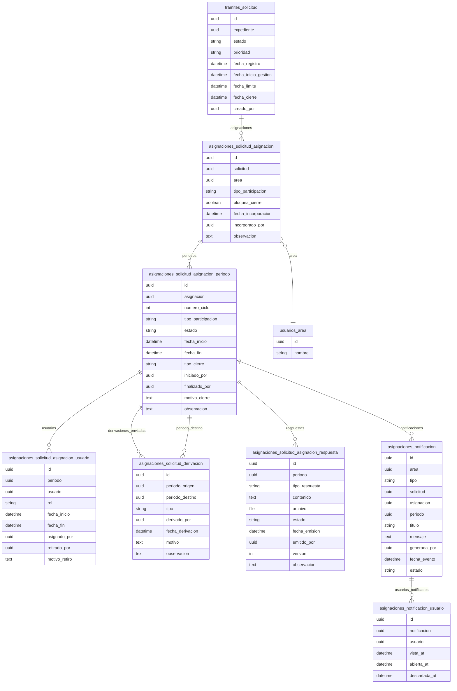

# Esquema Completo de Base de Datos — V2

> Documento unificado que consolida todos los modelos de datos del sistema CIP Mesa de Partes.
> Previene inconsistencias entre módulos y sirve como fuente de verdad única.

---

## Índice

1. [Módulo Tramites](#módulo-trámites)
   - Expediente
   - ExpedienteArchivo
   - ExpedienteAntecedente
   - Solicitud
   - SolicitudEstadoHistorial
2. [Módulo Asignaciones](#módulo-asignaciones)
   - SolicitudAsignacion
   - SolicitudAsignacionPeriodo
   - SolicitudAsignacionUsuario
   - SolicitudDerivacion
   - SolicitudAsignacionRespuesta
   - Notificacion
   - NotificacionUsuario
3. [Módulo Usuarios](#módulo-usuarios)
   - Area
   - Cargo
   - AsignacionUsuario

---

## Módulo Tramites

### 1. Expediente

*Representa la data fría del ciudadano y el documento ingresado. Es inmutable a nivel de flujo.*

- `id`: UUID (PK, provisto por BaseModel)
- `numero`: Integer (Auto-incremental, se reinicia cada año)
- `tipo_persona`: Choice (NATURAL, JURIDICA, COLEGIADO)
- `dni`, `ruc`, `cip`: CharField (Opcionales, null=True)
- `razon_social`, `nombres`, `apellidos`, `correo`, `telefono`: CharField
- `tipo_documento`: Choice (Oficio, Carta, etc.)
- `numero_documento`, `numero_folios`, `asunto`, `observaciones`
- `fecha_registro`: DateTime (Fecha real de ingreso al negocio)
- `creado_por`: FK a Usuario
- `@property id_publico`: Función que retorna `f"LIMA-{fecha_registro.year}-{numero:04d}"`

> **REGLAS:**
> - NO tiene `modificado_por` (se audita con django-simple-history).
> - NO tiene archivos adjuntos en la misma tabla.
> - NO usa M2M mágicos de Django para antecedentes.

---

### 2. ExpedienteArchivo

*Tabla 1:N que unifica el documento principal y los anexos sin contaminar el Expediente.*

- `id`: UUID
- `expediente`: FK a Expediente (on_delete=CASCADE, related_name='archivos')
- `tipo_archivo`: Choice (`PRINCIPAL`, `ANEXO`) -> Reemplaza a los booleanos peligrosos.
- `archivo`: FileField
- `nombre_original`: CharField
- `descripcion`: CharField/TextField
- `creado_por`: FK a Usuario

---

### 3. ExpedienteAntecedente

*Tabla independiente explícita (through) para vincular un trámite nuevo con uno histórico.*

- `id`: UUID
- `expediente`: FK a Expediente (El trámite nuevo)
- `antecedente`: FK a Expediente (El trámite viejo/origen)
- `categoria`: CharField (Opcional, para clasificar el vínculo futuro)
- `observaciones`: TextField (Opcional)

> **REGLAS:**
> - Constraint de unicidad entre `expediente` y `antecedente`.
> - NO tiene campo `creado_por` (es implícito al crearse la relación junto al expediente principal).

---

### 4. Solicitud

*Contenedor del Estado Global del trámite en la institución.*

- `id`: UUID (BaseModel)
- `expediente`: OneToOne a Expediente
- `estado`: Choice (Estado GLOBAL)
- `prioridad`: Choice
- `fecha_registro`: DateTime
- `fecha_inicio_gestion`: DateTime (Para medir tiempos muertos)
- `fecha_limite`: DateTime (Nullable)
- `fecha_cierre`: DateTime (Nullable)
- `creado_por`: FK a Usuario
- `observacion`: TextField (Nullable)
- `created_at`: DateTime (BaseModel)
- `updated_at`: DateTime (BaseModel)

> **REGLAS:**
> - ❌ NO contiene `area_responsable` ni `usuario_asignado` (pasan a `asignaciones`).

---

### 5. SolicitudEstadoHistorial

*Registro de auditoría inmutable para saber quién movió el estado global de la solicitud y por qué.*

- `id`: UUID
- `solicitud`: FK a Solicitud
- `estado_anterior`: CharField
- `estado_nuevo`: CharField
- `fecha`: DateTime (auto_now_add)
- `cambiado_por`: FK a Usuario
- `motivo` y `observacion`: TextField (Opcionales)

---

## Módulo Asignaciones

### Visión General

El módulo `asignaciones` modela tres preocupaciones ortogonales que antes estaban mezcladas en `Solicitud`:

| Concern | Modelo padre | Describe |
|---|---|---|
| **Área** (¿Quién?) | `SolicitudAsignacion` | El área involucrada en el trámite |
| **Ciclo temporal** (¿Cuándo?) | `SolicitudAsignacionPeriodo` | Cada ingreso/operación del área |
| **Operador humano** (¿Quién lo hizo?) | `SolicitudAsignacionUsuario` | El usuario individual que participa |

Este desacoplamiento permite que una misma área entre y salga múltiples veces (múltiples períodos), que cada período tenga varios usuarios con roles distintos, y que las derivaciones y respuestas se dibujen como eventos formales entre períodos — sin contaminar el modelo de `Solicitud`.

---

### 6. SolicitudAsignacion

**Tabla:** `asignaciones_solicitud_asignacion`

Relación estable entre una `Solicitud` y un `Area`. Responde: *"¿Qué áreas participan o participaron en esta solicitud?"*

| Campo | Tipo | Descripción |
|---|---|---|
| `id` | UUID | Identificador único |
| `solicitud` | FK → `tramites.Solicitud` | Solicitud padre |
| `area` | FK → `usuarios.Area` | Área participante |
| `tipo_participacion` | Enum `TipoParticipacion` | `PRINCIPAL` o `ADJUNTA` |
| `bloquea_cierre` | Boolean | Si debe resolverse para cerrar la solicitud |
| `fecha_incorporacion` | DateTime | Fecha real de incorporación al trámite |
| `incorporado_por` | FK → `Usuario`, nullable | Usuario que incorporó el área |
| `observacion` | Text, nullable | Notas sobre la relación Solicitud–Área |

**Constraints:**
- `UNIQUE(solicitud, area)` → solo una `SolicitudAsignacion` por área dentro de una misma solicitud.

**Relaciones:**
```
SolicitudAsignacion
  ├── 1:N → SolicitudAsignacionPeriodo   (los ciclos operativos)
  ├── 1:N → Notificacion                (notificaciones al área)
  └── N:1 ← Solicitud                   (vuelve a tramites)
```

---

### 7. SolicitudAsignacionPeriodo

**Tabla:** `asignaciones_solicitud_asignacion_periodo`

Cada entrada o reingreso operativo del área a una solicitud. Ejemplo: Arquitectura entra, es derivada a Estructuras, y luego Arquitectura reingresa en un segundo período.

| Campo | Tipo | Descripción |
|---|---|---|
| `id` | UUID | Identificador único |
| `asignacion` | FK → `SolicitudAsignacion` | Asignación padre |
| `numero_ciclo` | PositiveInteger | Secuencial del ingreso: 1, 2, 3… |
| `tipo_participacion` | Enum `TipoParticipacion` | `PRINCIPAL` o `ADJUNTA` para este ciclo |
| `estado` | Enum `EstadoPeriodo` | `ABIERTO` o `CERRADO` |
| `fecha_inicio` | DateTime | Fecha real de inicio del período |
| `fecha_fin` | DateTime, nullable | Fecha de cierre (NULL si sigue abierto) |
| `tipo_cierre` | Enum `TipoCierre`, nullable | `FINALIZADO`, `DERIVADO`, `RETIRADO`, `RECHAZADO`, `ANULADO` |
| `iniciado_por` | FK → `Usuario`, nullable | Usuario que abrió el período |
| `finalizado_por` | FK → `Usuario`, nullable | Usuario que cerró el período |
| `motivo_cierre` | Text, nullable | Razón del cierre |
| `observacion` | Text, nullable | Notas particulares del ciclo |

**Manager personalizado:** `SolicitudAsignacionPeriodo.abiertos` / `.cerrados()` para filtrar por estado.

**Constraints:**
- `UNIQUE(asignacion, numero_ciclo)` → no hay dos ciclos con el mismo número para la misma asignación.

**Relaciones:**
```
SolicitudAsignacionPeriodo
  ├── 1:N → SolicitudAsignacionUsuario   (usuarios en este ciclo)
  ├── 1:N → SolicitudDerivacion          (enviadas desde aquí)
  ├── 1:N ← SolicitudDerivacion            (recibidas desde otro)
  ├── 1:N → SolicitudAsignacionRespuesta   (respuestas formales)
  ├── 1:N → Notificacion                  (notificaciones del ciclo)
  └── N:1 ← SolicitudAsignacion            (vuelve a la asignación)
```

---

### 8. SolicitudAsignacionUsuario

**Tabla:** `asignaciones_solicitud_asignacion_usuario`

Usuarios que trabajan por el área durante un período determinado. Ejemplo: Arquitectura/Ciclo 2 tiene a Juan (responsable), Pedro (colaborador) y María (revisor).

| Campo | Tipo | Descripción |
|---|---|---|
| `id` | UUID | Identificador único |
| `periodo` | FK → `SolicitudAsignacionPeriodo` | Período padre |
| `usuario` | FK → `Usuario` | Usuario participante |
| `rol` | String(50), nullable | Rol: `Responsable`, `colaborador`, `revisor`, etc. |
| `fecha_inicio` | DateTime | Fecha de inicio de participación |
| `fecha_fin` | DateTime, nullable | Fecha de retiro (NULL si sigue activo) |
| `asignado_por` | FK → `Usuario`, nullable | Usuario que incorporó a este usuario |
| `retirado_por` | FK → `Usuario`, nullable | Usuario que lo retiró |
| `motivo_retiro` | Text, nullable | Razón del retiro |

**Relaciones:**
```
SolicitudAsignacionUsuario
  └── N:1 ← SolicitudAsignacionPeriodo
```

---

### 9. SolicitudDerivacion

**Tabla:** `asignaciones_solicitud_derivacion`

Movimiento formal entre períodos. Ejemplo: Arquitectura/Ciclo 1 es derivada a Estructuras/Ciclo 1. Luego Estructuras la devuelve a Arquitectura/Ciclo 2.

| Campo | Tipo | Descripción |
|---|---|---|
| `id` | UUID | Identificador único |
| `periodo_origen` | FK → `SolicitudAsignacionPeriodo` | Período desde donde se deriva |
| `periodo_destino` | FK → `SolicitudAsignacionPeriodo` | Período hacia donde se deriva |
| `tipo` | Enum `TipoDerivacion` | `DERIVACION` o `DEVOLUCION` |
| `derivado_por` | FK → `Usuario` | Usuario que realizó la derivación |
| `fecha_derivacion` | DateTime | Fecha real del movimiento |
| `motivo` | Text | Razón de la derivación |
| `observacion` | Text, nullable | Información complementaria |

**Relaciones:**
```
SolicitudDerivacion
  ├── N:1 ← SolicitudAsignacionPeriodo (periodo_origen → derivaciones_enviadas)
  └── N:1 ← SolicitudAsignacionPeriodo (periodo_destino → derivaciones_recibidas)
```

---

### 10. SolicitudAsignacionRespuesta

**Tabla:** `asignaciones_solicitud_asignacion_respuesta`

Respuesta formal del área a una solicitud. No es la respuesta personal del usuario — es institucionalmente del área. Ejemplo: Área Arquitectura responde con `emitido_por=María`, pero la respuesta pertenece a Arquitectura/Ciclo 2.

| Campo | Tipo | Descripción |
|---|---|---|
| `id` | UUID | Identificador único |
| `periodo` | FK → `SolicitudAsignacionPeriodo` | Período que produjo la respuesta |
| `tipo_respuesta` | Enum `TipoRespuesta` | `INFORME`, `OBSERVACION`, `CONFORMIDAD`, `DESCARGO`, `OTRO` |
| `contenido` | Text, nullable | Texto de la respuesta |
| `archivo` | FileField, nullable | Documento oficial adjunto |
| `estado` | Enum `EstadoRespuesta` | `BORRADOR`, `EMITIDA`, `ANULADA`, `RECTIFICADA` |
| `fecha_emision` | DateTime, nullable | Momento real de emisión |
| `emitido_por` | FK → `Usuario` | Usuario que ejecutó la emisión |
| `version` | PositiveInteger | Número de versión (versionado) |
| `observacion` | Text, nullable | Complemento |

**Relaciones:**
```
SolicitudAsignacionRespuesta
  └── N:1 ← SolicitudAsignacionPeriodo (vuelve al ciclo)
```

---

### 11. Notificacion

**Tabla:** `asignaciones_notificacion`

Evento comunicado al área. La notificación es del área, no del usuario individual.

| Campo | Tipo | Descripción |
|---|---|---|
| `id` | UUID | Identificador único |
| `area` | FK → `usuarios.Area` | Área destinataria |
| `tipo` | Enum `TipoNotificacion` | `NUEVA_ASIGNACION`, `DEVOLUCION`, `COMENTARIO`, `RESPUESTA`, `RECORDATORIO`, `URGENTE` |
| `solicitud` | FK → `tramites.Solicitud`, nullable | Solicitud asociada |
| `asignacion` | FK → `SolicitudAsignacion`, nullable | Asignación asociada |
| `periodo` | FK → `SolicitudAsignacionPeriodo`, nullable | Período asociado |
| `titulo` | String(200) | Título de la notificación |
| `mensaje` | Text, nullable | Detalle del mensaje |
| `generada_por` | FK → `Usuario`, nullable | Actor que provocó el evento |
| `fecha_evento` | DateTime, nullable | Fecha del evento (para importar históricos) |
| `estado` | Enum `EstadoNotificacion` | `PENDIENTE`, `ENVIADA`, `LEIDA`, `DESCARTADA` |

**Relaciones:**
```
Notificacion
  ├── 1:N → NotificacionUsuario    (usuarios que la vieron)
  ├── N:1 ← Area                  (área destinataria)
  ├── N:1 ← tramites.Solicitud    (solicitud asociada)
  ├── N:1 ← SolicitudAsignacion   (asignación asociada)
  └── N:1 ← SolicitudAsignacionPeriodo (período asociado)
```

---

### 12. NotificacionUsuario

**Tabla:** `asignaciones_notificacion_usuario`

Rastrea quién podía ver la notificación y quién efectivamente la vio. Ejemplo: Notificación #500 para Área Arquitectura. Juan la vio a las 08:10, Pedro no la ha visto, María la vio a las 08:16.

| Campo | Tipo | Descripción |
|---|---|---|
| `id` | UUID | Identificador único |
| `notificacion` | FK → `Notificacion` | Notificación padre |
| `usuario` | FK → `Usuario` | Usuario destinatario |
| `vista_at` | DateTime, nullable | Cuándo abrió/vio la notificación |
| `abierta_at` | DateTime, nullable | Cuándo entró al detalle |
| `descartada_at` | DateTime, nullable | Cuándo fue descartada |

**Constraints:**
- `UNIQUE(notificacion, usuario)` → un usuario solo aparece una vez por notificación.

**Relaciones:**
```
NotificacionUsuario
  └── N:1 ← Notificacion
```

---

## Módulo Usuarios

### 13. Area (Catálogo Maestro)

*Define las bandejas o departamentos de la institución a las que se puede rutear un trámite.*

- `id`: UUID (BaseModel)
- `nombre`: CharField(120), unique=True
- `descripcion`: TextField (Opcional)
- `activo`: BooleanField(default=True) -> Permite "apagar" un área sin borrar su historial.
- `@property slug`: Calculado al vuelo a partir del nombre.

> **REGLAS:** NO hereda de VigenciaModel por ser un catálogo estático.

---

### 14. Cargo (Catálogo Maestro)

*Define los roles o puestos de los usuarios en la institución.*

- `id`: UUID (BaseModel)
- `nombre`: CharField(100), unique=True
- `activo`: BooleanField(default=True)

> **REGLAS:** NO hereda de VigenciaModel. Se eliminó el campo numérico `nivel` por instrucción de negocio.

---

### 15. AsignacionUsuario (Tabla Operativa de Vigencia)

*El "Contrato". Une a un usuario con un Área y un Cargo, guardando el historial exacto de sus movimientos en la empresa.*

- `id`: UUID (BaseModel)
- `usuario`: FK a Usuario
- `area`: FK a Area
- `cargo`: FK a Cargo
- `periodo_inicio`: DateField (Heredado de VigenciaModel)
- `periodo_fin`: DateField (Heredado de VigenciaModel, Nullable)

> **REGLAS:**
> - Hereda de `VigenciaModel` para manejar el historial laboral activo/inactivo mediante fechas.
> - **Unique Constraint**: Solo puede haber UNA asignación activa (`periodo_fin__isnull=True`) por usuario. Esto garantiza la relación 1:1 operativa, pero N:M histórica.

---

## Enums del Módulo Asignaciones

| Enum | Valores |
|---|---|
| `TipoParticipacion` | `PRINCIPAL`, `ADJUNTA` |
| `EstadoPeriodo` | `ABIERTO`, `CERRADO` |
| `TipoCierre` | `FINALIZADO`, `DERIVADO`, `RETIRADO`, `RECHAZADO`, `ANULADO` |
| `TipoDerivacion` | `DERIVACION`, `DEVOLUCION` |
| `TipoRespuesta` | `INFORME`, `OBSERVACION`, `CONFORMIDAD`, `DESCARGO`, `OTRO` |
| `EstadoRespuesta` | `BORRADOR`, `EMITIDA`, `ANULADA`, `RECTIFICADA` |
| `TipoNotificacion` | `NUEVA_ASIGNACION`, `DEVOLUCION`, `COMENTARIO`, `RESPUESTA`, `RECORDATORIO`, `URGENTE` |
| `EstadoNotificacion` | `PENDIENTE`, `ENVIADA`, `LEIDA`, `DESCARTADA` |

---

## Diagrama de Entidad-Relación (Mermaid)



---

## Diagrama de Árbol Jerárquico (ASCII)

```
tramites.Solicitud
│
├── asignaciones.SolicitudAsignacion  (1:N)  ── ¿Qué áreas participan?
│   │
│   ├── asignaciones.SolicitudAsignacionPeriodo  (1:N)  ── ¿En qué ciclo/operação?
│   │   │
│   │   ├── asignaciones.SolicitudAsignacionUsuario  (1:N)  ── ¿Quiénes operan?
│   │   │
│   │   ├── asignaciones.SolicitudDerivacion  (1:N)  ── ¿A dónde se derivó?
│   │   │       └── → otro SolicitudAsignacionPeriodo (destino)
│   │   │
│   │   ├── asignaciones.SolicitudAsignacionRespuesta  (1:N)  ── ¿Qué respondió el área?
│   │   │
│   │   └── asignaciones.Notificacion  (1:N)  ── ¿Qué notificaciones del ciclo?
│   │       │
│   │       └── asignaciones.NotificacionUsuario  (1:N)  ── ¿Quién la vio?
│   │
│   └── asignaciones.Notificacion  (1:N)  ── ¿Qué notificaciones directas al área?
│       │
│       └── asignaciones.NotificacionUsuario  (1:N)
│
└── ( otros módulos: expediente, historial, archivos... )
```

---

*Documento unificado el 2026-08-23*
