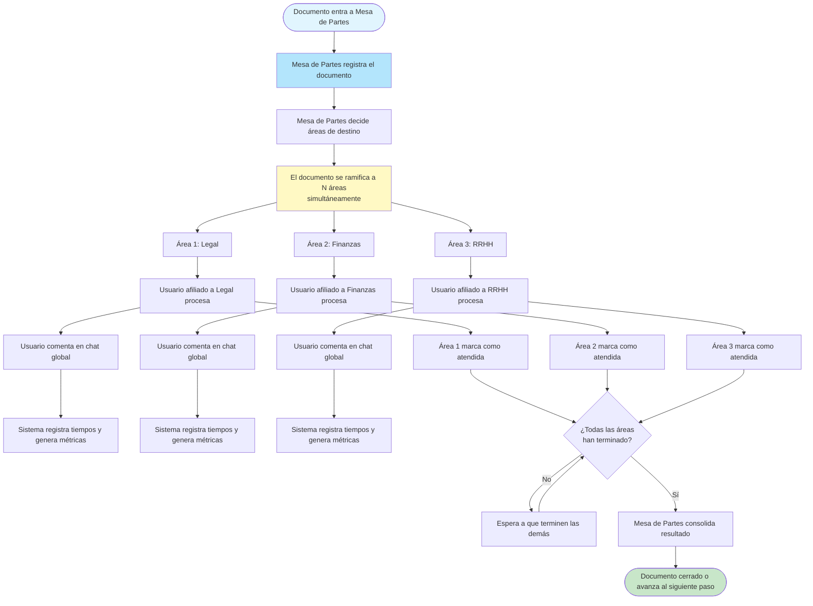

# Arquitectura Propuesta V2 — Mesa de Partes CIP

> **Blueprint de Negocio** para el rediseño del sistema.
> Enfocado en el FLUJO MACRO y la IDEA conceptual. Sin código, sin clases, sin nombres de librerías.
> **Versión**: 2.0-macro | **Fecha**: Agosto 2026 | **Estado**: Borrador para revisión

---

## Tabla de Contenidos

1. [El Problema de V1](#1-el-problema-de-v1)
2. [Los Cuatro Pilares de V2](#2-los-cuatro-pilares-de-v2)
   - [Pilar 1: Flujo Paralelo a N-Áreas](#pilar-1-flujo-paralelo-a-n-áreas)
   - [Pilar 2: Afiliación Dinámica y Métricas de Efectividad](#pilar-2-afiliación-dinámica-y-métricas-de-efectividad)
   - [Pilar 3: Comentarios Globales](#pilar-3-comentarios-globales)
   - [Pilar 4: Motor de Reglas (Permisos)](#pilar-4-motor-de-reglas-permisos)
3. [Journey de Usuario V2](#3-journey-de-usuario-v2)

---

## 1. El Problema de V1

### El modelo mental de V1

En V1, cada documento sigue un camino **lineal y forzado**:

```
Un documento → Una solicitud → Un área fija → Cierre
```

Esto parece lógico en papel, pero no refleja la realidad. Un documento often necesita ser revisado por múltiples áreas al mismo tiempo. Legal necesita verlo, Finanzas necesita revisarlo, y maybe another área more. But V1 forced you to **duplicar el documento** or create multiple "solicitudes" connected artificialmente.

### Síntomas concretos

| Síntoma | Qué significa en la práctica |
|---------|------------------------------|
| **Relación 1:1 forzada** | Si un documento debe ir a 3 áreas, el personal crea 3 expedientes separados (copia y pega) |
| **Área fija única** | No existe el concepto de "este documento vive en múltiples sitios al mismo tiempo" |
| **Afiliación estática** | Un usuario pertenece a un área y ya. No puede "visitar" otra área temporalmente |
| **Permisos binarios** | O puedes tocar todo o no puedes tocar nada. No hay graduación |
| **Comentarios aislados** | Los comentarios viven dentro de cada solicitud. No hay una visión unificada |
| **Sin medición de tiempo** | No se sabe cuánto tardó cada área. No hay datos para premiar o corregir |
| **Historial plano** | Se sabe que algo cambió, pero no quién lo hizo, cuándo, ni por qué |

### La frustración del usuario

El personal de Mesa de Partes se ve obligado a crear **trucos** para compensar las limitaciones del sistema. Eso genera:
- Documentos duplicados que confunden a todos
- Incapacidad de saber qué está pasando realmente
- Usuarios que no pueden ayudar en áreas que necesitan refuerzo
- Nadie sabe quién es realmente responsable de qué

---

## 2. Los Cuatro Pilares de V2

V2 se construye sobre cuatro ideas independientes que se complementan. Ninguna depende de código específico — son concepts de negocio que se implementan con la tecnología que mejor convenga.

---

### Pilar 1: Flujo Paralelo a N-Áreas

#### La idea central

Un documento no pertenece a un área. Un documento **visita** múltiples áreas simultáneamente.

Cuando entra un documento a Mesa de Partes, el personal no decide "va a Legal" o "va a Finanzas". Decide **"va a estas tres áreas al mismo tiempo"**. Cada área recibe una copia viva del documento, lo trabaja independently, y cuando termina, lo devuelve.

#### Cómo funciona conceptualmente

1. **Entrada**: Un documento llega a Mesa de Partes y se registra en el sistema.

2. **Ramificación**: En el mismo momento, el sistema crea una "visita" por cada área designada. Visualmente, el documento aparece en la bandeja de cada área casi instantáneamente.

3. **Trabajo independiente**: Cada área ve el documento, lo revisa, hace comentarios, y eventually marca si está de acuerdo, en desacuerdo, o si necesita más info. Cada área actúa **sin esperar a las demás**.

4. **Agregación**: Mesa de Partes tiene una vista unificada que muestra el estado de cada visita. Puede ver "Legal ✓, Finanzas ⏳, RRHH ⏳" sin entrar a cada área.

5. **Cierre**: Cuando todas las áreas relevantes han terminado, el documento puede cerrarse o avanzar al siguiente paso.

#### Qué NO es

- **No es reenvío**: No se envía el documento de un área a otra en cadena.
- **No es duplicación**: No se copian archivos. Es el mismo documento con múltiples "puntos de vista".
- **No es secuencial**: Las áreas no esperan su turno. Trabajan en paralelo desde el momento en que el documento entra.

#### Beneficio de negocio

El tiempo total de atención se reduce drásticamente porque N áreas trabajan simultáneamente en lugar de secuencialmente. Un documento que antes tardaba 15 días (3 áreas × 5 días en secuencia) puede tardar 5 días (todas trabajan juntas).

---

### Pilar 2: Afiliación Dinámica y Métricas de Efectividad

#### La idea central

Un usuario no "pertenece" a un área de forma permanente. Un usuario decide **afiliarse temporalmente** a un área, trabaja ahí, y cuando termina, se desafilia. El sistema mide cada affiliation: cuándo entraste, cuándo saliste, qué hiciste mientras estuviste.

Esto se llama **Accountability**: cada persona es responsable de su tiempo.

#### Cómo funciona conceptualmente

**Afiliación (entrar a trabajar a un área)**

1. El usuario abre su panel y ve una lista de áreas disponibles.
2. Dice "Hoy trabajo en Legal" y se afilia.
3. El sistema registra: usuario X entró al área Legal a las 8:00 AM.
4. A partir de ese momento, el usuario ve los documentos que están en Legal.
5. Puede tomar documentos, procesarlos, comentarlos.

**Desafiliación (terminar de trabajar en un área)**

1. El usuario dice "Me voy de Legal" y se desafilia.
2. El sistema registra: usuario X salió del área Legal a las 5:00 PM.
3. Los documentos que estaban en sus manos vuelven a la bandeja del área (no se pierden).
4. El sistema sabe exactamente cuánto tiempo estuvo: 9 horas.

**Métricas de efectividad**

Por cada affiliation, el sistema calcula:

| Métrica | Qué mide |
|---------|----------|
| **Tiempo en área** | Cuántas horas estuvo el usuario trabajando en esa área |
| **Documentos procesados** | Cuántos documentos atendió mientras estuvo afiliado |
| **SLA cumplimiento** | Qué porcentaje de sus documentos fueron atendidos dentro del plazo |
| **Velocidad promedio** | Tiempo promedio que tardó en atender cada documento |

**Castigos y recompensas**

- Si un usuario consistently incumple los SLA de su área → flagged para revisión
- Si un usuario processa más de lo esperado → visible en su perfil para consideración de promotion
- Si un área entera está saturada → se nota en las métricas y se puede pedir refuerzo

#### Por qué importa

 accountability solves a real problem: "Nadie sabe quién hizo qué y cuándo." Con affiliations, cada acción tiene un nombre y un timestamp. Si algo se hizo mal, se sabe exactamente quién lo hizo. Si algo se hizo bien, también se sabe.

---

### Pilar 3: Comentarios Globales

#### La idea central

Todos los comentarios de un documento — sin importar si son sobre el documento mismo, sobre una asignación específica, o sobre una observación — viven en **una sola bandeja de chat unificada**.

El usuario no tiene que buscar en múltiples lugares. Abre un documento y ve toda la conversación completa.

#### Cómo funciona conceptualmente

1. **Una sola fuente**: Cada documento tiene una bandeja de comentarios. ahí aparecen todos los comentarios, de cualquier tipo, de cualquier persona involucrada.

2. **Hilos organizados**: Los comentarios pueden responderse entre sí, formando hilos. Un jefe de área puede responder a una observación de un colaborador, y esa respuesta aparece right below.

3. **Tipos de comentario**: Los comentarios tienen un "tipo" (observación, aprobación, rechazo, alerta) para facilitar filtrar y buscar.

4. **Notificaciones centralizadas**: El usuario tiene una sola bandeja de notificaciones que le dice "tienes nuevos comentarios" sin importar dónde aparezcan en el sistema.

5. **Archivos adjuntos**: Los comentarios pueden tener archivos adjuntos. Si alguien sube un PDF como evidencia de algo, ese archivo se adjunta al comentario y está disponible ahí.

#### Ejemplo de usuario

```
Usuario abre el documento "Exp-2026-0042"
  ↓
Ve la bandeja de comentarios unificada:
  
  [Mesa de Partes - 10:30 AM]
  "Documento recibido y registrado"
  
    └─ [Legal - 11:15 AM] (respuesta)
       "Revisado. Hay un error en la página 3."
       
         └─ [El ciudadano - 2:00 PM] (respuesta)
            "Corregido. Adjunto nueva versión."
            
              └─ [Legal - 3:00 PM] (aprobación)
                 "OK. Legal conforme."
                 
  [RRHH - 12:00 PM]
  "Recibido. En cola para revisión."
```

Todo en un solo lugar. El usuario no tuvo que entrar a "la solicitud" o "la asignación de Legal" por separado.

#### Por qué importa

Lafragmentación de comentarios es una fuente enorme de confusión. Cuando los comentarios están en 5 lugares diferentes, people miss things. Con comentarios globales, toda la conversación viaja con el documento.

---

### Pilar 4: Motor de Reglas (Permisos)

#### La idea central

El sistema no dice "este usuario tiene permiso" o "no tiene permiso". El sistema dice **"este usuario tiene permiso en este momento, bajo estas condiciones"**.

La frase clave es: **"Solo puedes tocar un documento si estás activamente afiliado a su área en este momento."**

#### Lógica de negocio en lugar de permisos técnicos

En V1, los permisos eran técnicos: "este grupo puede editar este campo." Eran binary y estáticos.

En V2, los permisos son lógicos y dinámicos:

**Regla 1 — Afiliación activa requerida**
> Para tocar un documento que está en un área, necesitas estar afiliado a esa área en este momento.
>
> - ¿Estás afiliado a Legal? Puedes trabajar en los documentos de Legal.
> - ¿No estás afiliado? No puedes verlos ni tocarlos.
> - ¿Te desafiliaste ayer? Ya no puedes tocarlos aunque ayer tuvieras acceso.

**Regla 2 — Rol dentro del área**
> No todos los afiliados tienen las mismas capacidades.
>
> - Un colaborador puede procesar documentos.
> - Un jefe de área puede reasignar documentos a otros.
> - Un consultor solo puede leer, no procesar.

**Regla 3 — Estado del documento**
> No puedes tocar un documento que ya está cerrado o archivado.
>
> - ¿El documento está "En Trámite"? Puedes trabajar en él.
> - ¿El documento está "Cerrado"? Solo lectura para todos.

**Regla 4 — Creación y Routing**
> Solo Mesa de Partes puede crear y rutear documentos.
>
> - Cualquier usuario puede crear comentarios.
> - Solo Mesa de Partes decide a qué áreas va un documento.

#### Validación en tiempo real

Cada vez que un usuario intenta hacer algo, el sistema pregunta:

1. ¿Está afiliado al área correcta en este momento?
2. ¿Tiene el rol suficiente para esta acción?
3. ¿El documento está en un estado que permite esta acción?

Si cualquiera de las tres falla → acción denegada con mensaje claro de por qué.

#### Por qué importa

El problema de V1 era que los permisos no reflejaban la realidad. Un usuario que se fue de vacaciones seguía pudiendo tocar documentos. Un usuario que solo debía consultar podía procesar. Con reglas dinámicas basadas en affiliations reales, el sistema refleja el estado real de la organización.

---

## 3. Journey de Usuario V2

El siguiente diagrama muestra el camino que sigue un documento y los principales actores en V2:



### Descripción del Journey

1. **Entrada**: Un ciudadano o usuario interno presenta un documento en Mesa de Partes.

2. **Registro**: Mesa de Partes registra el documento y lo deja en estado "pendiente de routing."

3. **Routing**: Mesa de Partes selecciona las áreas de destino (puede ser 1, 2, 3, o más).

4. **Ramificación**: En un solo paso, el documento aparece en todas las bandejas de las áreas seleccionadas. Las áreas no se enteran por "notificaciones" que llegan después — ven el documento inmediatamente.

5. **Procesamiento paralelo**: Cada área trabaja independently. Un usuario afiliado a Legal toma el documento, lo revisa, hace comentarios, y eventually lo marca como atendido. Lo mismo ocurre en Finanzas y RRHH al mismo tiempo.

6. **Chat global**: Cada comentario de cada actor aparece en la bandeja de comentarios unificada del documento. Mesa de Partes puede ver toda la conversación sin entrar a cada área.

7. **Métricas automáticas**: Cada acción genera un registro de tiempo. El sistema sabe a qué hora llegó a cada área, cuánto tardó cada usuario en procesarlo, y si se cumplió el SLA.

8. **Consolidación**: Cuando todas las áreas han terminado, Mesa de Partes ve el resultado consolidado y puede cerrar el documento o derivelo al siguiente paso.

---

## Resumen de Cambios Macro

| Concepto | V1 (Legacy) | V2 (Propuesta) |
|----------|-------------|----------------|
| Relación documento-área | 1:1 forzada | N:N simultánea |
| Afiliación de usuarios | Estática (permanente) | Dinámica (temporal con medición) |
| Comentarios | Aislados por solicitud | Globales y unificados |
| Permisos | Grupos estáticos | Motor de reglas dinámicas |
| Métricas | No existen | Automáticas por cada acción |
| Tiempo de atención | Secuencial (N × T) | Paralelo (máximo T entre áreas) |

---

*Documento macro para revisión conceptual del rediseño V2 — Agosto 2026.*
