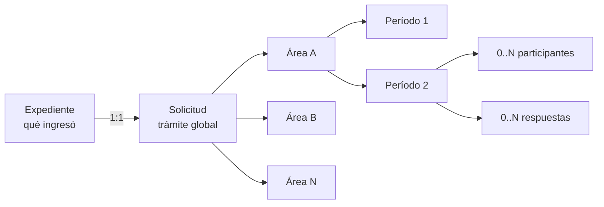

# Visión y alcance

## En una frase

Mesa de Partes registra lo recibido, abre un único trámite por expediente y coordina intervenciones paralelas de áreas con trazabilidad institucional, humana y documental independiente.

## Problema funcional

Un modelo lineal de «un área actual» no puede representar correctamente trabajo paralelo, reingresos, múltiples operadores ni respuestas institucionales. El diseño objetivo separa el trámite global de la intervención de cada área y de la participación individual de usuarios.

## Actores funcionales

| Actor | Responsabilidad conceptual |
|---|---|
| Registrador de Mesa de Partes | Registra expediente, solicitud y distribución inicial. |
| Área institucional | Recibe la intervención y produce trabajo/respuesta institucional. |
| Usuario operador | Ve avisos, toma o comparte trabajo y ejecuta acciones en nombre de un área. |
| Sistema | Conserva estados, historial, auditoría, notificaciones y atomicidad. |

**Objetivo confirmado:** no se asignan todavía acciones a perfiles, cargos, grupos o permisos. Las reglas de negocio por estado y tipo de participación sí aplican.

**Futuro:** los perfiles conocidos, permisos finos, `django-guardian`, `rules` u otro mecanismo de autorización se diseñarán después.

## Alcance funcional objetivo confirmado

Las capacidades siguientes describen el objetivo funcional validado. No implican que ya estén implementadas; el estado real se resume por separado en [Estado de implementación observado](#estado-de-implementación-observado).

- Crear solo un expediente.
- Crear una solicitud sobre un expediente existente.
- Crear expediente, solicitud y distribución en una sola operación; este es el camino prioritario.
- Mantener una solicitud registrada sin áreas.
- Distribuir o incorporar varias áreas en paralelo.
- Reincorporar un área mediante un nuevo período.
- Gestionar estados explícitos e historial de cada período.
- Registrar múltiples participantes por período.
- Registrar respuestas formales sin acoplarlas al cierre.
- Finalizar cada intervención de área de forma independiente.
- Corregir una asignación errónea sin borrar historia.
- Cambiar `PRINCIPAL`/`ADJUNTA` cerrando un ciclo y abriendo otro.
- Notificar al área y auditar vista, apertura y descarte por usuario.
- Consultar listados y detalles de expedientes, solicitudes y notificaciones.

## Fuera de alcance deliberado

| Tema | Estado |
|---|---|
| Roles, permisos y autorización fina | Futuro; no debe condicionar esta especificación. |
| Regla de cierre global de solicitud | Futuro; finalizar un período no la define. |
| Comentarios tipo chat y menciones | Futuro importante. |
| Documento consolidado/firma institucional | Futuro. |
| Pago o habilitación para siguiente etapa | Futuro. |
| SLA, calendario laboral y analítica avanzada | Futuro. |
| Devolución o transferencia normal entre áreas | Excluido por decisión funcional. |

## Vocabulario canónico

| Término | Definición |
|---|---|
| Expediente | Información objetiva y documental recibida. |
| Solicitud | Caso o trámite global asociado 1:1 al expediente. |
| Asignación | Relación estable `Solicitud–Área`; existe una sola por par. |
| Período | Ciclo temporal de participación de un área. |
| Tipo de participación | Papel del área en un ciclo: `PRINCIPAL` o `ADJUNTA`. |
| Participante | Usuario que trabaja durante un período. |
| Respuesta | Resultado formal emitido institucionalmente por el área en un período. |
| Estado del período | Avance institucional explícito: `PENDIENTE`, `EN_GESTION`, `CERRADO`. |
| Tipo de cierre | Causa por la que terminó un período. |
| Notificación | Evento institucional dirigido a un área. |
| Interacción de notificación | Vista, apertura o descarte de un usuario concreto. |
| Toma | Alta de un usuario en `SolicitudAsignacionUsuario`; no es una vista. |

## Cuatro dimensiones que no deben mezclarse

| Dimensión | Fuente de verdad | Ejemplo |
|---|---|---|
| Estado global | `Solicitud.estado` + historial global | La solicitud está `EN_GESTION`. |
| Estado institucional del área | Período + historial de período | Arquitectura está `PENDIENTE`. |
| Ejecución humana | Participaciones de usuario | Ana y Luis trabajan en el período. |
| Resultado formal | Respuestas | Arquitectura emitió un informe. |

Una combinación válida es: período `EN_GESTION`, cero usuarios activos y una respuesta en borrador. Cada dimensión registra un hecho diferente; la consistencia no se obtiene inventando dependencias automáticas.

## Principios de diseño

1. Las APIs expresan acciones de negocio, no secuencias CRUD de tablas.
2. Las operaciones compuestas son atómicas en base de datos; los efectos sobre storage externo requieren carga temporal o compensación.
3. Las correcciones conservan historial; no se borra la película funcional.
4. Las fechas de negocio son distintas de `created_at` y deben soportar carga histórica.
5. El frontend declara intención; el backend coordina inserciones, actualizaciones e historial.
6. La documentación no convierte una propuesta futura en comportamiento actual.

## Estado de implementación observado

**Actual:** existen los modelos base de expediente, solicitud, asignaciones, períodos, usuarios, respuestas y notificaciones. Existen tres endpoints de creación. El frontend no contiene páginas o features de Mesa de Partes.

**Parcial:** existe tabla y servicio de historial de estado de período, pero el período actual no persiste todavía el estado operativo objetivo y los flujos de creación no generan ese historial.

**Ausente:** listados, detalles, distribución posterior, toma, participantes, transición explícita, respuestas operativas, finalización, corrección de asignación y bandeja de notificaciones.

Siguiente lectura: [02. Flujo end-to-end](02-flujo-end-to-end.md).
