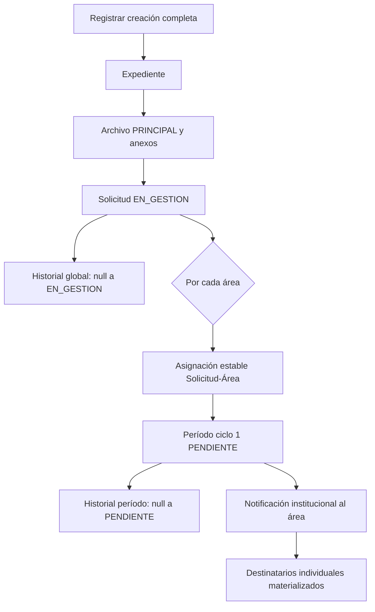
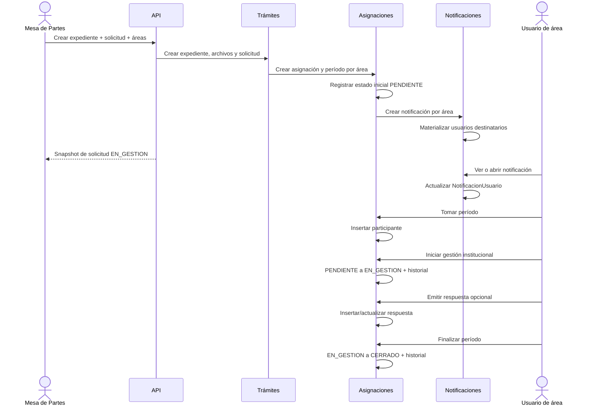
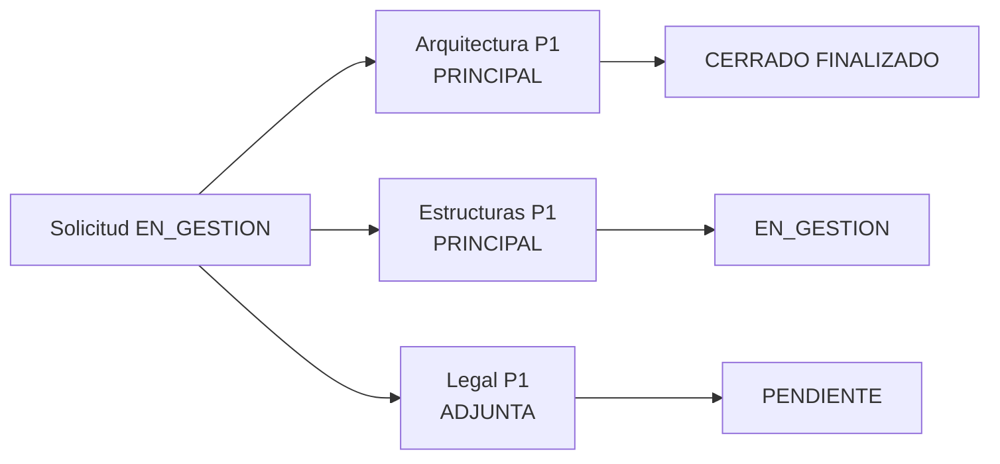
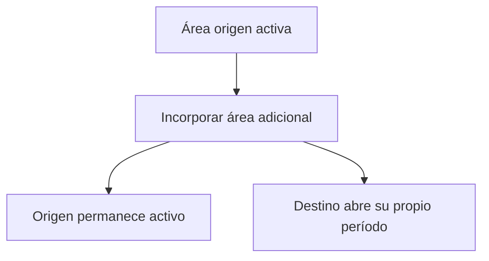
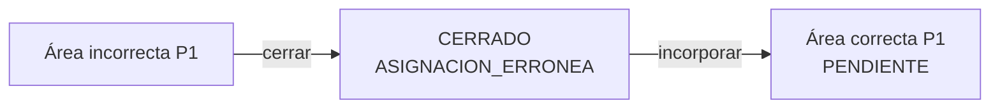
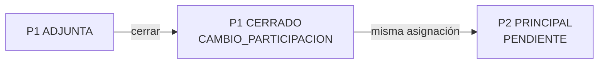

# Flujo end-to-end

## Camino prioritario

El camino prioritario crea expediente, solicitud, distribución, períodos e información de comunicación en una sola transacción. La solicitud termina en `EN_GESTION`; cada período nuevo inicia institucionalmente en `PENDIENTE`.

## Secuencia completa

Ver y tomar se muestran seguidos por claridad, pero son acciones independientes. Tomar tampoco debe inferir automáticamente el estado institucional; la transición debe ejecutarse de forma explícita o como una regla macro expresamente validada.

## Tres caminos de creación

### A. Solo expediente

**Intención:** registrar lo recibido sin abrir todavía el trámite.

**Resultado:** `Expediente`, archivos y antecedentes opcionales. No crea solicitud ni asignaciones.

**Actual:** `POST /api/expedientes/crear` coordina expediente y archivos; `transaction.atomic()` protege las filas de base de datos, no revierte por sí mismo objetos ya escritos en storage externo.

### B. Solicitud sobre expediente

**Intención:** abrir el trámite para un expediente existente.

**Objetivo confirmado:** puede crearse sin áreas y quedar `REGISTRADA`; si incluye áreas, queda `EN_GESTION`.

**Actual:** `POST /api/solicitudes/crear` exige al menos un área y siempre crea `EN_GESTION`.

### C. Creación completa

**Intención:** registrar ingreso y activar áreas en un único caso de uso.

**Objetivo confirmado:** esta fase prioriza el camino completo con una o más áreas y resultado `EN_GESTION`.

**Actual:** `POST /api/solicitudes/crear-completo` implementa la transacción compuesta, aunque aún no crea historial de período ni destinatarios individuales.

## Operación paralela de áreas

No existe una única «área actual». Las tres situaciones coexisten dentro de una solicitud.

## Incorporar y reincorporar

### Área nueva

1. Leer solicitud y área.
2. Crear `SolicitudAsignacion` con actor, fecha, motivo/observación.
3. Crear período ciclo 1.
4. Crear historial inicial `PENDIENTE`.
5. Notificar al área y materializar destinatarios.

### Área que ya participó

1. Reutilizar la asignación estable.
2. Verificar que no exista período abierto.
3. Crear el siguiente ciclo, nunca reabrir uno cerrado.
4. Registrar historial y notificar de nuevo.

### Área ya activa

No se duplica asignación ni período. El reintento debe devolver conflicto de negocio o el snapshot vigente, según la convención uniforme del API.

## Incorporación no es transferencia

**Objetivo confirmado:** no existe devolución ni transferencia como flujo normal. Cada área concluye de manera independiente.

## Corrección de asignación errónea

El período incorrecto conserva actor, fecha y motivo. La incorporación correcta no necesita `periodo_origen` ni otra tabla de movimiento.

## Cambio de participación

El cambio real nunca edita retrospectivamente el tipo del ciclo anterior.

## Participantes y respuestas

- Un período puede tener cero, uno o varios usuarios activos.
- Un usuario puede retirarse sin cerrar el período.
- La toma crea una participación; no cambia una notificación.
- La respuesta pertenece al período, aunque guarde quién la emitió.
- Responder no finaliza automáticamente.
- Finalizar no exige universalmente respuesta; una intervención `ADJUNTA` o consultiva puede cerrar sin ella.
- Reglas específicas de obligatoriedad se definirán por tipo de trámite en otra fase.

## Cierre independiente

Cada área puede cerrar su período con una causa. El cierre actualiza el período y agrega historial de estado; no cambia automáticamente `Solicitud.estado` a `FINALIZADA`.

**Futuro:** la regla global decidirá cuándo una solicitud puede finalizar, archivarse, generar documento consolidado o avanzar a pago.

## Escenarios alternativos válidos

| Escenario | Resultado válido |
|---|---|
| Solicitud creada sin áreas | `REGISTRADA`, sin asignaciones ni períodos. |
| Período pendiente sin usuarios | Trabajo institucional disponible, nadie lo tomó. |
| Período en gestión sin usuarios activos | El área inició gestión, pero actualmente no hay operador activo. |
| Varios usuarios activos | Colaboración dentro del mismo período. |
| Respuesta emitida y período abierto | El área respondió, pero no concluyó formalmente el ciclo. |
| Período cerrado sin respuesta | Válido cuando la regla específica no exige respuesta. |
| Área que reingresa | Nueva fila de período; asignación estable reutilizada. |
| Varias principales | Todas trabajan en paralelo. |

Detalle de persistencia: [04. Operaciones y efectos en datos](04-operaciones-y-efectos-en-datos.md).
