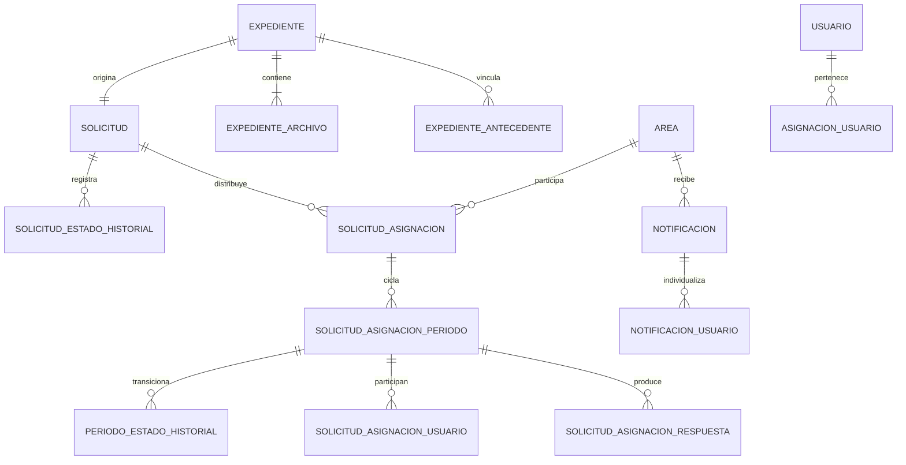

# Modelo de datos y tablas

## Vista general

## Convención de campos

Todos los modelos heredan `id` UUID, `created_at` y `updated_at` de `BaseModel`. Las fechas de negocio (`fecha_registro`, `fecha_inicio`, `fecha_cambio`, etc.) no deben sustituirse por timestamps técnicos.

## Expediente

**Autoridad:** qué ingresó al sistema.

| Campo real | Uso |
|---|---|
| `numero` | Secuencia visible anual; `id_publico` se calcula como `LIMA-año-NNNN`. |
| `tipo_persona` | `NATURAL`, `JURIDICA`, `COLEGIADO`. |
| `dni`, `ruc`, `cip` | Identificación según tipo de persona. |
| `razon_social`, `nombres`, `apellidos` | Identidad del interesado. |
| `correo`, `telefono` | Contacto. |
| `tipo_documento`, `numero_documento` | Documento administrativo recibido. |
| `numero_folios`, `asunto`, `observaciones` | Contenido descriptivo. |
| `fecha_registro` | Fecha real de ingreso. |
| `creado_por` | Actor del registro. |

**Actual:** existe `django-simple-history`. La numeración usa `MAX(numero)+1` por año y aún necesita protección de concurrencia.

## ExpedienteArchivo

**Autoridad:** archivos del expediente.

Campos reales: `expediente`, `tipo_archivo`, `archivo`, `nombre_original`, `descripcion`, `creado_por`.

**Objetivo confirmado:** exactamente un archivo `PRINCIPAL` y cero o más `ANEXO` por expediente.

**Actual:** el schema y la base permiten cero o varios principales; no existe constraint para la invariante objetivo.

## ExpedienteAntecedente

**Autoridad:** vínculo explícito entre expediente nuevo y antecedente.

Campos reales: `expediente`, `antecedente`, `categoria`, `observaciones`. Existe unicidad `(expediente, antecedente)`.

**Recomendación:** impedir autorreferencia y ciclos si el negocio no los permite.

## Solicitud

**Autoridad:** estado global del trámite.

La cardinalidad de negocio final es `Expediente 1:1 Solicitud`. Durante el camino «solo expediente» existe transitoriamente un expediente sin solicitud; la restricción física impide siempre una segunda solicitud y la apertura posterior completa la relación.

| Campo real | Objetivo |
|---|---|
| `expediente` | Relación `OneToOne`; no admite una segunda solicitud. |
| `estado` | Objetivo: `REGISTRADA`, `EN_GESTION`, `FINALIZADA`, `ANULADA`. |
| `prioridad` | Real: `BAJA`, `MEDIA`, `ALTA`, `URGENTE`. |
| `fecha_registro` | Nacimiento administrativo. |
| `fecha_inicio_gestion` | Primera distribución; se establece una sola vez. |
| `fecha_limite` | Plazo global opcional. |
| `fecha_cierre` | Cierre global; no cierre de áreas. |
| `creado_por` | Actor que creó la solicitud. |
| `observacion` | Contexto global opcional. |

**Actual:** los estados son `PENDIENTE`, `EN_GESTION`, `OBSERVADO`, `DERIVADO`, `ATENDIDO`, `ARCHIVADO`. La creación siempre usa `EN_GESTION`.

**Objetivo confirmado:** reemplazar la semántica inicial `PENDIENTE` por `REGISTRADA`; `DERIVADO` no es estado global del diseño paralelo.

## SolicitudEstadoHistorial

**Autoridad:** película de transiciones globales.

Campos reales: `solicitud`, `estado_anterior`, `estado_nuevo`, `fecha`, `cambiado_por`, `motivo`, `observacion`.

**Brecha actual:** los choices de historial (`RECEPCIONADO`, `EN_PROCESO`, etc.) no coinciden con `Solicitud.estado`, y el flujo inserta `EN_GESTION` fuera de esos choices. `fecha` usa `auto_now_add`, lo que impide cargar una fecha histórica real.

**Objetivo confirmado:** alinear estados con `Solicitud`, agregar `origen` y usar `fecha_cambio` explícita; actor nullable solo para sistema/Legacy.

## SolicitudAsignacion

**Autoridad:** si un área participa o participó alguna vez en una solicitud.

| Campo real | Evaluación |
|---|---|
| `solicitud`, `area` | Autoridad estable; unicidad confirmada. |
| `fecha_incorporacion`, `incorporado_por` | Auditoría confirmada. |
| `observacion` | Debe conservar el motivo/contexto de incorporación. |
| `tipo_participacion` | Duplicado actual; el tipo temporal autoritativo vive en el período. |
| `bloquea_cierre` | Prematuro: las reglas de cierre global están diferidas. |

**Objetivo confirmado:** no agregar `periodo_origen` ni otra tabla de incorporación. Guardar actor, fecha y motivo.

## SolicitudAsignacionPeriodo

**Autoridad:** ciclo institucional de un área.

| Campo | Estado |
|---|---|
| `asignacion` | Real y confirmado. |
| `numero_ciclo` | Real; secuencia 1..N por asignación. |
| `tipo_participacion` | Real y confirmado: un solo valor por ciclo. |
| `fecha_inicio`, `fecha_fin` | Reales; delimitan el ciclo. |
| `tipo_cierre` | Real; incluye causas de cierre. |
| `iniciado_por`, `finalizado_por`, `motivo_cierre`, `observacion` | Reales y necesarios para auditoría. |
| `estado` | Real: `ABIERTO/CERRADO`; objetivo: estado institucional `PENDIENTE/EN_GESTION/CERRADO`. |

**Recomendación:** hacer que `estado` sea la fuente de verdad institucional con `PENDIENTE`, `EN_GESTION`, `CERRADO`; la apertura se deduce consistentemente de `fecha_fin IS NULL` y `estado != CERRADO`. Esto evita mantener dos campos de estado divergentes.

**Brecha actual:** no existe constraint de máximo un período abierto por asignación.

## SolicitudAsignacionPeriodoEstadoHistorial

**Autoridad:** duración y causa de cada transición institucional del período.

Campos reales: `periodo`, `estado_anterior`, `estado_nuevo`, `fecha_cambio`, `cambiado_por`, `motivo`, `origen`.

Choices reales/objetivo: `PENDIENTE`, `EN_GESTION`, `CERRADO`.

**Actual parcial:** tabla, migración y servicio existen; no están integrados en creación o acciones de negocio. El período no conserva aún el snapshot operativo correspondiente.

## SolicitudAsignacionUsuario

**Autoridad:** usuarios que participaron en un período.

Campos reales: `periodo`, `usuario`, `rol`, `fecha_inicio`, `fecha_fin`, `asignado_por`, `retirado_por`, `motivo_retiro`.

**Objetivo confirmado:** cero o varios usuarios activos; sin responsable único ni mínimo por ahora. `rol` es opcional y no debe convertirse en autorización.

**Brecha actual:** falta unicidad condicional para impedir dos participaciones abiertas del mismo usuario en el mismo período.

## SolicitudAsignacionRespuesta

**Autoridad:** resultado formal institucional de un período.

Campos reales: `periodo`, `tipo_respuesta`, `contenido`, `archivo`, `estado`, `fecha_emision`, `emitido_por`, `version`, `observacion`.

Estados reales: `BORRADOR`, `EMITIDA`, `ANULADA`, `RECTIFICADA`.

**Objetivo confirmado:** la respuesta no es estado del período. Puede haber varias versiones/respuestas; emitir no finaliza.

**Brecha actual:** `emitido_por` es obligatorio en el modelo incluso cuando `estado = BORRADOR`, mientras `fecha_emision` sí admite `NULL`. Por tanto, el modelo real no puede representar correctamente un borrador creado por un usuario y todavía sin emisor formal. Tampoco hay servicios, schemas ni endpoints de respuesta.

**Recomendación funcional, no implementada:** conservar un `creado_por` para el autor del borrador y permitir `emitido_por = NULL` hasta la transición a `EMITIDA`. Como alternativa mínima, hacer `emitido_por` nullable mientras la respuesta sea `BORRADOR`, sin confundir al creador técnico con el emisor institucional.

## Notificacion

**Autoridad:** evento comunicado institucionalmente a un área.

Campos reales: `area`, `tipo`, `solicitud`, `asignacion`, `periodo`, `titulo`, `mensaje`, `generada_por`, `fecha_evento`, `estado`.

**Recomendación:** tratarla como evento inmutable. El estado agregado actual no debe sustituir los timestamps individuales.

**Brecha actual:** la creación enlaza solicitud y asignación, pero omite `periodo` aun cuando existe.

## NotificacionUsuario

**Autoridad:** qué usuario tuvo disponible el evento y cómo interactuó.

Campos reales: `notificacion`, `usuario`, `vista_at`, `abierta_at`, `descartada_at`; unicidad `(notificacion, usuario)`.

**Objetivo confirmado:** materializar los destinatarios elegibles al crear la notificación. Ver/abrir/descartar no equivale a tomar.

**Brecha actual:** los flujos crean `Notificacion`, pero no filas `NotificacionUsuario`.

## Area, Usuario y AsignacionUsuario

- `Area`: `nombre`, `descripcion`, `activo`.
- `Usuario`: identidad autenticada y auditoría de actor.
- `AsignacionUsuario`: afiliación vigente usuario–área–cargo con `periodo_inicio`/`periodo_fin` y una sola afiliación activa por usuario.

`AsignacionUsuario` sirve para determinar destinatarios y contexto institucional. No reemplaza `SolicitudAsignacionUsuario`, que registra participación real en un período.

## Tabla existente fuera del objetivo normal

`SolicitudDerivacion` y `TipoDerivacion.DEVOLUCION` existen hoy en modelos/migraciones, pero no forman parte del flujo objetivo confirmado. No deben usarse para incorporar áreas ni para corregir una asignación errónea.

Siguiente lectura: [04. Operaciones y efectos en datos](04-operaciones-y-efectos-en-datos.md).
