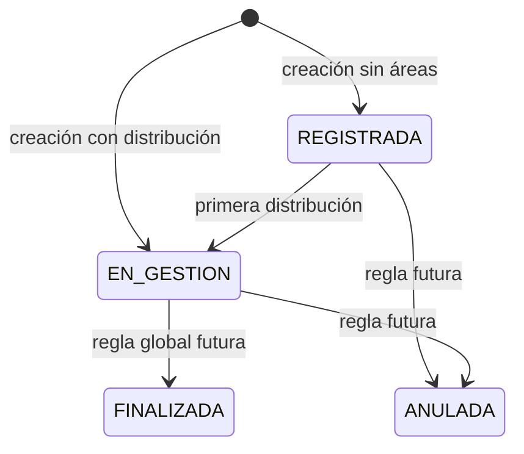
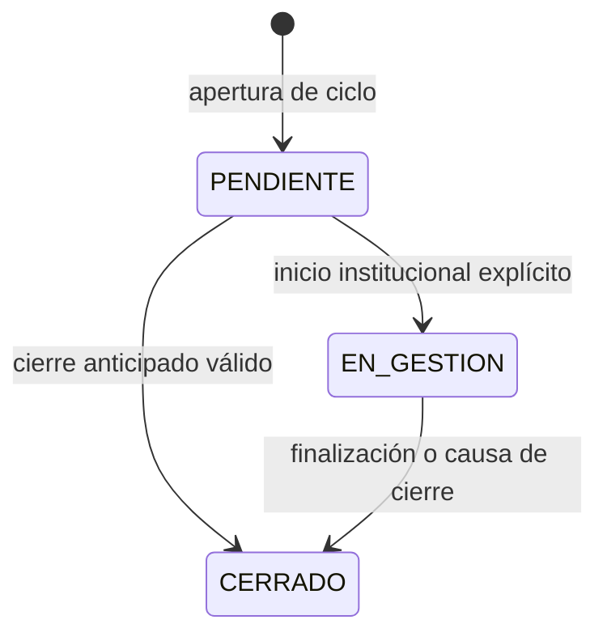
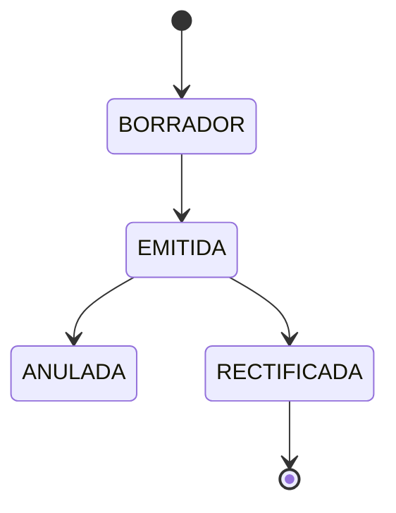

# Estados y transiciones

## Regla principal

Solicitud, período, participantes, respuestas y notificaciones tienen ciclos de vida distintos. Ningún estado debe usarse como sustituto de otro.

## Matriz de dimensiones

| Dimensión | Estado persistido | Qué NO significa |
|---|---|---|
| Solicitud | `REGISTRADA`, `EN_GESTION`, `FINALIZADA`, `ANULADA` | No indica qué área trabaja. |
| Período | `PENDIENTE`, `EN_GESTION`, `CERRADO` | No indica cantidad de participantes ni respuesta. |
| Participante | Activo si `fecha_fin IS NULL` | No define el estado del período. |
| Respuesta | `BORRADOR`, `EMITIDA`, `ANULADA`, `RECTIFICADA` | `EMITIDA` no equivale a período cerrado. |
| Notificación individual | Timestamps de interacción | Ver/abrir no equivale a tomar. |

## Solicitud

| Transición | Disparador | Efectos obligatorios |
|---|---|---|
| `null -> REGISTRADA` | Crear sin áreas | Historial global. |
| `null -> EN_GESTION` | Crear con áreas | `fecha_inicio_gestion`, historial global. |
| `REGISTRADA -> EN_GESTION` | Primera incorporación | `fecha_inicio_gestion` una sola vez, historial. |
| `EN_GESTION -> FINALIZADA` | Futuro | Regla aún no definida. |
| `* -> ANULADA` | Futuro | Política global aún no definida. |

**Inválido:** usar `DERIVADO` como estado global porque un área incorporó otra. No existe transferencia normal.

## Período

### Transiciones válidas

| Desde | Hacia | Condición |
|---|---|---|
| `null` | `PENDIENTE` | Creación del período. |
| `PENDIENTE` | `EN_GESTION` | Acción institucional explícita. |
| `PENDIENTE` | `CERRADO` | Error, retiro, rechazo, anulación o finalización sin gestión previa permitida. |
| `EN_GESTION` | `CERRADO` | Cierre por causa explícita. |

### Transiciones inválidas

| Transición | Motivo |
|---|---|
| `CERRADO -> PENDIENTE` | Un período histórico nunca se reabre. |
| `CERRADO -> EN_GESTION` | El reingreso crea otro ciclo. |
| `EN_GESTION -> PENDIENTE` | Sería regresión histórica; no se infiere por retiro de usuarios. |
| Cambio por PATCH genérico | Debe pasar por caso de uso transaccional con historial. |

### Historial obligatorio

Toda transición inserta `SolicitudAsignacionPeriodoEstadoHistorial` con:

- `estado_anterior` y `estado_nuevo`;
- `fecha_cambio` de negocio;
- `cambiado_por`, nullable para sistema/Legacy;
- `motivo`;
- `origen`.

El update del snapshot y el insert del historial deben estar en la misma transacción.

## Tipos de cierre

| Tipo | Semántica |
|---|---|
| `FINALIZADO` | El área concluyó correctamente su intervención. |
| `RETIRADO` | La participación válida dejó de ser necesaria. |
| `RECHAZADO` | El área determinó que no corresponde atender. |
| `ANULADO` | El ciclo fue invalidado administrativamente. |
| `ASIGNACION_ERRONEA` | El área fue incorporada por error; luego se incorpora la correcta. |
| `CAMBIO_PARTICIPACION` | El área continúa en un ciclo nuevo con otro tipo. |

**Actual heredado:** existe `DERIVADO`, pero no corresponde al flujo objetivo normal. Debe considerarse legado/no utilizable mientras no exista una necesidad nueva confirmada.

## Participantes

No hay enum de estado necesario:

| Condición | Interpretación |
|---|---|
| `fecha_fin IS NULL` | Participación activa. |
| `fecha_fin IS NOT NULL` | Participación terminada. |

Retirar al último usuario no mueve el período a `PENDIENTE`. Tomar al primer usuario no lo mueve automáticamente a `EN_GESTION`.

## Respuestas

**Recomendación:** `RECTIFICADA` es terminal para esa fila. La respuesta corregida se crea como otra fila con su propia versión, normalmente desde `BORRADOR` hasta `EMITIDA`; nunca se reactiva la misma respuesta rectificada ni se sobrescribe evidencia formal.

## Notificaciones

La notificación institucional es un evento. Las métricas fiables viven principalmente en `NotificacionUsuario`:

| Evento | Campo | Efecto colateral prohibido |
|---|---|---|
| Vista individual | `vista_at` | No tomar período. |
| Navegación al detalle | `abierta_at` | No iniciar gestión. |
| Descarte individual | `descartada_at` | No cerrar período. |

El `estado` agregado actual de `Notificacion` no debe marcarse `LEIDA` porque un solo usuario la vio si la notificación sigue siendo institucional del área.

## Combinaciones válidas

| Período | Usuarios activos | Respuesta emitida | Válido |
|---|---:|---:|---|
| `PENDIENTE` | 0 | No | Sí. |
| `PENDIENTE` | 2 | No | Sí; la toma no mueve estado automáticamente. |
| `EN_GESTION` | 0 | No | Sí. |
| `EN_GESTION` | 3 | Sí | Sí; responder no cierra. |
| `CERRADO` | 0 | No | Sí cuando la regla específica no exige respuesta. |
| `CERRADO` | 0 | Sí | Sí. |

## Diferencias con la implementación actual

- `Solicitud.estado` aún no contiene `REGISTRADA`, `FINALIZADA` ni `ANULADA`.
- `SolicitudEstadoHistorial` usa otro catálogo de estados.
- `SolicitudAsignacionPeriodo.estado` aún usa `ABIERTO/CERRADO`.
- El historial operativo existe, pero no actualiza un snapshot del período ni se crea automáticamente.
- `AUTOASIGNACION` existe como origen de historial, pero el objetivo no obliga a que tomar cambie el estado.

Siguiente lectura: [06. Notificaciones y auditoría](06-notificaciones-y-auditoria.md).
