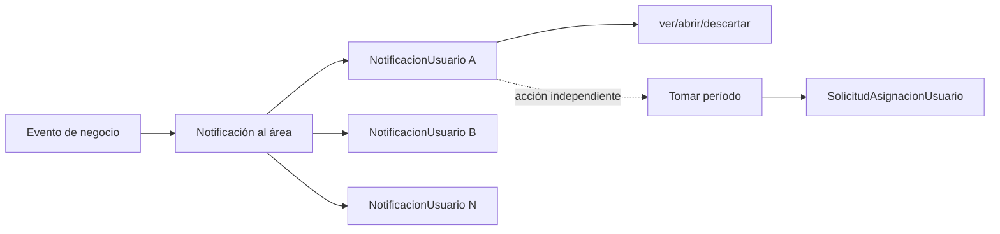

# Notificaciones y auditoría

## Modelo mental



La rama de comunicación termina en timestamps individuales. La rama de responsabilidad comienza en la participación del período.

## Notificación institucional

`Notificacion.area` identifica al destinatario institucional. `solicitud`, `asignacion` y `periodo` aportan contexto navegable; `generada_por` y `fecha_evento` preservan actor y fecha de negocio.

**Objetivo confirmado:** una notificación no se reasigna a un usuario. Los usuarios son consumidores individualizados del evento del área.

**Recomendación:** una vez creada, no editar título, mensaje, área ni contexto. Si el hecho cambia, emitir otro evento.

## Materialización de destinatarios

Al generar el evento:

1. Consultar afiliaciones vigentes `AsignacionUsuario` del área en la fecha del evento.
2. Insertar una fila `NotificacionUsuario` por usuario elegible.
3. Conservar esas filas aunque luego cambie la afiliación del usuario.
4. No añadir retroactivamente usuarios que ingresaron al área después del evento.

Esto permite responder quién tuvo oportunidad real de ver el aviso.

**Actual:** solo se inserta `Notificacion`; no se materializan destinatarios.

## Semántica de timestamps

| Campo | Momento exacto | Política de reintento |
|---|---|---|
| `vista_at` | El usuario despliega individualmente la notificación. | Guardar la primera fecha. |
| `abierta_at` | El usuario navega al detalle operativo. | Guardar la primera fecha. |
| `descartada_at` | El usuario retira el aviso de su vista personal. | Guardar la primera fecha. |

Un GET de listado o detalle no debe modificar estos campos. La acción explícita evita métricas falsas por polling, precarga o refetch.

## Bandeja de área e individualización

La bandeja institucional se compone de notificaciones del área, pero la respuesta para el usuario debe incluir su relación individual:

- estado de vista/apertura/descarte del actor;
- contexto de solicitud, asignación y período;
- si el período continúa activo;
- si el actor ya tiene participación abierta, calculado desde `SolicitudAsignacionUsuario`.

No debe existir un booleano «tomada» en `NotificacionUsuario`.

## Eventos mínimos

| Evento | Contexto mínimo | Destinatario |
|---|---|---|
| Nueva distribución | solicitud, asignación, período | Área incorporada. |
| Reincorporación | solicitud, asignación, nuevo período | Área reincorporada. |
| Cambio de participación | solicitud, asignación, nuevo período | Misma área. |
| Asignación corregida | solicitud, asignación/período correcto | Área correcta. |
| Respuesta emitida | solicitud, período, respuesta | Futuro consumidor definido. |
| Comentario/mención | solicitud y comentario | Futuro. |

No se define un evento de devolución porque ese flujo no existe en el objetivo confirmado.

## Línea temporal auditable

```mermaid
timeline
    title Ejemplo de intervención de área
    09:00 : Período PENDIENTE
          : Notificación creada
    09:04 : Pedro ve notificación
    09:07 : Ana abre detalle
    09:12 : Ana toma el período
    09:20 : Área inicia EN_GESTION
    13:45 : Área emite respuesta por Ana
    14:00 : Período CERRADO FINALIZADO
```

Cada punto proviene de una tabla distinta y no debe reconstruirse a partir de un único estado.

## Métricas derivables

| Métrica | Fuentes |
|---|---|
| Tiempo hasta primera vista del área | `MIN(vista_at) - fecha_evento`. |
| Tiempo hasta primera toma | primera `SolicitudAsignacionUsuario.fecha_inicio - Periodo.fecha_inicio`. |
| Vista a toma individual | participación del usuario menos su `vista_at`. |
| Tiempo por estado institucional | diferencias entre filas del historial del período. |
| Tiempo hasta respuesta | `fecha_emision - fecha_inicio`. |
| Duración del ciclo | `fecha_fin - fecha_inicio`. |
| Reingresos | cantidad de períodos menos uno por asignación. |
| Asignaciones erróneas | cierres `ASIGNACION_ERRONEA`. |

## Interpretación responsable

- Una notificación no vista por todos no implica incumplimiento.
- La primera reacción del área suele ser más útil que una tasa individual aislada.
- Los tiempos calendario no equivalen a tiempos laborales.
- No crear todavía tablas agregadas de métricas; derivar de hechos transaccionales.

## Auditoría funcional y técnica

| Mecanismo | Propósito |
|---|---|
| Historial global de solicitud | Transiciones del trámite. |
| Historial de período | Transiciones institucionales y tiempos. |
| Participaciones de usuario | Quién trabajó y durante qué intervalo. |
| Respuestas/versiones | Qué resultado formal se emitió. |
| NotificacionUsuario | Quién recibió oportunidad y cómo interactuó. |
| `django-simple-history` | Cambios técnicos de filas seleccionadas. |

La auditoría técnica no reemplaza eventos funcionales consultables.

Siguiente lectura: [07. Páginas, bandejas y endpoints](07-paginas-bandejas-y-endpoints.md).
