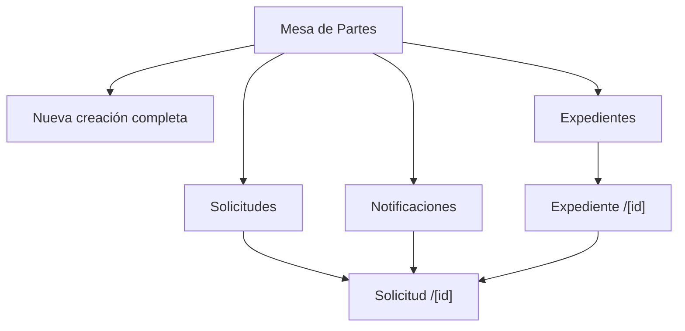
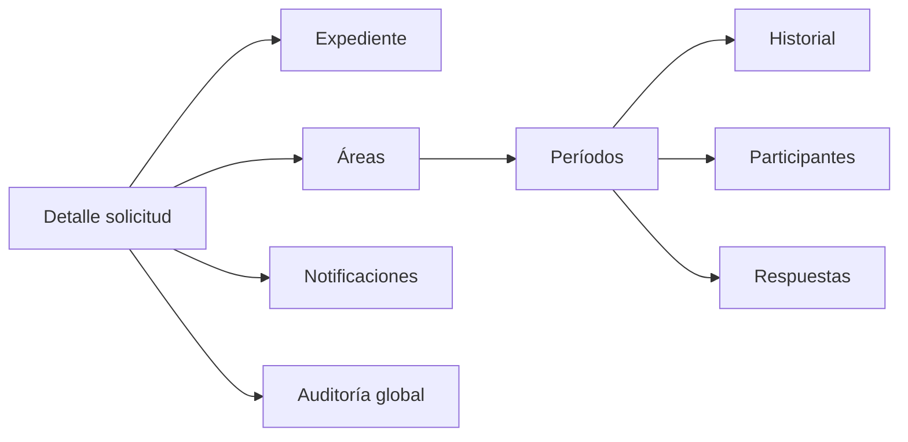

# Páginas, bandejas y endpoints

## Resumen

Expedientes necesitan consulta y detalle, pero no son la bandeja operativa prioritaria. Solicitudes y notificaciones sí requieren listados paginados, filtros y rutas de detalle.

## Estado actual del frontend

**Actual:** no existen páginas, features, hooks o schemas frontend para Mesa de Partes. El `frontend/src/app` contiene autenticación, proyectos y liquidaciones, pero no rutas de expedientes, solicitudes o notificaciones.

**Objetivo confirmado:** construir la experiencia sin confundir el término «expediente» usado como texto en liquidaciones con la entidad nueva de `tramites.Expediente`.

## Mapa objetivo de páginas

| Ruta frontend objetivo | Propósito | Prioridad |
|---|---|---|
| `/mesa-de-partes/nueva` | Creación completa prioritaria. | Alta |
| `/solicitudes` | Bandeja operativa paginada. | Alta |
| `/solicitudes/[id]` | Detalle integral y acciones. | Alta |
| `/notificaciones` | Bandeja de avisos del área con estado individual. | Alta |
| `/notificaciones/[id]` | Vista del aviso o redirección controlada al detalle. | Alta |
| `/expedientes` | Listado/consulta documental. | Media |
| `/expedientes/[id]` | Detalle documental y enlace a solicitud. | Media |

## Creación completa

Debe guiar al usuario por bloques reconocibles:

1. Interesado: tipo de persona e identificación.
2. Documento: tipo, número, folios, asunto y observaciones.
3. Archivos: un principal y anexos.
4. Antecedentes opcionales.
5. Solicitud: prioridad, fechas opcionales y observación.
6. Distribución: varias áreas, cada una `PRINCIPAL` o `ADJUNTA`, sin duplicados.
7. Confirmación: resumen de filas que se crearán.

El frontend envía una intención única; no encadena llamadas para crear cada tabla.

## Bandeja de solicitudes

### Columnas mínimas

- identificador público del expediente;
- asunto/interesado resumido;
- estado global y prioridad;
- fecha de registro e inicio de gestión;
- áreas activas por tipo;
- conteo de períodos `PENDIENTE`/`EN_GESTION`;
- fecha límite y condición de vencimiento calculada;
- última actividad relevante.

### Filtros funcionales

| Filtro | Fuente |
|---|---|
| `estado` | `Solicitud.estado`. |
| `prioridad` | `Solicitud.prioridad`. |
| `area_id` | Asignación/período. |
| `tipo_participacion` | Período activo. |
| `periodo_estado` | Estado institucional del período. |
| `usuario_id` o `me` | Participación activa/histórica según parámetro. |
| `sin_participantes` | Período activo sin usuarios activos. |
| `con_respuesta` | Existencia/estado de respuesta. |
| `fecha_desde/hasta` | Fecha de negocio definida por contrato del filtro. |
| `busqueda` | ID público, documento, interesado o asunto. |

La API debe documentar si los filtros múltiples se combinan con AND y qué fecha utiliza cada rango.

## Detalle integral de solicitud

El detalle es el centro operativo y consolida:

- solicitud y su historial global;
- expediente, archivos y antecedentes;
- todas las áreas participantes;
- todos los períodos, ordenados por ciclo;
- estado actual e historial de cada período;
- participantes activos e históricos;
- respuestas y versiones;
- notificaciones e interacciones relevantes del actor;
- actor/fecha/motivo de incorporaciones, cambios y cierres;
- resumen calculado, sin inventar un estado global.

Si el payload integral resulta pesado, puede usarse inclusión explícita o subrecursos, pero la UI debe conservar una vista consolidada.

## Bandeja de notificaciones

Debe mostrar eventos del área con la interacción del usuario autenticado:

- no vista, vista, abierta o descartada;
- tipo y fecha del evento;
- solicitud/expediente asociado;
- área y período contextual;
- acceso al detalle;
- indicador separado de si el usuario participa en el período.

Abrir la página de listado no marca automáticamente eventos.

## Listado y detalle de expedientes

El listado documental permite buscar por ID público, año, tipo/número de documento, interesado y asunto. El detalle muestra archivos, antecedentes, fechas, creador y solicitud 1:1 si existe.

No se diseña como bandeja de trabajo por áreas; esa función pertenece a solicitudes.

## Endpoints actuales comprobados

### Convención de rutas

La API real está montada bajo `/api`. Todas las rutas backend de este documento son absolutas e incluyen ese prefijo. En backend, `{id}` representa siempre un UUID; la notación `[id]` se reserva exclusivamente para segmentos dinámicos del frontend.

| Método | Ruta registrada | Estado |
|---|---|---|
| `POST` | `/api/expedientes/crear` | Actual; FormData con expediente y archivos. |
| `POST` | `/api/solicitudes/crear` | Actual; JSON, exige áreas. |
| `POST` | `/api/solicitudes/crear-completo` | Actual; FormData compuesto. |

No existen controllers registrados para asignaciones o notificaciones.

## Catálogo funcional objetivo

El catálogo conserva el estilo actual `/crear` para las operaciones ya existentes y usa acciones de negocio para las capacidades objetivo. La tabla define capacidades, no schemas técnicos monolíticos.

### Creación y consulta

| Método | Ruta funcional | Resultado conceptual |
|---|---|---|
| `POST` | `/api/expedientes/crear` | Expediente con archivos y antecedentes. |
| `GET` | `/api/expedientes` | Página de expedientes. |
| `GET` | `/api/expedientes/{id}` | Detalle documental. |
| `POST` | `/api/solicitudes/crear` | Solicitud sobre expediente, con cero o más áreas. |
| `POST` | `/api/solicitudes/crear-completo` | Expediente + solicitud + distribución. |
| `GET` | `/api/solicitudes` | Página filtrada de solicitudes. |
| `GET` | `/api/solicitudes/{id}` | Detalle integral. |
| `GET` | `/api/solicitudes/{id}/estado-operativo` | Resumen calculado, no nuevo estado persistido. |

### Áreas y períodos

| Método | Ruta funcional | Acción |
|---|---|---|
| `POST` | `/api/solicitudes/{id}/areas` | Incorporar o reincorporar área. |
| `POST` | `/api/periodos/{id}/iniciar-gestion` | Transición explícita a `EN_GESTION`. |
| `POST` | `/api/periodos/{id}/tomar` | Autoasignar al actor. |
| `POST` | `/api/periodos/{id}/usuarios` | Agregar participante. |
| `POST` | `/api/participaciones-usuario/{id}/retirar` | Terminar participación individual. |
| `POST` | `/api/periodos/{id}/finalizar` | Cerrar con `FINALIZADO`. |
| `POST` | `/api/periodos/{id}/marcar-asignacion-erronea` | Cerrar conservando error. |
| `POST` | `/api/periodos/{id}/cambiar-participacion` | Cerrar ciclo y abrir el siguiente. |

No se incluyen endpoints de devolver, transferir o derivar como flujo normal.

### Respuestas

| Método | Ruta funcional | Acción |
|---|---|---|
| `POST` | `/api/periodos/{id}/respuestas` | Crear borrador/versión. |
| `GET` | `/api/periodos/{id}/respuestas` | Consultar respuestas del área/ciclo. |
| `POST` | `/api/respuestas/{id}/emitir` | Emitir sin cerrar período. |
| `POST` | `/api/respuestas/{id}/anular` | Anular respuesta, no período. |
| `POST` | `/api/respuestas/{id}/rectificar` | Marcar la fila como rectificada y crear una nueva versión separada. |

### Notificaciones

| Método | Ruta funcional | Acción |
|---|---|---|
| `GET` | `/api/notificaciones` | Página del área individualizada para el actor. |
| `GET` | `/api/notificaciones/{id}` | Detalle sin efecto lateral. |
| `POST` | `/api/notificaciones/{id}/vista` | Registrar primera vista. |
| `POST` | `/api/notificaciones/{id}/abrir` | Registrar navegación al detalle. |
| `POST` | `/api/notificaciones/{id}/descartar` | Descartar para el actor. |

## Contratos de respuesta funcionales

### Página paginada

El contrato real es `ApiResponse[PaginatedData[T]]`. El objeto `data` contiene exactamente:

| Campo | Significado |
|---|---|
| `items` | Elementos de la página. |
| `total` | Cantidad total de elementos. |
| `page` | Página actual. |
| `page_size` | Tamaño solicitado/aplicado. |
| `total_pages` | Cantidad total de páginas. |

`has_next` y `has_previous` no son campos del contrato actual. Si la interfaz los necesita, se derivan respectivamente de `page < total_pages` y `page > 1`, o se consideran una ampliación futura explícita.

### Resultado de una acción

Debe devolver un snapshot suficiente para actualizar la UI, por ejemplo:

- IDs de entidades afectadas;
- período actualizado y nuevo período si aplica;
- transición registrada;
- resumen operativo vigente;
- errores estandarizados mediante excepciones globales.

No es necesario retornar todos los modelos completos.

## Separación de estado UI

La interfaz puede calcular etiquetas como «sin participantes» o «con respuesta», pero no debe enviarlas como estado institucional ni persistirlas en el período.

Siguiente lectura: [08. Reglas, invariantes y concurrencia](08-reglas-invariantes-y-concurrencia.md).
