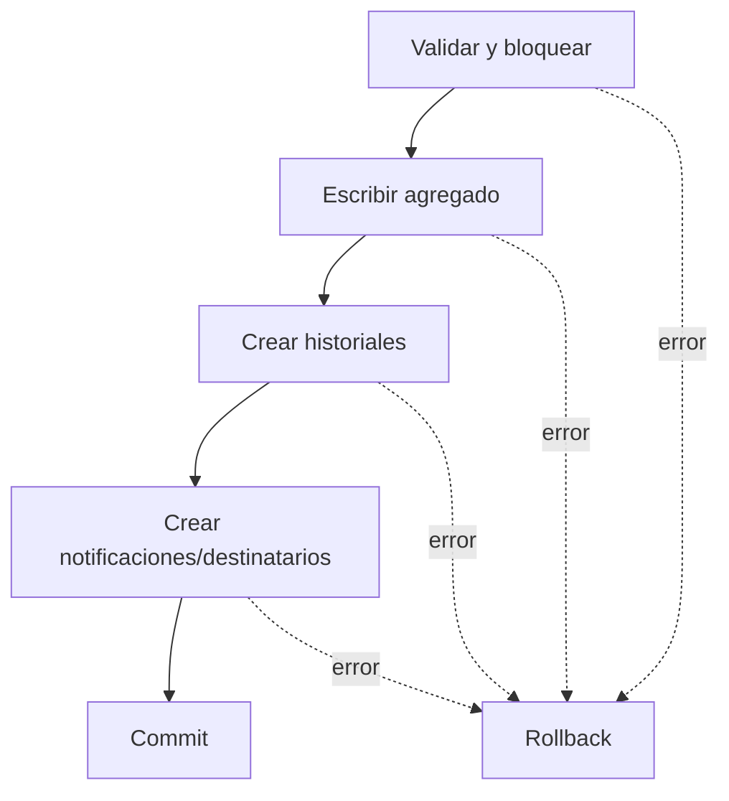

# Reglas, invariantes y concurrencia

## Invariantes de dominio

| Regla | Protección objetivo |
|---|---|
| Un expediente tiene como máximo una solicitud | `OneToOneField`/unique en base. |
| Una solicitud–área tiene una sola asignación estable | Unique `(solicitud, area)`. |
| Una asignación tiene ciclos únicos | Unique `(asignacion, numero_ciclo)`. |
| Una asignación tiene máximo un período no cerrado | Constraint condicional por `fecha_fin IS NULL` o estado no cerrado. |
| Un usuario tiene máximo una participación abierta por período | Unique condicional `(periodo, usuario)` con `fecha_fin IS NULL`. |
| Una notificación tiene una relación por usuario | Unique `(notificacion, usuario)`. |
| Un expediente tiene exactamente un archivo principal | Constraint condicional o flujo transaccional más validación. |
| Un período cerrado tiene fecha, causa y actor | Check constraint donde sea viable + validación de negocio. |
| Un período abierto no tiene fecha/tipo de cierre | Check constraint. |
| Cada transición actualiza snapshot y crea historial | Servicio transaccional único. |

## Invariantes semánticas

- `SolicitudAsignacion` no es estado actual; la actividad se determina por el período vigente.
- `tipo_participacion` autoritativo pertenece al período.
- Un período cerrado es inmutable funcionalmente.
- Incorporar un área no modifica períodos de otras áreas.
- Respuesta, participantes y estado institucional son independientes.
- Una notificación vista no implica participación.
- Finalizar un período no finaliza la solicitud.
- No se borra historial para corregir errores.
- No se crea `SolicitudDerivacion` para distribución, incorporación o corrección.

## Atomicidad por caso de uso

Deben ser atómicas como mínimo:

- expediente + archivos + antecedentes;
- creación completa;
- solicitud + distribución;
- primera distribución de solicitud registrada;
- incorporación/reingreso;
- transición de estado + historial;
- cambio de participación;
- cierre por asignación errónea más área correcta si se expone como macro;
- emisión/versionado de respuesta cuando afecte varias filas;
- finalización de período y cierre de participaciones si esa política se confirma.

Según el contrato arquitectónico, `transaction.atomic()` vive en la capa de flujo, no en controllers ni en servicios core individuales.

## Riesgos de concurrencia

### Numeración anual de expediente

**Actual:** `MAX(numero)+1` permite que dos transacciones obtengan el mismo número.

**Recomendación:** constraint único por año/número con estrategia de secuencia o bloqueo y reintento. Como el año se deriva de fecha, puede requerir campo de año, constraint funcional o tabla de secuencias.

### Siguiente ciclo

No calcular solo `COUNT()+1`. Bloquear la asignación, leer `MAX(numero_ciclo)` dentro de la transacción y confiar además en unique.

### Período único abierto

Dos incorporaciones simultáneas pueden abrir dos ciclos. La validación de aplicación sin constraint no basta.

### Toma simultánea

Dos reintentos del mismo usuario no deben crear participaciones abiertas duplicadas. Varios usuarios diferentes sí pueden tomar simultáneamente.

### Transición de estado

Bloquear el período (`select_for_update` o equivalente) y revalidar el último estado antes de actualizar e insertar historial.

### Cierre simultáneo

Dos acciones no deben cerrar el mismo período con causas distintas. La primera confirmada gana; la segunda observa `CERRADO` y retorna conflicto/estado vigente.

### Respuestas y versiones

La numeración de versión requiere unique y serialización para impedir dos versiones iguales.

### Timestamps de notificación

Actualizar solo si el campo es nulo. Dos eventos simultáneos conservan la primera interacción real, no la última.

## Idempotencia

| Operación | Comportamiento seguro de reintento |
|---|---|
| Crear completo | Usar clave idempotente para no duplicar expediente. |
| Incorporar área activa | Conflicto o snapshot actual; no nuevo ciclo. |
| Tomar | Devolver participación existente o conflicto. |
| Retirar usuario | No cambiar la fecha original. |
| Iniciar gestión | No duplicar historial. |
| Finalizar | No crear segundo cierre. |
| Cambiar participación | No crear ciclos adicionales. |
| Emitir respuesta | No mover `fecha_emision` ni duplicar versión. |
| Vista/apertura/descarte | Conservar primer timestamp. |

La API debe elegir de manera uniforme entre respuesta idempotente exitosa y conflicto de negocio. No mezclar convenciones por endpoint.

## Fechas y Legacy

- `fecha_registro`, `fecha_inicio`, `fecha_fin`, `fecha_cambio`, `fecha_evento` y `fecha_emision` son fechas de negocio.
- `created_at` informa cuándo se insertó la fila en la plataforma.
- Los campos de negocio no deben usar `auto_now_add` cuando se requiere migración histórica.
- Validar orden temporal: inicio <= transición <= fin, y `fecha_inicio_gestion >= fecha_registro` salvo importación justificada.

**Brecha actual:** `SolicitudEstadoHistorial.fecha` usa `auto_now_add`.

## Integridad de archivos

Una transacción de base no elimina automáticamente archivos ya escritos en almacenamiento externo al hacer rollback. La implementación debe contemplar limpieza compensatoria o estrategia de carga temporal/promoción después del commit.

## Eliminación y retención

No existe borrado funcional para asignaciones, períodos, participaciones históricas, respuestas emitidas, historiales o notificaciones. Las correcciones se expresan con cierre, anulación, retiro, rectificación o nuevo ciclo.

Las FK actuales usan varios `CASCADE`; antes de habilitar borrados administrativos se debe confirmar que no destruyan auditoría requerida.

## Arquitectura de implementación

- Controller: parsear, delegar, presentar éxito.
- Orchestrator: fachada delgada por endpoint.
- Flujo: caso de uso, validaciones coordinadas y transacción.
- Core: operaciones ORM síncronas reutilizables sin transacción propia.
- Presenter: mapear resultados sin consultar base.
- Excepciones: lanzar errores de dominio/HTTP y dejar respuesta al handler global.
- Schemas: composición, no inflación por endpoint.
- Tests: pytest, Ninja `TestClient`, DB real, fixtures organizadas según el contrato V2.

Siguiente lectura: [09. Fases y pendientes](09-fases-y-pendientes.md).
