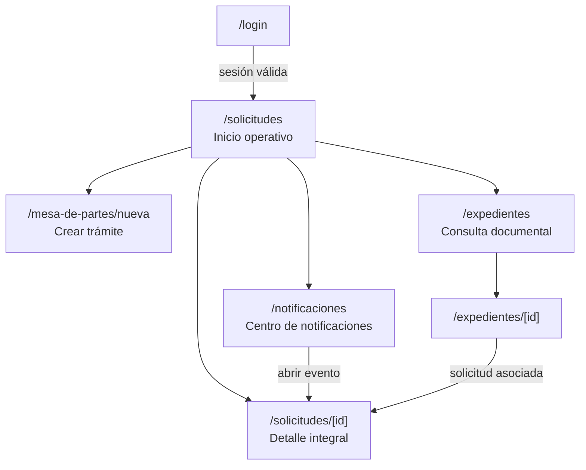

# Guía operativa para construir el frontend de Mesa de Partes

Esta guía organiza la construcción del frontend de Mesa de Partes sobre la arquitectura y el lenguaje visual que ya existen en `frontend/`. Su propósito es permitir que diseño, frontend y backend trabajen con la misma frontera: qué está disponible hoy, qué contrato falta y qué experiencia debe construirse sin simular datos ni endpoints.

## Ruta rápida

1. Lea [Páginas, bandejas y endpoints](07-paginas-bandejas-y-endpoints.md) para validar el catálogo funcional de API.
2. Revise [Bloqueos reales](#bloqueos-reales-para-iniciar) antes de implementar una página conectada.
3. Construya primero la estructura común y el formulario de [Crear trámite](#crear-trámite-mesa-de-partesnueva).
4. Conecte solicitudes, notificaciones y expedientes solo cuando sus endpoints marcados **REQUERIDO** existan.
5. Verifique cada entrega con los [criterios de aceptación](#criterios-de-aceptación).

## Cómo leer esta guía

| Etiqueta | Significado operativo |
|---|---|
| **ACTUAL** | Comportamiento comprobado en frontend, controller, schema o presenter. Puede integrarse, respetando sus brechas documentadas. |
| **OBJETIVO CONFIRMADO** | Comportamiento funcional decidido y obligatorio para esta fase. |
| **REQUERIDO** | Contrato o endpoint objetivo aún ausente. El frontend no debe fingir que existe. |
| **RECOMENDACIÓN UX** | Forma sugerida de presentar el objetivo sin convertirla en una implementación rígida. |
| **FUTURO** | Deliberadamente fuera de esta fase. |

Esta guía no reemplaza:

- [Modelo de datos y tablas](03-modelo-datos-y-tablas.md), para autoridad y campos persistidos;
- [Operaciones y efectos en datos](04-operaciones-y-efectos-en-datos.md), para inserciones, actualizaciones y atomicidad;
- [Estados y transiciones](05-estados-y-transiciones.md), para máquinas de estado independientes;
- [Notificaciones y auditoría](06-notificaciones-y-auditoria.md), para vista, apertura, descarte y toma;
- [Reglas, invariantes y concurrencia](08-reglas-invariantes-y-concurrencia.md), para idempotencia y condiciones de carrera.

## Decisiones que gobiernan el frontend

- Un `Expediente` tiene exactamente una `Solicitud`, salvo el intervalo válido donde se creó solo el expediente.
- Solicitudes es la bandeja operativa principal; expedientes es una consulta documental.
- La fase actual prioriza `POST /api/solicitudes/crear-completo`.
- La creación completa recibe una o más áreas y deja la solicitud en `EN_GESTION`.
- Pueden coexistir múltiples áreas `PRINCIPAL` y `ADJUNTA`; no existe una única área actual.
- El estado de solicitud, el estado de período, los participantes y las respuestas son dimensiones independientes.
- Una notificación pertenece al área. Vista, apertura y descarte son individuales; tomar el período es otra acción.
- No existe devolución o transferencia como flujo normal.
- Roles, permisos, `django-guardian` y `rules` quedan fuera de esta guía.

## Base frontend que debe preservarse

### Arquitectura actual

| Aspecto | Patrón actual que debe reutilizarse |
|---|---|
| Framework | Next.js 16 con App Router y React 19. |
| Rutas autenticadas | Grupo `app/(protected)` con validación de sesión en el layout de servidor. |
| Protección temprana | `src/proxy.ts` verifica la cookie `auth_access_token`. |
| Organización | Feature por dominio con `views`, `components`, `hooks`, `schemas`, `services` o `types` según necesidad real. |
| Datos remotos | Axios compartido en `src/lib/api.ts` y TanStack React Query. |
| Validación | Zod para contratos en runtime y React Hook Form para formularios. |
| Respuestas | `ApiResponse<T>` y schemas Zod compuestos con `apiResponseSchema`. |
| Paginación | Query params `page` y `page_size`; estado de página en hooks; `Pagination` como control visible. |
| Tablas | `AppDataTable` con skeleton, error, reintento, vacío y click de fila. |
| Cards | Superficies `bg-card`, borde suave, radios amplios, badges y jerarquía de datos. |
| Formularios | `GenericForm`, `AppFormModal`, `AppStepperFormModal` y `MultiPartFormStepper`; no crear un motor paralelo. |
| Navegación | `ProtectedSidebar`, overlay móvil y cierre de sesión existente. |
| Lenguaje visual | Plus Jakarta Sans, paleta CIP vino/dorado, iconografía Lucide, `PageHeader`, botones redondeados y foco visible. |

### Restricciones de integración

1. Crear `features/mesa-de-partes` o features cohesionadas para expedientes, solicitudes y notificaciones; no mezclar la entidad `tramites.Expediente` con el texto «expediente» de liquidaciones.
2. Mantener las páginas App Router delgadas: la vista compone; hooks consultan o mutan; schemas validan respuestas.
3. Usar el cliente `api`, que ya aplica base `/api`, JWT, refresh y reintento único ante `401`.
4. Validar en runtime el envelope y el payload. El tipo TypeScript por sí solo no prueba el contrato recibido.
5. No introducir estado global para datos de servidor. React Query mantiene listados, detalles e invalidaciones; Zustand continúa reservado para sesión u otro estado realmente global.
6. Las etiquetas calculadas como «sin participantes» o «con respuesta» son presentación, no estados que deban enviarse al backend.

## Login y redirección inicial

### Flujo actual

1. `/login` muestra el formulario de usuario y contraseña.
2. El frontend envía JSON a `POST /api/auth/login/username` con `username` y `password`.
3. La respuesta trae `access_token`, `refresh_token`, `expires_at` y `user` dentro de `ApiResponse`.
4. El cliente persiste cookies y actualiza el store de autenticación.
5. **ACTUAL:** el login, `/` y el proxy redirigen a `/liquidaciones`.
6. El layout protegido valida `getUserSession()` y redirige a `/login` si no existe sesión.

### Objetivo de Mesa de Partes

**OBJETIVO CONFIRMADO:** cuando Mesa de Partes sea la entrada operativa de esta fase, el destino autenticado debe ser `/solicitudes`. La misma decisión debe aplicarse de forma coherente en:

- envío exitoso del login;
- visita a `/` con sesión;
- visita a `/login` con token válido.

La guía no exige eliminar Liquidaciones. El sidebar debe incorporar un grupo «Mesa de Partes» y conservar los módulos actuales.

## Mapa de navegación



## Inventario de páginas y rutas

| Ruta frontend | Estado actual | Objetivo | Prioridad |
|---|---|---|---|
| `/login` | **ACTUAL** | Conservar UI y autenticación; cambiar destino inicial cuando se active Mesa de Partes. | Alta, base existente |
| `/` | **ACTUAL** redirige a `/liquidaciones` o `/login` | Redirigir usuarios autenticados a `/solicitudes`. | Alta |
| `/solicitudes` | Ausente | Bandeja operativa inicial, paginada y filtrable. | Alta |
| `/solicitudes/[id]` | Ausente | Detalle consolidado y centro de acciones de la solicitud. | Alta |
| `/mesa-de-partes/nueva` | Ausente | Formulario principal de creación completa. | Alta |
| `/notificaciones` | Ausente | Bandeja del área individualizada para el usuario. | Alta |
| `/notificaciones/[id]` | Ausente | Resolver el aviso y redirigir controladamente al detalle relacionado. | Alta |
| `/expedientes` | Ausente | Listado paginado de consulta documental. | Media |
| `/expedientes/[id]` | Ausente | Detalle del ingreso, archivos, antecedentes y solicitud asociada. | Media |

## Vista inicial operativa: `/solicitudes`

**OBJETIVO CONFIRMADO:** solicitudes es la página inicial después del login. No se construye un dashboard de métricas sin contratos; la primera versión es una bandeja útil y verificable.

### Estructura visible

1. `PageHeader` con título «Solicitudes», descripción breve y acción principal «Crear trámite».
2. Búsqueda visible por ID público, documento, interesado o asunto.
3. Botón «Filtros» con contador y chips removibles para filtros activos.
4. Resumen textual de resultados, no métricas inventadas.
5. Tabla en escritorio y cards equivalentes en móvil.
6. Paginación basada en `total`, `page`, `page_size` y `total_pages`.

### Orden recomendado

- prioridad `URGENTE`, `ALTA`, `MEDIA`, `BAJA` solo si el backend expone orden estable;
- dentro del orden elegido, actividad o registro más reciente primero;
- la UI no debe reordenar solo la página y hacer parecer que ordenó el universo completo.

### Acciones

- Acción primaria por fila/card: «Ver solicitud».
- «Crear trámite» navega a `/mesa-de-partes/nueva`.
- Las futuras acciones de período aparecen únicamente en el detalle y solo cuando el endpoint existe.
- No mostrar «Transferir», «Devolver» ni una acción global de «Finalizar solicitud».

## Consulta de expedientes: `/expedientes`

**OBJETIVO CONFIRMADO:** es un listado paginado de consulta, no una bandeja priorizada por trabajo.

### Filtros y columnas

| Elemento | Contenido funcional |
|---|---|
| Búsqueda | `id_publico`, documento, interesado o asunto. |
| Año | Año de `fecha_registro` o convención que confirme el endpoint. |
| Tipo de documento | Valores reales de `TipoDocumento`. |
| Identificación | DNI, RUC o CIP según `tipo_persona`. |
| Registro | Fecha de negocio del expediente. |
| Solicitud | Indicador y acceso si la relación 1:1 ya existe. |

### Fila o card de expediente

Debe reconocer el registro sin abrirlo:

- `id_publico` como identificador principal;
- asunto en una o dos líneas;
- nombre completo o razón social;
- tipo y número de documento;
- fecha de registro;
- número de folios;
- badge de tipo de persona;
- estado relacional «Con solicitud» o «Sin solicitud», sin inventar estado propio del expediente;
- acción «Ver expediente» y, si existe relación, acceso «Ver solicitud».

**RECOMENDACIÓN UX:** use tabla para densidad en escritorio y una card de encabezado compacto en móvil. El color no debe ser la única forma de expresar el estado relacional.

## Detalle de expediente: `/expedientes/[id]`

### Encabezado

- `id_publico`, asunto y fecha de registro;
- persona/interesado y contacto;
- documento recibido y folios;
- creador cuando el contrato de detalle lo exponga;
- enlace a la solicitud 1:1 si existe.

### Secciones

| Sección | Contenido |
|---|---|
| Interesado | Tipo de persona, DNI/RUC/CIP, nombres/apellidos o razón social, correo y teléfono. |
| Documento | Tipo, número, folios, asunto y observaciones. |
| Archivos | Un principal objetivo y anexos, con nombre original, tipo y acción segura de descarga/visualización. |
| Antecedentes | Vínculos y categoría cuando el endpoint objetivo los incluya. |
| Solicitud asociada | Estado global, prioridad y enlace; no duplicar el detalle integral. |

**REQUERIDO:** `GET /api/expedientes/{id}`. El `ExpedienteOut` actual pertenece a creación y no constituye este endpoint de detalle; además, el presenter actual no llena `archivos`, aunque el schema los declare.

## Bandeja de solicitudes: `/solicitudes`

### Filtros

| Filtro | Semántica |
|---|---|
| `busqueda` | ID público, documento, interesado o asunto. |
| `estado` | Estado global de `Solicitud`. |
| `prioridad` | `BAJA`, `MEDIA`, `ALTA`, `URGENTE`. |
| `area_id` | Área con asignación/período según contrato de consulta. |
| `tipo_participacion` | `PRINCIPAL` o `ADJUNTA` del período activo. |
| `periodo_estado` | Estado institucional del período. |
| `usuario_id` o `me` | Participación activa o histórica, según parámetro explícito. |
| `sin_participantes` | Período activo sin participación abierta. |
| `con_respuesta` | Existencia o estado de respuesta según contrato. |
| `fecha_desde`, `fecha_hasta` | Rango sobre la fecha de negocio que el endpoint documente. |

Los filtros combinados deben usar la semántica AND que confirme la API. Cambiar filtros o `page_size` vuelve a página 1. La URL debe conservar filtros útiles para recarga y navegación hacia atrás cuando el equipo implemente esa sincronización.

### Fila o card de solicitud

- ID público del expediente como referencia principal;
- asunto e interesado resumidos;
- estado global de solicitud y prioridad como badges con texto;
- fecha de registro y, cuando exista, fecha de inicio de gestión;
- áreas activas agrupadas visualmente por `PRINCIPAL` y `ADJUNTA`;
- conteos separados de períodos `PENDIENTE` y `EN_GESTION`;
- fecha límite y condición calculada solo si la API provee datos suficientes;
- última actividad relevante con su fecha;
- indicador «Participo» separado del estado de notificación;
- acción primaria «Ver solicitud».

No mostrar una única «área actual», ni derivar el estado global desde conteos de períodos.

## Detalle de solicitud: `/solicitudes/[id]`

**OBJETIVO CONFIRMADO:** es el centro operativo consolidado.

### Jerarquía de información

1. Encabezado: ID público, asunto, estado global, prioridad, fechas y acción de volver a la bandeja.
2. Resumen del expediente: interesado, documento, archivos y enlace al detalle documental.
3. Áreas participantes: agrupación visual por asignación estable.
4. Períodos de cada área: ciclo, tipo, estado institucional, fechas y tipo de cierre.
5. Participantes: activos e históricos con inicio, fin y actor.
6. Respuestas: borradores/versiones/emitidas sin confundirlas con cierre.
7. Historial: global y por período, con actor, fecha, motivo y origen.
8. Notificaciones relacionadas e interacción del actor.

### Presentación recomendada

- Encabezado y resumen siempre visibles.
- Tabs o secciones ancladas para «Áreas», «Historial», «Respuestas» y «Notificaciones» cuando el volumen lo justifique.
- Cada área usa una card; sus períodos aparecen como una línea temporal o acordeón ordenado por `numero_ciclo`.
- Un período muestra tres bloques separados: estado institucional, participantes y respuestas.
- Acciones contextuales viven junto al período afectado, no en un menú global ambiguo.

### Acciones objetivo, todas requeridas

| Acción | Endpoint **REQUERIDO** | Regla UI mínima |
|---|---|---|
| Incorporar/reincorporar área | `POST /api/solicitudes/{id}/areas` | No cerrar otras áreas. |
| Iniciar gestión | `POST /api/periodos/{id}/iniciar-gestion` | Solo desde `PENDIENTE`. |
| Tomar | `POST /api/periodos/{id}/tomar` | No marcar notificación ni cambiar estado automáticamente. |
| Agregar participante | `POST /api/periodos/{id}/usuarios` | Admitir varios usuarios. |
| Retirar participante | `POST /api/participaciones-usuario/{id}/retirar` | No cerrar el período. |
| Crear respuesta | `POST /api/periodos/{id}/respuestas` | No finalizar al emitir. |
| Emitir respuesta | `POST /api/respuestas/{id}/emitir` | Mantener estado de período. |
| Finalizar período | `POST /api/periodos/{id}/finalizar` | No finalizar solicitud. |
| Marcar asignación errónea | `POST /api/periodos/{id}/marcar-asignacion-erronea` | Conservar historial. |
| Cambiar participación | `POST /api/periodos/{id}/cambiar-participacion` | Cerrar ciclo y abrir otro. |

No habilitar una acción solo porque el frontend cree que corresponde. Primero debe existir el endpoint y el snapshot de respuesta suficiente para invalidar o actualizar las queries correctas.

## Centro de notificaciones: `/notificaciones`

### Bandeja

Cada fila o card debe incluir:

- título y tipo del evento;
- fecha del evento;
- área destinataria;
- ID público y asunto resumido;
- período contextual y si sigue activo;
- estado individual: «No vista», «Vista», «Abierta» o «Descartada»;
- indicador independiente «Participas» o «No participas»;
- acción «Abrir solicitud».

### Reglas de interacción

1. Cargar el listado no registra vista.
2. Mostrar deliberadamente una notificación puede llamar `POST /api/notificaciones/{id}/vista` una sola vez.
3. Navegar desde el aviso al detalle llama `POST /api/notificaciones/{id}/abrir` y luego abre `/solicitudes/[id]`.
4. Descartar llama `POST /api/notificaciones/{id}/descartar` y solo afecta al usuario.
5. Tomar se ejecuta desde el período con `POST /api/periodos/{id}/tomar`; nunca se representa como estado de `NotificacionUsuario`.
6. Los timestamps conservan la primera interacción; reintentar no debe moverlos.

La ruta `/notificaciones/[id]` puede resolver el evento y redirigir al detalle asociado. No necesita duplicar toda la solicitud si no aporta una tarea propia.

## Crear trámite: `/mesa-de-partes/nueva`

### Resultado esperado

Una confirmación exitosa crea, como unidad de negocio:

- un expediente;
- sus archivos principal y anexos;
- una solicitud en `EN_GESTION`;
- una asignación y un período inicial por área;
- historial global y notificaciones según la implementación actual;
- en el objetivo completo, historial inicial del período y destinatarios individuales.

El detalle transaccional y las brechas de esas escrituras están en [Operación 3: Creación completa](04-operaciones-y-efectos-en-datos.md#3-creación-completa).

### Forma de presentación

**RECOMENDACIÓN UX:** usar una página de ancho controlado con stepper persistente, no un modal pequeño. Puede reutilizar la semántica y los componentes de `AppStepperFormModal` o `MultiPartFormStepper`, adaptando el shell a una ruta completa. El volumen, la carga de archivos y la confirmación justifican una página dedicada.

### Pasos

#### 1. Interesado

| Campo | Regla real del payload |
|---|---|
| `tipo_persona` | Obligatorio: `NATURAL`, `JURIDICA`, `COLEGIADO`. |
| `dni` | Opcional en schema; 8 caracteres. La UI lo exige para `NATURAL`. |
| `ruc` | Opcional en schema; 11 caracteres. La UI lo exige para `JURIDICA`. |
| `cip` | Opcional; máximo 20. La UI lo exige para `COLEGIADO` si esa es la regla funcional validada. |
| `razon_social` | Opcional en schema; máximo 255. La UI lo exige para `JURIDICA`. |
| `nombres`, `apellidos` | Opcionales en schema; máximo 150 cada uno. La UI los exige para persona natural/colegiada según negocio. |
| `correo` | Opcional; validar formato antes de enviar. |
| `telefono` | Opcional; máximo 20. |

Al cambiar `tipo_persona`, mostrar solo identificadores pertinentes y limpiar valores incompatibles antes de confirmar.

#### 2. Documento

| Campo | Regla real del payload |
|---|---|
| `tipo_documento` | Obligatorio: `OFICIO`, `CARTA`, `SOLICITUD`, `MEMORANDO`, `INFORME`, `EXPEDIENTE`, `RECIBO`, `CERTIFICADO`, `OTRO`. |
| `numero_documento` | Opcional; máximo 50. |
| `numero_folios` | Entero mayor o igual a 0; valor actual por defecto 0. |
| `asunto` | Obligatorio y no vacío. |
| `observaciones` | Opcional; pertenece al expediente. |

#### 3. Archivos

- Un archivo principal obligatorio por decisión funcional.
- Cero o más anexos.
- Cada entrada contiene `tipo_archivo`, `nombre_original`, `descripcion` opcional y `archivo`.
- Permitir quitar y reemplazar antes del envío.
- Mostrar nombre, tamaño y tipo; validar límites cuando el backend los defina.
- No afirmar que el rollback de base elimina archivos del storage externo.

**Brecha actual:** el schema admite cero o varios principales. La UI debe exigir exactamente uno, pero la protección definitiva también corresponde al backend.

#### 4. Solicitud

| Campo | Regla real del payload |
|---|---|
| `prioridad` | `BAJA`, `MEDIA`, `ALTA`, `URGENTE`; valor por defecto `MEDIA`. |
| `observacion` | Opcional; pertenece a la solicitud, no al expediente. |

`fecha_registro`, `fecha_inicio_gestion` y `fecha_limite` no forman parte del payload actual de creación completa. No enviarlas como campos inventados. Si se muestran como objetivo futuro, deben quedar deshabilitadas y explicar «Requiere ampliación del contrato».

#### 5. Áreas

- Seleccionar una o más áreas activas.
- Cada fila contiene `area_id`, `tipo_participacion` y `observacion` opcional.
- `tipo_participacion` admite exactamente `PRINCIPAL` o `ADJUNTA`.
- Impedir la misma `area_id` dos veces.
- Admitir varias `PRINCIPAL` y varias `ADJUNTA`.
- No solicitar área origen, transferencia, devolución ni responsable único.

**Bloqueo actual:** no existe un controller registrado para listar áreas. La ruta de catálogo tampoco está definida en el documento 07. El selector no debe usar IDs hardcodeados; backend y frontend deben acordar primero un endpoint de áreas activas y su schema mínimo (`id`, `nombre`, `descripcion`, `activo`).

#### 6. Antecedentes

Los antecedentes son un objetivo confirmado del expediente, pero `SolicitudHibridaCreateIn` no los recibe y el flujo actual no los crea.

**Estado `partial-disabled`:** conservar el bloque fuera del camino crítico o mostrarlo deshabilitado con la explicación «Disponible cuando el contrato de creación incluya antecedentes». No enviar un campo desconocido.

#### 7. Resumen y confirmación

Mostrar antes de enviar:

- interesado e identificación;
- documento, folios y asunto;
- archivo principal y cantidad de anexos;
- prioridad y observación de solicitud;
- áreas agrupadas por `PRINCIPAL` y `ADJUNTA`;
- resultado esperado: expediente + solicitud `EN_GESTION` + distribución inicial.

La confirmación debe permitir volver a cualquier paso sin perder datos.

#### 8. Envío y resultado

- Bloquear navegación, cierre accidental y segundo submit mientras se envía.
- Mantener un texto anunciable «Creando trámite…».
- En éxito, mostrar `id_publico`, estado, prioridad y acciones «Ver solicitud» y «Ver expediente».
- No depender de `asignaciones` en la respuesta actual: el presenter no las llena aunque el schema las declare.
- En error de validación, conservar los datos y enfocar el primer campo inválido.
- En timeout o error de red después de enviar, no reintentar automáticamente: hoy no existe una clave idempotente confirmada y el registro podría haberse creado.

### Secuencia completa

```mermaid
sequenceDiagram
    actor U as Usuario
    participant F as Frontend
    participant C as POST /api/solicitudes/crear-completo
    participant DB as Base de datos
    participant ST as Storage

    U->>F: Completa pasos y confirma
    F->>F: Valida campos, un principal y áreas únicas
    F->>F: Construye FormData: data + files
    F->>C: multipart/form-data autenticado
    C->>DB: Crea expediente y solicitud
    C->>ST: Guarda principal y anexos
    C->>DB: Crea historial, asignaciones, períodos y notificaciones
    alt éxito
        C-->>F: ApiResponse[SolicitudOut]
        F-->>U: Resultado y enlaces de detalle
    else validación o conflicto
        C-->>F: ApiResponse con error
        F-->>U: Conserva formulario y muestra corrección
    else timeout ambiguo
        F-->>U: No reintenta automáticamente; solicita verificar
    end
```

## Payload real de creación completa

### Transporte

`POST /api/solicitudes/crear-completo` es **ACTUAL** y usa `multipart/form-data` estricto compuesto por:

| Parte | Contenido |
|---|---|
| `data` | String JSON validado como `SolicitudHibridaCreateIn`. |
| `files` | Lista de archivos; cada nombre multipart sigue `token___nombre_real.ext`. |

No recibe JSON crudo. No usa composición `AsForm`. El controller declara `Form[DataForm]` y `File[list[UploadedFile]]`, y `parse_form_json` hidrata los tokens del JSON con los archivos.

El helper frontend `buildApiPayload` ya implementa esta convención: reemplaza cada `File` por un token `file_<uuid>`, agrega el JSON en `data` y adjunta cada archivo bajo `files`.

### Estructura lógica antes de tokenizar archivos

```json
{
  "prioridad": "MEDIA",
  "observacion": "Contexto general de la solicitud",
  "areas_distribucion": [
    {
      "area_id": "00000000-0000-0000-0000-000000000000",
      "tipo_participacion": "PRINCIPAL",
      "observacion": "Revisión principal"
    },
    {
      "area_id": "11111111-1111-1111-1111-111111111111",
      "tipo_participacion": "ADJUNTA",
      "observacion": null
    }
  ],
  "expediente": {
    "tipo_persona": "NATURAL",
    "dni": "12345678",
    "ruc": null,
    "cip": null,
    "razon_social": null,
    "nombres": "Nombre",
    "apellidos": "Apellidos",
    "correo": "persona@example.com",
    "telefono": "999999999",
    "tipo_documento": "SOLICITUD",
    "numero_documento": "DOC-001",
    "numero_folios": 12,
    "asunto": "Asunto del trámite",
    "observaciones": null,
    "archivos": {
      "principal": [
        {
          "tipo_archivo": "PRINCIPAL",
          "nombre_original": "documento.pdf",
          "descripcion": "Documento recibido",
          "archivo": "<File>"
        }
      ],
      "anexo": [
        {
          "tipo_archivo": "ANEXO",
          "nombre_original": "anexo-1.pdf",
          "descripcion": null,
          "archivo": "<File>"
        }
      ]
    }
  }
}
```

### Mapeo formulario a payload

| Sección UI | Campo UI | Ruta real en payload | Estado |
|---|---|---|---|
| Interesado | Tipo de persona | `expediente.tipo_persona` | **ACTUAL** |
| Interesado | DNI/RUC/CIP | `expediente.dni`, `.ruc`, `.cip` | **ACTUAL** |
| Interesado | Identidad | `expediente.razon_social`, `.nombres`, `.apellidos` | **ACTUAL** |
| Interesado | Contacto | `expediente.correo`, `.telefono` | **ACTUAL** |
| Documento | Tipo y número | `expediente.tipo_documento`, `.numero_documento` | **ACTUAL** |
| Documento | Folios y asunto | `expediente.numero_folios`, `.asunto` | **ACTUAL** |
| Documento | Observaciones | `expediente.observaciones` | **ACTUAL** |
| Archivos | Principal/anexos | `expediente.archivos.principal[]`, `.anexo[]` | **ACTUAL**, invariante parcial |
| Solicitud | Prioridad | `prioridad` | **ACTUAL** |
| Solicitud | Observación | `observacion` | **ACTUAL** |
| Áreas | Área, tipo, observación | `areas_distribucion[]` | **ACTUAL**, catálogo bloqueado |
| Solicitud | Fechas | Sin campo actual | **REQUERIDO** si se decide captura manual |
| Expediente | Antecedentes | Sin campo actual | **REQUERIDO** |

## Tablas afectadas al enviar

| Tabla | Efecto actual observado |
|---|---|
| `Expediente` | Inserta el ingreso y `creado_por`. |
| `ExpedienteArchivo` | Inserta principal(es) y anexos enviados. |
| `Solicitud` | Inserta solicitud `EN_GESTION` y `creado_por`. |
| `SolicitudEstadoHistorial` | Inserta historial inicial con inconsistencias de catálogo conocidas. |
| `SolicitudAsignacion` | Inserta una relación estable por área. |
| `SolicitudAsignacionPeriodo` | Inserta ciclo 1 en estado real `ABIERTO`. |
| `Notificacion` | Inserta una notificación por área, sin período enlazado. |
| `SolicitudAsignacionPeriodoEstadoHistorial` | No se inserta todavía; brecha del objetivo. |
| `NotificacionUsuario` | No se inserta todavía; brecha del objetivo. |
| `ExpedienteAntecedente` | No se inserta con el payload actual. |

Para precondiciones, atomicidad e idempotencia, consulte [04. Operaciones y efectos en datos](04-operaciones-y-efectos-en-datos.md#3-creación-completa).

## Matriz página, endpoint y bloqueo

| Página/acción | Endpoint | Estado API | Bloqueo frontend real |
|---|---|---|---|
| Login por usuario | `POST /api/auth/login/username` | **ACTUAL** | Ninguno para el flujo existente. |
| Registrar solo expediente | `POST /api/expedientes/crear` | **ACTUAL parcial** | No es el camino prioritario; recibe el mismo patrón `data` + `files` y no crea solicitud. |
| Crear solicitud sobre expediente | `POST /api/solicitudes/crear` | **ACTUAL parcial** | Recibe JSON, exige al menos un área y siempre crea `EN_GESTION`. |
| Seleccionar áreas activas | Ruta no definida | **REQUERIDO** | No existe controller ni catálogo acordado; bloquea selector real. |
| Crear trámite completo | `POST /api/solicitudes/crear-completo` | **ACTUAL parcial** | Puede integrarse; faltan antecedentes, idempotencia, historial de período, destinatarios y respuesta completa. |
| Listar solicitudes | `GET /api/solicitudes` | **REQUERIDO** | La bandeja no puede conectarse ni paginarse. |
| Detalle solicitud | `GET /api/solicitudes/{id}` | **REQUERIDO** | No existe payload consolidado. |
| Resumen operativo | `GET /api/solicitudes/{id}/estado-operativo` | **REQUERIDO** | No calcular un estado global nuevo en cliente. |
| Listar expedientes | `GET /api/expedientes` | **REQUERIDO** | La consulta no puede conectarse. |
| Detalle expediente | `GET /api/expedientes/{id}` | **REQUERIDO** | El POST actual no sustituye el detalle. |
| Listar notificaciones | `GET /api/notificaciones` | **REQUERIDO** | No existe bandeja individualizada. |
| Detalle notificación | `GET /api/notificaciones/{id}` | **REQUERIDO** | No existe resolución segura del aviso. |
| Marcar vista | `POST /api/notificaciones/{id}/vista` | **REQUERIDO** | No registrar vista localmente como si fuera persistida. |
| Marcar apertura | `POST /api/notificaciones/{id}/abrir` | **REQUERIDO** | No hay auditoría individual de navegación. |
| Descartar | `POST /api/notificaciones/{id}/descartar` | **REQUERIDO** | No ocultar permanentemente solo en cliente. |
| Operar períodos/participantes/respuestas | Rutas del [catálogo objetivo](07-paginas-bandejas-y-endpoints.md#catálogo-funcional-objetivo) | **REQUERIDO** | El detalle debe mostrarse primero como consulta; acciones permanecen deshabilitadas/ausentes. |

## Contratos de datos funcionales

### Paginación obligatoria

Todos los listados de expedientes, solicitudes y notificaciones deben responder como `ApiResponse[PaginatedData[T]]`:

```json
{
  "success": true,
  "data": {
    "items": [],
    "total": 0,
    "page": 1,
    "page_size": 10,
    "total_pages": 0
  },
  "error": null
}
```

`has_next` y `has_previous` no forman parte del contrato. Se derivan de `page < total_pages` y `page > 1`. El tipo genérico histórico `PaginatedResponse<T>` de `frontend/src/types/api.types.ts`, que usa `data`, `count` y camelCase, no corresponde a este contrato; las features nuevas deben seguir el patrón Zod ya usado por Proyectos.

### Item de expediente requerido

El listado necesita, como mínimo funcional, ID UUID, `id_publico`, tipo e identificación de persona, nombre visible, tipo/número de documento, asunto, folios, fecha de registro y referencia resumida a la solicitud si existe.

### Detalle de expediente requerido

Debe extender el item con contacto, observaciones, creador, archivos, antecedentes y solicitud 1:1. Este contrato es **REQUERIDO** y debe definirse en backend; no reutilizar a ciegas `ExpedienteOut` de creación.

### Item de solicitud requerido

Debe incluir ID, resumen de expediente, estado global, prioridad, fechas, áreas activas por tipo, conteos de períodos por estado, fecha límite, última actividad e indicador de participación del actor cuando corresponda.

### Detalle integral de solicitud requerido

Debe consolidar:

- solicitud e historial global;
- expediente, archivos y antecedentes;
- asignaciones por área;
- períodos ordenados por ciclo e historial de cada uno;
- participantes activos e históricos;
- respuestas y versiones;
- notificaciones relacionadas e interacción del actor;
- actor, fecha y motivo de incorporaciones, cambios y cierres.

El backend puede usar inclusiones o subrecursos por rendimiento, pero la UI mantiene una experiencia consolidada y estados de carga por sección.

### Item de notificación requerido

Debe incluir notificación institucional, área, solicitud/expediente resumidos, asignación/período contextual, timestamps individuales del actor, vigencia del período e indicador de participación calculado desde `SolicitudAsignacionUsuario`.

## Componentes funcionales sugeridos

Los nombres son orientativos; las responsabilidades son el contrato importante.

| Componente | Responsabilidad | Patrón existente a preservar |
|---|---|---|
| `MesaDePartesNavGroup` | Agregar Crear trámite, Solicitudes, Notificaciones y Expedientes al sidebar. | Acordeones y overlay de `ProtectedSidebar`. |
| `SolicitudFilters` | Editar filtros y mostrar chips activos. | Modal/chips de vistas de Liquidaciones. |
| `SolicitudTable` | Vista densa de escritorio. | `AppDataTable`. |
| `SolicitudCard` | Equivalente móvil con la misma acción primaria. | Cards de Liquidaciones/Inspectores. |
| `ExpedienteTable` / `ExpedienteCard` | Consulta documental responsive. | Tabla compartida y cards `bg-card`. |
| `StatusBadge` | Mapear valor real a texto, icono y color. | `Badge`; nunca depender solo del color. |
| `SolicitudDetailHeader` | Identidad, estado global, prioridad y navegación. | `PageHeader` y breadcrumbs disponibles. |
| `AreaPeriodCard` | Mostrar asignación, ciclos, estado, usuarios y respuestas por separado. | Card colapsable cuando haya varios ciclos. |
| `NotificationRow/Card` | Evento, estado individual y acceso al detalle. | Fila/card con badges y acción explícita. |
| `CrearTramiteStepper` | Coordinar pasos, validación, resumen y submit único. | Semántica de steppers y `GenericForm`. |
| `FileCollectionField` | Principal único, anexos, metadatos y eliminación previa. | `buildApiPayload` para tokenización. |
| `AreaDistributionField` | Varias áreas únicas con tipo y observación. | `SearchableSelect`, filas repetibles y validación Zod. |

No extraer un componente hasta que exista una repetición o responsabilidad clara. La meta es consistencia, no una biblioteca abstracta prematura.

## Estados UI y errores

### Matriz de estados

| Estado | Comportamiento obligatorio |
|---|---|
| `initial` | Mostrar estructura estable y controles disponibles; no usar un vacío falso antes de ejecutar la primera consulta. |
| `loading` | Skeleton con forma de tabla, card o sección; conservar encabezado y filtros. |
| `empty` | Mensaje contextual. Diferenciar «sin registros» de «sin resultados para estos filtros». |
| `error` | Mensaje inline, acción «Reintentar» y conservación de filtros/página/formulario. |
| `success` | Datos validados, paginación coherente y acciones habilitadas según contrato disponible. |
| `submitting` | Botón deshabilitado, indicador de progreso, cierre/navegación accidental bloqueados y anuncio accesible. |
| `partial-disabled` | Sección visible pero no editable, con motivo concreto del bloqueo de API; nunca un control gris sin explicación. |

### Reintentos

- Los GET pueden reintentarse manualmente con `refetch`; evitar bucles de toast por polling.
- Las mutaciones idempotentes de vista/apertura/descarte pueden reintentarse cuando el backend las implemente conservando el primer timestamp.
- La creación completa no debe reintentarse automáticamente después de timeout hasta que exista una clave idempotente o una consulta fiable para verificar el resultado.
- Un `401` usa el refresh central existente; si falla, la aplicación debe terminar la sesión y volver a `/login` sin perder silenciosamente el contexto.

### Errores de formulario

- Asociar el mensaje al campo con `aria-describedby` y `aria-invalid`.
- Mostrar un resumen superior solo cuando hay errores en varios pasos o errores de negocio no ligados a un campo.
- Llevar foco al primer error del paso.
- Traducir códigos del API a mensajes accionables sin ocultar el código en logs/telemetría.
- No limpiar archivos ni pasos válidos ante un `400`, `409` o fallo de red.

## Responsive

| Contexto | Presentación |
|---|---|
| Escritorio | Sidebar de 256 px existente; tablas para listados densos; filtros y acciones en línea con wrap. |
| Tablet | Tabla con columnas esenciales o cards según densidad; filtros en sheet/modal. |
| Móvil | Sidebar overlay existente; cards de ancho completo; acción primaria visible; detalles en secciones apiladas. |

Reglas:

- No resolver móvil únicamente con scroll horizontal de una tabla de muchas columnas.
- Tabla y card consumen el mismo item validado y ofrecen las mismas acciones críticas.
- Ocultar datos secundarios solo si están disponibles al expandir o abrir detalle.
- El stepper debe mostrar número/estado de paso aun cuando oculte títulos largos.
- Botones táctiles deben conservar área suficiente y no depender de hover.

## Accesibilidad operativa básica

- Cada input tiene `label` visible y relación `htmlFor`/`id`.
- Campos obligatorios se anuncian en texto, no solo con asterisco o color.
- Errores usan `aria-invalid`, `aria-describedby` y foco administrado.
- Modales/sheets conservan trampa de foco; al cerrar, el foco vuelve al disparador.
- Filas clicables también ofrecen enlace o botón accesible por teclado.
- Iconos decorativos usan `aria-hidden`; botones solo con icono tienen `aria-label`.
- Badges de estado incluyen texto; vino, dorado, verde o rojo no son la única señal.
- Loading, submit y resultado usan una región `aria-live` adecuada.
- El stepper usa `aria-current="step"` y permite volver con teclado a pasos completados.
- Respetar `prefers-reduced-motion`, ya contemplado por los estilos globales.
- Mantener el foco visible global y no anularlo con clases locales.

## Bloqueos reales para iniciar

| Bloqueo | Impacto | Trabajo frontend posible mientras se resuelve |
|---|---|---|
| No existe endpoint de áreas activas ni ruta objetivo acordada. | Bloquea la selección real de distribución y, por tanto, un formulario productivo completo. | Construir el campo repetible, schema y estados con fixture local solo en test/story, nunca en runtime productivo. |
| No existen `GET` de solicitudes. | Bloquea inicio operativo y filtros reales. | Construir shell, schemas propuestos y componentes presentacionales; no etiquetar la página como conectada. |
| No existe detalle integral de solicitud. | Bloquea el centro operativo y todas sus acciones. | Diseñar secciones contra un contrato acordado, sin encadenar consultas inexistentes. |
| No existen `GET` de expedientes. | Bloquea consulta y detalle documental. | Construir navegación y componentes presentacionales después de solicitudes. |
| No existen endpoints de notificaciones. | Bloquea estados individuales y auditoría de interacción. | Construir solo estructura visual; no marcar vista en cliente. |
| `crear-completo` no tiene idempotencia HTTP confirmada. | Un retry tras timeout puede duplicar expediente. | Deshabilitar doble submit y ofrecer resultado ambiguo sin retry automático. |
| Presenter de solicitud omite `asignaciones`; presenter de expediente omite `archivos`. | El éxito de creación devuelve listas vacías por defecto aunque se hayan creado filas. | Basar el resultado inmediato en IDs/expediente devuelto y refetch cuando existan detalles; solicitar corrección del presenter. |
| Creación no integra antecedentes, historial inicial de período ni `NotificacionUsuario`. | La UI no puede prometer trazabilidad objetivo completa. | Mostrar resultado honesto y enlazar las brechas; no fabricar historial o destinatarios. |
| Estados reales y objetivo siguen desalineados. | Badges y acciones pueden interpretar mal `ABIERTO`, `PENDIENTE` y estados globales. | Centralizar mapeos y esperar contrato final antes de habilitar acciones. |

## Orden recomendado de construcción frontend

1. **Base de feature y contratos:** rutas App Router, navegación de Mesa de Partes, query keys, schemas Zod del envelope y componentes de estado sin llamadas ficticias.
2. **Creación completa:** stepper, validación condicional de persona, archivos, distribución, resumen y mutación multipart. Resolver primero el endpoint de catálogo de áreas.
3. **Bandeja de solicitudes:** conectar `GET /api/solicitudes`, filtros, paginación, tabla/card y redirección inicial.
4. **Detalle de solicitud en lectura:** integrar expediente, áreas, períodos, participantes, historial, respuestas y notificaciones sin acciones aún.
5. **Acciones operativas:** habilitar una por una cuando su endpoint exista, con invalidación del detalle, bandeja y notificaciones afectadas.
6. **Centro de notificaciones:** listado, estados individuales, navegación y descarte; mantener tomar separado.
7. **Expedientes:** listado documental y detalle, reutilizando identidad, archivos y paginación.
8. **Endurecimiento:** pruebas responsive/teclado, errores, timeout ambiguo, invalidación de queries y verificación de accesibilidad.

No construir primero todas las pantallas con mocks permanentes. El orden protege el camino prioritario y hace visibles las dependencias de API.

## Criterios de aceptación

### Navegación y sesión

- [ ] El usuario sin sesión termina en `/login`.
- [ ] El usuario autenticado entra a `/solicitudes` cuando se activa Mesa de Partes como inicio.
- [ ] El sidebar contiene Crear trámite, Solicitudes, Notificaciones y Expedientes sin eliminar módulos existentes.
- [ ] La navegación funciona con teclado y en overlay móvil.

### Crear trámite

- [ ] El formulario envía una sola llamada a `POST /api/solicitudes/crear-completo`.
- [ ] El transporte es `multipart/form-data` con partes `data` y `files` en la convención real.
- [ ] Existe exactamente un principal en la validación frontend y cero o más anexos.
- [ ] Se admiten múltiples áreas `PRINCIPAL` y `ADJUNTA` sin IDs duplicados.
- [ ] Los campos se mapean únicamente a `SolicitudHibridaCreateIn`; antecedentes y fechas no soportadas no se envían.
- [ ] El resumen permite volver y editar sin pérdida de datos.
- [ ] El submit doble está impedido y un timeout no dispara retry automático.
- [ ] El éxito muestra el ID público y enlaces a los detalles cuando estén disponibles.

### Listados y detalles

- [ ] Cada listado consume `ApiResponse[PaginatedData[T]]` con `items`, `total`, `page`, `page_size`, `total_pages`.
- [ ] Loading, vacío, error y reintento son distintos y conservan filtros.
- [ ] Solicitudes es la bandeja operativa; expedientes se presenta como consulta.
- [ ] Escritorio usa tabla cuando aporta densidad y móvil usa cards equivalentes.
- [ ] El detalle de solicitud separa estado global, estado de período, participantes y respuestas.
- [ ] Ninguna pantalla presenta endpoint o dato requerido como existente.

### Notificaciones y acciones

- [ ] Cargar un GET no marca vista ni apertura.
- [ ] Vista, apertura y descarte actualizan únicamente la interacción individual.
- [ ] Tomar crea participación y permanece separado de notificación y estado institucional.
- [ ] No existen acciones de devolución o transferencia normal.
- [ ] Finalizar período no se presenta como finalización automática de solicitud.

### Accesibilidad y calidad

- [ ] Labels, errores asociados, foco y navegación por teclado están verificados.
- [ ] Estados y prioridades tienen texto además de color.
- [ ] Los cambios de carga y submit son anunciables.
- [ ] La UI respeta reducción de movimiento.
- [ ] Los enlaces relativos de esta guía y el README resuelven dentro de `docs-principal`.

## Checklist de preparación de API

Antes de declarar el frontend operativo, backend y frontend deben confirmar:

- [ ] endpoint y schema de áreas activas;
- [ ] schemas de item y detalle de expedientes;
- [ ] schemas de item y detalle integral de solicitudes;
- [ ] schema individualizado de notificaciones;
- [ ] semántica AND y fecha usada por cada filtro;
- [ ] catálogo final de estados expuesto durante la fase de transición;
- [ ] respuesta suficiente de cada mutación para invalidar o actualizar queries;
- [ ] estrategia de idempotencia de creación completa;
- [ ] límites y tipos permitidos para archivos.

Volver al [mapa principal](README.md) o revisar el [catálogo de páginas y endpoints](07-paginas-bandejas-y-endpoints.md).
